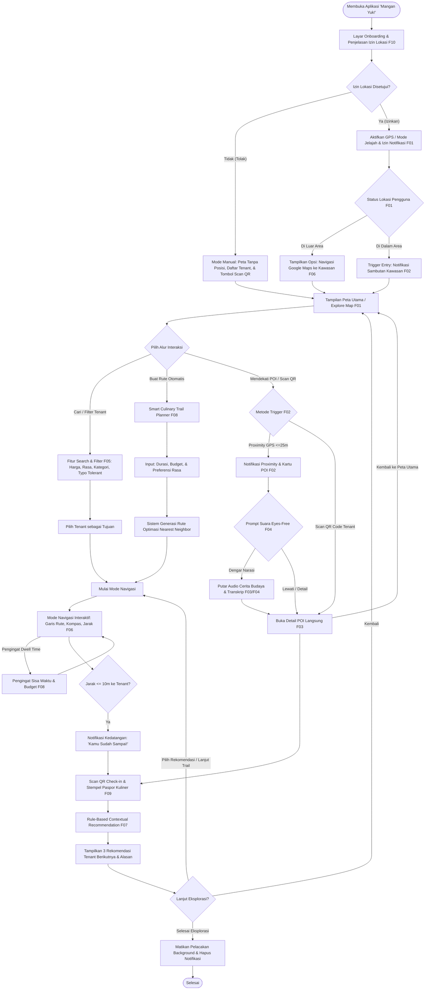
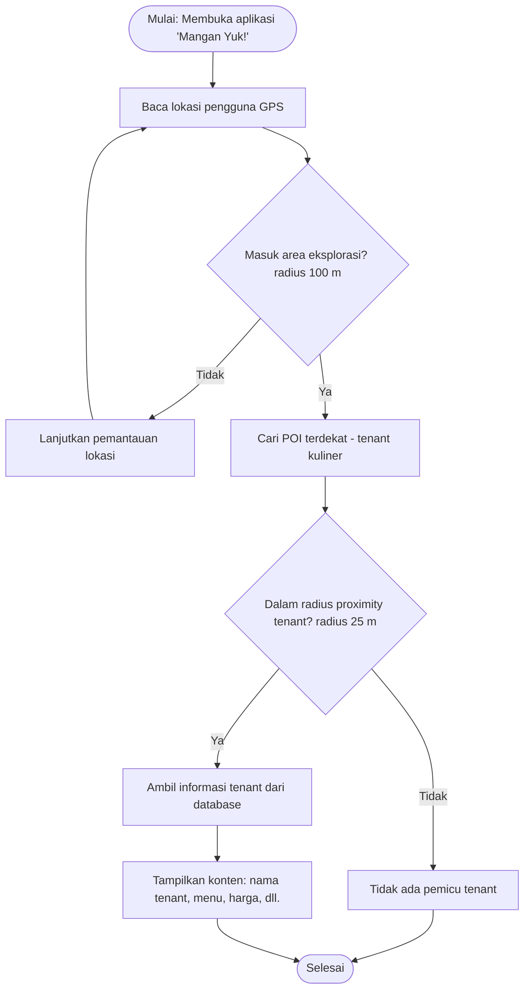

# PRD — ManganYuk!

**Aplikasi Eksplorasi Kuliner Berdasarkan Lokasi dan Preferensi Pengguna**
Studi kasus: Tempat Kuliner Sudirman Street Food, Bandung

- Mata Kuliah: II4011 Transformasi Digital — Dosen: Prof. Ir. Kridanto Surendro, M.Sc., Ph.D.
- Kelompok: 06 / Copyright PPL — Program Studi Sistem dan Teknologi Informasi, STEI ITB, 2026

| No | Nama | NIM | Role |
|---|---|---|---|
| 1 | Dita Maheswari | 13523125 | Back End, DB |
| 2 | Samantha Laqueenna Ginting | 13523138 | Front End |
| 3 | Anggita Najmi Layali | 18223122 | UI/UX |
| 4 | Theresia Ivana M. S | 18223126 | Back End, DB |
| 5 | Raka Adhitya Nugraha | 18223013 | Project Manager & Scrum Master |

---

## 1. Product Definition

### 1.1 Problem Statement

Pengunjung kawasan kuliner seperti Sudirman Street Food, Bandung, dapat menghadapi kesulitan dalam mengeksplorasi berbagai pilihan kuliner ketika memiliki keterbatasan waktu dan anggaran. Informasi mengenai lokasi tenant, menu, dan harga dapat tersebar di berbagai sumber, sehingga pengguna perlu mencari dan membandingkan informasi secara terpisah sebelum menentukan tempat yang ingin dikunjungi. Kondisi ini berpotensi membuat proses eksplorasi kuliner menjadi kurang efisien, terutama ketika pengguna ingin mengunjungi beberapa tenant dalam satu waktu.

Hal ini membuka peluang transformasi digital melalui aplikasi eksplorasi kuliner berbasis lokasi yang mengintegrasikan informasi tenant dengan konteks posisi pengguna. Dengan memanfaatkan lokasi pengguna, filter berdasarkan preferensi, serta rekomendasi tenant dan rute kunjungan, aplikasi dapat membantu pengguna menemukan pilihan kuliner yang relevan dengan waktu dan anggaran mereka tanpa harus berpindah-pindah platform.

### 1.2 Target User / Stakeholder

| Target User | Karakteristik | Kebutuhan Utama |
|---|---|---|
| Pengunjung kawasan kuliner (lokal dan non-lokal) | Individu atau kelompok yang mengunjungi Sudirman Street Food; memiliki preferensi makanan, anggaran, dan waktu kunjungan yang berbeda | Menemukan tenant kuliner yang sesuai dengan anggaran, preferensi, dan lokasi; membandingkan pilihan berdasarkan informasi yang tersedia |
| Pengunjung dengan waktu terbatas | Pengunjung yang ingin mengeksplorasi beberapa tenant dalam satu kunjungan dengan durasi tertentu | Menentukan prioritas kunjungan dan menemukan rute sesuai waktu yang ia punya |

### 1.3 Proposed Product

**Mangan Yuk!** adalah aplikasi *location-based culinary & local culture explorer* yang membantu pengunjung dan wisatawan kawasan kuliner Sudirman Street Food untuk menemukan, menjelajahi, serta memahami ragam kuliner lokal beserta cerita budayanya secara efisien melalui pemicu lokasi *hybrid* (GPS), **Smart Culinary Trail Planner** berbasis preferensi (waktu, budget, dan rasa), narasi audio multimodal, serta panduan navigasi interaktif, sehingga pengguna dapat menikmati pengalaman jelajah kuliner yang terstruktur, hemat waktu, dan kaya akan nilai budaya lokal tanpa perlu membuka banyak platform secara bersamaan.

### 1.4 Product Goals & Non-Goals

| Product Goals | Non-Goals |
|---|---|
| **G01.** Membantu pengunjung menemukan rekomendasi tempat kuliner dan tenant berdasarkan lokasi/geofencing saat eksplorasi di area studi kasus. | **NG01.** Versi awal tidak menyediakan sistem pemesanan makanan (online food ordering) atau transaksi pembayaran digital (payment gateway). |
| **G02.** Membantu pengguna membandingkan menu dan estimasi harga antar-tenant kuliner secara langsung dalam satu platform. | **NG02.** Versi awal tidak menggunakan fitur AI, kecerdasan buatan, maupun LLM untuk sistem rekomendasi atau chatbot. |
| **G03.** Menyediakan peta interaktif dan navigasi rute untuk memandu pengguna menuju titik/tenant kuliner yang dituju. | **NG03.** Aplikasi tidak menyediakan pembaruan stok menu atau antrean secara real-time dari pihak tenant (menggunakan estimasi berbasis data historis/input pengguna). |
| **G04.** Membantu pengguna mengoptimalkan waktu kunjungan dengan memberikan informasi estimasi antrean dan pengingat durasi (dwelling time). | **NG04.** Versi awal tidak mencakup seluruh area kuliner di Kota Bandung, melainkan berfokus khusus pada pilot project di Sudirman Street Food. |
| **G05.** Mengirimkan notifikasi berbasis geofencing (push notification) saat pengguna memasuki radius atau lokasi area kuliner. | **NG05.** Aplikasi tidak menyediakan reservasi tempat duduk atau meja secara langsung untuk pengunjung. |

---

## 2. User Experience Scenario

### 2.1 Main Exploration Scenario

#### Skenario Normal: Pengguna pertama kali memakai aplikasi, menjalankan Culinary Trail, lalu mencari tenant tambahan

| # | Aksi Aktor | Reaksi Sistem |
|---|---|---|
| 1 | Membuka aplikasi Mangan Yuk! untuk pertama kali | Menampilkan halaman onboarding (pengenalan aplikasi: jelajah kuliner, cerita budaya, culinary trail) |
| 2 | Menekan tombol **Lanjut** | Menampilkan penjelasan penggunaan lokasi (alasan, kapan lokasi dibaca, data tidak dikirim ke server) dan tombol "Izinkan Lokasi" |
| 3 | Menekan tombol **Izinkan Lokasi**, lalu memilih "Izinkan" pada dialog sistem | Meminta izin notifikasi |
| 4 | Mengizinkan notifikasi | Meminta preferensi rasa (pedas/manis/gurih) dan jenis kuliner (makanan/minuman/jajanan), dengan opsi **Lewati** |
| 5 | Memilih preferensi pedas dan gurih, lalu menekan tombol **Mulai** | Menyimpan preferensi secara lokal, menampilkan **Beranda** (peta OSM + denah kawasan, posisi pengguna, status "Di luar area", jarak ke Sudirman Street Food, tombol Buka di Google Maps, Rencanakan Trail, dan Mode Jelajah) |
| 6 | Menekan tombol **Buka di Google Maps** | Membuka Google Maps dengan tujuan koordinat kawasan Sudirman Street Food |
| 7 | Menuju kawasan, kembali ke aplikasi, lalu mengaktifkan **Mode Jelajah** | Mengaktifkan pelacakan lokasi di background dan menampilkan notifikasi permanen "Mangan Yuk! sedang memandu" |
| 8 | Memasuki radius 100 m kawasan | **Entry event:** menampilkan notifikasi dan audio sambutan ("Selamat datang di Sudirman Street Food!"), menawarkan pilihan Rencanakan Trail atau Jelajah Bebas |
| 9 | Menekan notifikasi, lalu memilih **Rencanakan Trail** | Menampilkan form trail: durasi, budget, dan preferensi rasa (terisi otomatis dari onboarding) |
| 10 | Memilih durasi 60 menit, budget Rp50.000, lalu menekan **Buat Trail** | Menampilkan itinerary 3 tenant berurutan beserta estimasi total biaya, estimasi waktu, dan rute di peta |
| 11 | Menekan tombol **Mulai Trail** | Menetapkan tenant pertama sebagai tujuan dan masuk mode navigasi (garis ke tujuan, jarak dalam meter, panah kompas), disertai audio "Tenant pertama, 60 meter di depan" |
| 12 | Memasukkan HP ke saku dan berjalan mengikuti arahan audio | Memberi panduan audio setiap jarak berkurang 20 m |
| 13 | Memasuki radius 25 m tenant pertama | **Proximity event:** HP bergetar dan memutar prompt "Kamu mendekati [nama tenant]. Mau dengar ceritanya?", notifikasi menampilkan tombol **Dengar / Lewati** |
| 14 | Menekan tombol **Dengar** dari lock screen | Memutar audio narasi cerita kuliner (asal-usul makanan, istilah Sunda, keunikan tenant) |
| 15 | Tiba dalam jarak ≤10 m dari tenant | Memutar pengumuman "Kamu sudah sampai!" dan membuka kartu POI lengkap (foto, menu dan harga, cerita budaya, transkrip audio) |
| 16 | Memesan dan berada di tenant selama ≥3 menit | **Dwell event:** mencatat kunjungan secara otomatis dan menandai tenant pertama selesai pada trail |
| 17 | Masih makan di tenant melebihi alokasi waktu | **Dwell event:** mengirim notifikasi "Sisa waktumu 30 menit, masih ada 2 tenant" |
| 18 | Selesai makan dan berjalan keluar dari area tenant | **Exit event:** menampilkan tenant berikutnya beserta alasannya (misalnya "30 m dari sini · cocok setelah makanan pedas"), lalu masuk mode navigasi |
| 19 | Mengulangi alur navigasi, trigger, dan kunjungan untuk tenant kedua dan ketiga | Menjalankan trigger, memutar narasi, dan mencatat kunjungan otomatis untuk setiap tenant |
| 20 | Kunjungan di tenant terakhir selesai (dwell tercatat) | Menampilkan ringkasan trail (jumlah tenant, estimasi total belanja, durasi, dan jarak berjalan) |
| 21 | Menekan kolom pencarian dan mengetik "batagr" | Menampilkan hasil tenant batagor (toleran typo), diurutkan berdasarkan jarak |
| 22 | Memilih filter harga <Rp15rb, lalu memilih salah satu tenant | Menampilkan detail tenant dan tombol **Jadikan Tujuan** |
| 23 | Menekan tombol **Jadikan Tujuan** | Masuk mode navigasi menuju tenant yang dipilih |
| 24 | Tiba dalam jarak ≤10 m dari tenant | Memutar pengumuman "Kamu sudah sampai!", membuka kartu POI, lalu mencatat kunjungan setelah pengguna berada ≥3 menit |
| 25 | Menekan tombol **Selesai Jelajah** | Mematikan pelacakan background, menghapus notifikasi permanen, dan kembali ke Beranda |

#### Skenario Alternatif 1: Pengguna menolak izin lokasi

| Aksi Aktor | Reaksi Sistem |
|---|---|
| Menekan "Tolak" pada dialog izin lokasi | Menampilkan penjelasan bahwa trigger otomatis dan navigasi tidak tersedia, dengan tombol **Buka Pengaturan** dan **Lanjut tanpa Lokasi** |
| Menekan tombol Lanjut tanpa Lokasi | Menampilkan peta tanpa posisi pengguna dan daftar tenant |
| Mengetuk salah satu tenant pada peta atau daftar | Menampilkan kartu POI dan tombol putar audio narasi (tanpa trigger otomatis dan navigasi) |

#### Skenario Alternatif 2: Pengguna memilih Jelajah Bebas

| Aksi Aktor | Reaksi Sistem |
|---|---|
| Memilih Jelajah Bebas pada notifikasi entry event | Menampilkan peta dengan seluruh marker tenant tanpa tujuan tertentu |
| Berkeliling kawasan tanpa tujuan | Memicu proximity event setiap kali pengguna mendekati tenant |
| Berhenti di tenant yang menarik ≥3 menit, lalu berjalan pergi | Mencatat kunjungan (dwell event), lalu saat exit event menampilkan 3 rekomendasi tenant berikutnya beserta alasannya |

#### Skenario Alternatif 3: Sinyal GPS lemah

| Aksi Aktor | Reaksi Sistem |
|---|---|
| Berjalan di area dengan sinyal GPS lemah (akurasi >30 m) | Mengabaikan pembacaan lokasi tersebut agar tidak terjadi trigger palsu, dan menampilkan banner "Sinyal GPS lemah, trigger otomatis ditunda" |
| Mengetuk daftar "Tenant di sekitar" atau marker tenant di peta | Menampilkan kartu POI dan audio narasi secara manual, lalu melanjutkan trigger otomatis setelah akurasi GPS kembali ≤30 m |

#### Skenario Alternatif 4: Tenant pada trail tutup atau ingin dilewati

| Aksi Aktor | Reaksi Sistem |
|---|---|
| Menekan tombol **Lewati Tenant** pada mode navigasi | Menyusun ulang trail dengan tenant pengganti yang sedang buka, sesuai sisa waktu dan sisa budget, lalu menampilkan rute baru |

#### Skenario Alternatif 5: Pengguna menolak cerita saat proximity event

| Aksi Aktor | Reaksi Sistem |
|---|---|
| Menekan tombol **Lewati** pada notifikasi trigger | Menutup prompt audio, menyimpan tenant ke daftar "Terlewati", dan tidak memicu ulang tenant tersebut selama cooldown 30 menit |

#### Skenario Alternatif 6 (Optional): Pengguna mengumpulkan stempel Paspor Kuliner

| Aksi Aktor | Reaksi Sistem |
|---|---|
| Membuka menu Paspor Kuliner di Beranda | Menampilkan daftar trail tematik (misalnya "Jejak Jajanan Sunda" dan "Manis-manis Bandung") beserta progres masing-masing (misalnya 0/5) |
| Memilih trail "Jejak Jajanan Sunda" | Menampilkan daftar tenant yang termasuk trail tersebut dan menandainya di peta |
| Mengunjungi salah satu tenant pada trail dan berada di sana ≥3 menit | **Dwell event:** mencatat stempel digital untuk tenant tersebut, memutar efek suara singkat, dan memperbarui progres (1/5) |
| Mengunjungi tenant yang sama untuk kedua kalinya | Tidak mencatat stempel ganda; progres tetap 1/5 |
| Menutup aplikasi, lalu membukanya kembali di hari lain | Menampilkan progres paspor yang tersimpan (1/5) |
| Mengunjungi seluruh tenant pada trail hingga dwell tenant terakhir tercatat | Menampilkan badge "Jejak Jajanan Sunda" beserta audio ucapan selamat, dan menyimpan badge ke halaman Paspor Kuliner |

### 2.2 Main User Flow

Transkripsi dari diagram flowchart di PRD (label fitur Fxx sesuai yang tertulis di diagram).

---

## 3. Product Requirements — Baseline

| ID | Requirement | Deskripsi Implementasi | Priority | Acceptance Criteria |
|---|---|---|---|---|
| **F01** | Location Awareness | Aplikasi membaca posisi pengguna (akurasi tinggi, pembaruan tiap ±3 detik atau perpindahan ≥5 m). Posisi ditampilkan sebagai titik biru dengan lingkaran akurasi di peta, disertai status "Di dalam / di luar area Sudirman Street Food". Jika izin lokasi ditolak, aplikasi berjalan dalam mode tanpa lokasi: peta dan daftar tenant tetap dapat dibuka secara manual, tetapi trigger otomatis dan navigasi tidak aktif. | Must | (1) Posisi tampil di peta ≤10 detik setelah aplikasi dibuka dengan GPS aktif. (2) Posisi diperbarui saat pengguna berjalan ≥5 m. (3) Status di dalam/di luar area berubah dengan benar saat pengguna melewati batas area. (4) Jika izin ditolak, muncul layar penjelasan dan konten tenant tetap dapat dibuka manual dari peta atau daftar. |
| **F02** | Location-Based Trigger (Geofence) | Trigger sepenuhnya berbasis geofence GPS dengan empat jenis event: **Entry event** — geofence kawasan radius 100 m memunculkan notifikasi sambutan. **Proximity event** — geofence tenant/zona radius ±25 m memunculkan kartu POI dan tawaran audio; dicek dari pembaruan lokasi background dengan perhitungan jarak (haversine). **Dwell event** — pengguna berada di dalam geofence tenant ≥3 menit, sehingga kunjungan tercatat otomatis; jika melebihi alokasi trail, muncul pengingat sisa waktu (F08). **Exit event** — pengguna keluar dari geofence tenant, lalu muncul rekomendasi berikutnya (F07). Pencegahan trigger palsu/berulang: pembacaan lokasi dengan akurasi >30 m diabaikan, hysteresis (exit tercatat jika jarak > radius + 10 m), dan cooldown 30 menit per POI. Trigger berjalan di background melalui foreground service selama "Mode Jelajah" aktif. | Must | (1) Notifikasi entry muncul ≤15 detik setelah pengguna masuk area, termasuk saat aplikasi di background atau layar terkunci. (2) Kartu POI muncul ≤10 detik saat pengguna masuk radius POI, berhasil minimal 8 dari 10 percobaan lapangan. (3) Trigger tidak muncul berulang selama pengguna tetap di area POI. (4) Kunjungan tercatat setelah pengguna berada ≥3 menit di geofence tenant; pengguna yang hanya lewat (<3 menit) tidak tercatat berkunjung. (5) Pembacaan lokasi dengan akurasi >30 m tidak memicu trigger. |
| **F03** | Multimodal Exploration | Setiap POI (minimal 10 tenant) memiliki: minimal 3 foto (makanan, tenant, suasana), deskripsi singkat, cerita kuliner/budaya (asal-usul makanan, istilah Sunda, keunikan tenant), daftar menu dan harga, jam buka, serta audio narasi 45–90 detik (rekaman suara tim atau TTS) yang dilengkapi transkrip. Seluruh konten dibundel di dalam APK sehingga dapat diakses offline. | Must | (1) 10/10 POI memiliki foto, teks, cerita budaya, menu/harga, dan audio. (2) Audio dapat diputar, dijeda, dan dilanjutkan tanpa koneksi internet. (3) Transkrip audio tersedia untuk setiap narasi. (4) Konten POI terbuka ≤2 detik. |
| **F04** | Eyes-Free Interaction | Saat trigger terjadi, aplikasi memutar prompt suara, misalnya "Kamu mendekati Batagor X. Mau dengar ceritanya?", disertai getar. Pengguna merespons lewat tombol aksi di notifikasi (Dengar / Lewati) tanpa membuka aplikasi. **Mode Jalan** memutar narasi secara otomatis. Navigasi memberi panduan audio ("Tenant tujuan 20 meter lagi di sebelah kanan") dan pengumuman saat tiba di tujuan. | Must | (1) Pengguna dapat memutar narasi dari notifikasi lock screen tanpa membuka aplikasi. (2) Dalam Mode Jalan, narasi mulai ≤3 detik setelah trigger. (3) Panduan audio navigasi berbunyi minimal setiap pengurangan jarak 20 m dan saat tiba. (4) Dalam usability test, minimal 4 dari 5 penguji dapat menyelesaikan satu kunjungan POI (navigasi, trigger, dan narasi) tanpa melihat layar. |
| **F05** | Search & Destination | Pencarian berdasarkan nama tenant, nama menu, atau kategori, dengan pencarian toleran typo. Filter yang tersedia: rentang harga (<Rp15rb, Rp15–30rb, >Rp30rb), rasa (pedas/manis/gurih), jenis (makanan/minuman/jajanan), dan status buka. Hasil diurutkan berdasarkan jarak, dan pengguna dapat menetapkan tenant sebagai tujuan. | Must | (1) Hasil pencarian muncul ≤1 detik secara offline. (2) Kata kunci "batagor" dan typo "batagr" sama-sama menampilkan tenant batagor. (3) Kombinasi filter menghasilkan daftar yang sesuai. (4) Tenant dapat dipilih sebagai tujuan dan langsung masuk ke mode navigasi. |
| **F06** | Navigation | Menuju kawasan: membuka Google Maps melalui intent dengan koordinat kawasan. Di dalam kawasan: peta menampilkan garis dari posisi pengguna ke tenant tujuan, jarak dalam meter, dan panah arah berbasis kompas. Kedatangan terdeteksi saat jarak ≤10 m, lalu aplikasi memutar pengumuman "Kamu sudah sampai!" dan membuka kartu POI tenant tujuan. | Must | (1) Jarak ke tujuan diperbarui saat pengguna berjalan. (2) Panah menunjuk arah tujuan dengan deviasi ≤30°. (3) Notifikasi kedatangan muncul saat pengguna berada ≤10 m dari tenant, dan kartu POI tenant tersebut terbuka. (4) Navigasi dapat dilakukan ke 10/10 POI. (5) Tombol "Buka di Google Maps" berfungsi dari luar kawasan. |
| **F07** | Contextual Recommendation | Rekomendasi berbasis aturan (rule-based scoring) dengan faktor: jarak, status buka, kecocokan preferensi rasa, sisa budget, jam ramai (data observasi), dan status sudah/belum dikunjungi (dari dwell event). Muncul saat pengguna keluar dari geofence tenant yang sudah dikunjungi (exit event) dalam bentuk "3 pilihan berikutnya", masing-masing disertai alasan (misalnya "30 m dari sini · sesuai budget · biasanya tidak ramai jam segini"). Ada juga aturan pasangan rasa, misalnya setelah makanan pedas disarankan minuman segar. | Must | (1) Rekomendasi tidak pernah memuat tenant yang tutup atau sudah dikunjungi. (2) Setiap rekomendasi menampilkan alasannya. (3) Rekomendasi muncul ≤1 detik setelah exit event. (4) Input yang sama selalu menghasilkan rekomendasi yang sama (deterministik). |
| **F08** | Domain-Specific Innovative Feature: Smart Culinary Trail Planner | Pengguna mengisi waktu (30/60/90 menit), budget, dan preferensi rasa. Aplikasi memilih kombinasi tenant yang sesuai, lalu menyusun urutan rute dengan algoritma nearest neighbor, lengkap dengan estimasi total biaya dan waktu (dari data harga dan rata-rata durasi kunjungan hasil observasi). Progres trail diperbarui otomatis dari dwell event. Selama trail berjalan, dwell event juga memberi pengingat jika pengguna melewati alokasi waktu di satu tenant, misalnya "Sisa waktumu 25 menit, masih ada 2 tenant." | Must | (1) Untuk input 60 menit dan Rp50.000, aplikasi menghasilkan itinerary minimal 2 tenant dengan estimasi biaya ≤ budget dan waktu ≤ durasi. (2) Urutan rute tidak bolak-balik (setiap langkah menuju tenant terdekat berikutnya). (3) Tenant pada trail otomatis ditandai selesai setelah dwell event tercatat. (4) Notifikasi sisa waktu muncul saat dwell melebihi alokasi + 5 menit. (5) Pengguna dapat melewati tenant atau menyusun ulang trail. |
| **F09** | Location Privacy & Consent | Layar onboarding menjelaskan alasan aplikasi memakai lokasi, kapan lokasi dibaca (hanya saat Mode Jelajah aktif), dan bahwa data lokasi tidak dikirim ke server. Pengguna dapat mematikan Mode Jelajah kapan saja. | Must | (1) Penjelasan tampil sebelum permintaan izin sistem. (2) Pelacakan background berhenti saat Mode Jelajah dimatikan (notifikasi foreground hilang). (3) Tidak ada request jaringan yang membawa data lokasi (diverifikasi lewat log). |

### 3.1 Additional Requirements (Optional)

| ID | Requirement | Deskripsi | Priority | Acceptance Criteria |
|---|---|---|---|---|
| **F10** | Paspor Kuliner (Gamification) | Setiap QR check-in memberi stempel digital. Tersedia trail tematik, misalnya "Jejak Jajanan Sunda" dan "Manis-manis Bandung". Badge diberikan saat satu trail selesai. Data disimpan lokal (AsyncStorage). | Could | (1) Stempel tercatat setelah scan QR dan tidak terduplikasi pada tenant yang sama. (2) Progres trail tampil (misalnya 3/5). (3) Badge muncul saat trail selesai. (4) Data tetap ada setelah aplikasi ditutup dan dibuka kembali. |

---

## 4. Point of Interest (POI) & Location-Trigger Design

### 4.1 POI Definition

Semua POI: konten berisi 3 foto (makanan/tenant/suasana), deskripsi, menu & harga, audio narasi + transkrip. Trigger rule semua POI: **Proximity Event — pengguna masuk radius 10 m dari POI**.

| POI ID | Nama POI | Kategori | Zona | Koordinat (lat, lng) | Konten khusus | Audio | System Response |
|---|---|---|---|---|---|---|---|
| P01 | Raja Pukis Modern | Jajanan / Manis | Zone Entrance | -6.9181, 107.6002 | Tekstur lembut ala sandwich & varian isian | 60 s | Kartu POI, getar singkat, opsi pemutaran audio narasi "Cerita Raja Pukis Modern" |
| P02 | King Crab Bandung | Seafood / Gurih-Pedas | Zone Utama A | -6.9182, 107.6004 | King combo delight & pilihan saus | 75 s | Kartu POI, getar, memicu prompt audio eyes-free di Mode Jalan |
| P03 | Khe-Bab-Bi | Asian Food / Gurih | Zone Tengah A | -6.9183, 107.6005 | Varian kebab & menu olahan se'i | 60 s | Kartu POI dan tawaran audio penjelasan varian menu unik khas tenant |
| P04 | Dapur Sotoku | Makanan Berkuah / Gurih | Zone Tengah B | -6.9184, 107.6007 | Soto khas & gurami bakar | 50 s | Kartu POI, notifikasi aksi lockscreen ("Dengar/Lewati"), rekomendasi makanan berkuah |
| P05 | Baso Goreng Pandu | Jajanan / Gurih | Zone Lorong Utama | -6.9185, 107.6008 | Cerita olahan bakso ikan tenggiri krispi | 45 s | Kartu POI serta pengingat Paspor Kuliner untuk trail jajanan gurih |
| P06 | Hong Nam BakKutTeh & PorkRibs | Asian Food / Gurih | Zone Tengah C | -6.9186, 107.6010 | Olahan bak kut teh & samcan | 65 s | Kartu POI dan rekomendasi kontekstual hidangan khas |
| P07 | Kedai Kun Kun | Sate / Gurih-Manis | Zone Kuliner Malam | -6.9187, 107.6012 | Sate & varian sambal rica/kacang | 55 s | Kartu POI, prompt getar, atau opsi scan QR paspor (opsional) |
| P08 | Sate Babi Wibisana | Sate / Gurih-Aromatik | Zone Kuliner Malam B | -6.9188, 107.6014 | Aromatik bumbu ketumbar & sate babi jumbo | 60 s | Kartu POI, push notification rekomendasi tempat favorit ramai pengunjung |
| P09 | Nasi Campur Kencana99 | Makanan Utama / Gurih | Zone Plaza Barat | -6.9189, 107.6015 | Porsi nasi hainan/putih & topping lengkap | 50 s | Kartu POI dan memperbarui rute Smart Culinary Trail Planner ke titik tujuan |
| P10 | Rob Thai | Asian Food / Segar-Pedas | Zone Exit | -6.9190, 107.6017 | Tim ikan lemon & hidangan khas Thailand | 50 s | Kartu POI, narasi otomatis (Mode Jalan), atau opsi scan QR paspor (opsional) |

### 4.2 Location-Trigger Logic

#### 4.2.1 Diagram

#### 4.2.2 Penjelasan Alur Logika

1. **Pembacaan lokasi:** aplikasi meminta izin lokasi kepada pengguna dan membaca koordinat GPS secara berkala ketika fitur eksplorasi aktif.
2. **Identifikasi POI:** sistem mencari tenant yang berada dalam radius tertentu dari posisi pengguna.
3. **Pemeriksaan kondisi:** sistem memeriksa apakah pengguna telah memasuki radius pemicu dan apakah informasi tenant tersebut sudah ditampilkan dalam sesi eksplorasi saat ini.
4. **Pemilihan konten:** jika kondisi terpenuhi, sistem mengambil informasi tenant dari basis data. Informasi yang ditampilkan menggunakan data terstruktur dan aturan yang ditetapkan, bukan hasil generasi LLM.
5. **Respons sistem:** aplikasi menampilkan kartu informasi atau pop-up. Pengguna dapat melihat detail tenant, membandingkan pilihan, atau melanjutkan ke POI berikutnya.

#### 4.2.3 Contoh Skenario

Misalnya, radius pemicu ditetapkan sebesar 30 meter dari suatu tenant. Ketika pengguna mendekati tenant tersebut hingga masuk ke radius itu, aplikasi memeriksa status pemicu. Jika informasinya belum ditampilkan pada sesi eksplorasi, aplikasi menampilkan kartu berisi nama tenant, kategori makanan, menu, dan harga. Jika pengguna masih berada di radius yang sama, pop-up tidak ditampilkan berulang kali.

---

## 5. Low-Fidelity Prototype

### 5.1 Screen/State List (contoh dari template, belum lengkap)

| ID | Screen/State | Tujuan | Related Requirement |
|---|---|---|---|
| UI01 | Explore Map | Menampilkan posisi pengguna dan POI di sekitar | F01, F02 |
| UI02 | POI Trigger Notification | Memberi tahu pengguna bahwa ia telah mendekati koleksi | F02 |
| UI03 | POI Detail | Menampilkan informasi visual dan audio koleksi | F03, F04 |

### 5.2 Wireframe

_Belum diisi._ Prototype perlu memperlihatkan perubahan kondisi ketika pengguna masih berada di luar area POI, mulai mendekati POI, menerima pemicu, dan kemudian mengakses informasi eksplorasi.

---

## 6. Product Backlog

| Backlog ID | Product Backlog Item | Related Req. | Priority | Acceptance / Done Criteria | Target Sprint |
|---|---|---|---|---|---|
| PB01 | Menyiapkan project aplikasi dan struktur navigasi halaman yang dapat dijalankan pada perangkat uji | - | Must | Aplikasi berhasil dibuka tanpa crash dan perpindahan antarhalaman utama berjalan | S1 |
| PB02 | Mengimplementasikan onboarding, penjelasan privasi lokasi, serta permintaan izin lokasi dan notifikasi | F09, F01 | Must | Penjelasan tampil sebelum dialog izin sistem; jika izin ditolak, aplikasi masuk mode tanpa lokasi | S1 |
| PB03 | Mengimplementasikan pembacaan lokasi pengguna dan menampilkannya di peta beserta status di dalam/di luar area | F01 | Must | Posisi tampil ≤10 detik, diperbarui saat berpindah ≥5 m, dan status area berubah dengan benar | S1 |
| PB04 | Menyusun dataset minimal 10 POI (koordinat, menu, harga, jam buka, rasa, kategori) | F01, F02, F03 | Must | Data 10 POI dapat dibaca aplikasi dan ditampilkan sebagai marker di peta | S1 |
| PB05 | Mengimplementasikan Mode Jelajah dengan pelacakan lokasi di background | F02, F09 | Must | Notifikasi permanen muncul saat Mode Jelajah aktif dan pelacakan berhenti saat dimatikan | S2 |
| PB06 | Mengimplementasikan geofence entry event dan proximity event, termasuk pencegahan trigger palsu | F02 | Must | Notifikasi entry ≤15 detik; kartu POI ≤10 detik; akurasi >30 m diabaikan; trigger tidak berulang (cooldown 30 menit) | S2 |
| PB07 | Mengimplementasikan dwell event dan exit event untuk pencatatan kunjungan otomatis | F02 | Must | Kunjungan tercatat setelah ≥3 menit di geofence; pengguna yang hanya lewat tidak tercatat; exit menggunakan hysteresis | S2 |
| PB08 | Membuat kartu POI multimodal (foto, deskripsi, cerita budaya, menu & harga, audio narasi + transkrip) yang dapat diakses offline | F03 | Must | 10/10 POI memiliki konten lengkap, konten terbuka ≤2 detik, dan audio dapat diputar/dijeda tanpa internet | S2 |
| PB09 | Mengimplementasikan interaksi eyes-free: prompt suara, getar, tombol Dengar/Lewati di notifikasi, dan Mode Jalan | F04 | Must | Narasi dapat diputar dari lock screen; dalam Mode Jalan, narasi mulai ≤3 detik setelah trigger | S3 |
| PB10 | Mengimplementasikan pencarian toleran typo dan filter tenant (harga, rasa, jenis, status buka) | F05 | Must | Hasil muncul ≤1 detik secara offline; "batagr" menampilkan tenant batagor; kombinasi filter sesuai | S3 |
| PB11 | Mengimplementasikan navigasi menuju kawasan (Google Maps) dan di dalam kawasan (garis rute, jarak, kompas, panduan audio) | F06, F04 | Must | Panah deviasi ≤30°; panduan audio tiap 20 m; kedatangan ≤10 m membuka kartu POI; navigasi berhasil ke 10/10 POI | S3 |
| PB12 | Mengintegrasikan alur eksplorasi utama (lokasi → trigger → kartu POI → navigasi) untuk Major Progress Review | F01–F06 | Must | Satu skenario kunjungan POI dapat didemokan end-to-end di perangkat uji | S3 |
| PB13 | Mengimplementasikan rekomendasi kontekstual berbasis aturan (rule-based scoring) | F07 | Must | Muncul ≤1 detik setelah exit event; menampilkan 3 tenant beserta alasan; tidak memuat tenant tutup/sudah dikunjungi; hasil deterministik | S4 |
| PB14 | Mengimplementasikan Smart Culinary Trail Planner (input durasi, budget, rasa → itinerary nearest neighbor) | F08 | Must | Input 60 menit & Rp50.000 menghasilkan ≥2 tenant dengan biaya ≤ budget, waktu ≤ durasi, dan rute tidak bolak-balik | S4 |
| PB15 | Mengimplementasikan progres trail, pengingat sisa waktu, serta fitur lewati tenant/susun ulang trail | F08, F02 | Must | Tenant ditandai selesai setelah dwell; notifikasi muncul saat dwell melebihi alokasi + 5 menit; trail dapat disusun ulang | S4 |
| PB16 | Mengimplementasikan Paspor Kuliner (stempel digital, trail tematik, badge) | F10 | Could | Stempel tidak terduplikasi; progres tampil (misalnya 3/5); badge muncul; data tetap ada setelah aplikasi dibuka ulang | S4 |
| PB17 | Melakukan pengujian acceptance criteria (uji lapangan, usability test, verifikasi log jaringan) | F01–F10 | Must | Trigger berhasil ≥8/10 percobaan; ≥4/5 penguji menyelesaikan kunjungan tanpa melihat layar; tidak ada request berisi data lokasi | S5 |
| PB18 | Memperbaiki defect, melakukan retest, dan menstabilkan build akhir | - | Must | Seluruh defect prioritas tinggi tertutup, retest lulus, dan build final berjalan tanpa crash | S5 |

---

## 7. Sprint Plan

Sprint berlangsung satu minggu. Sprint plan awal dapat disesuaikan selama proyek, tetapi perubahan backlog/requirement harus dapat ditelusuri.

### Sprint 1 — Week 10
**Sprint Goal:** Membangun fondasi aplikasi dan location awareness.

| Backlog ID | Target Output / Evidence |
|---|---|
| PB01, PB02 | Aplikasi dapat dijalankan dan current location terbaca |
| PB03 | Dataset POI tersedia dan dapat dibaca aplikasi |

### Sprint 2 — Week 11
**Sprint Goal:** Membangun POI, location logic, dan location-based trigger.

| Backlog ID | Target Output / Evidence |
|---|---|
| PB06 | Informasi visual dan audio terintegrasi dalam core exploration flow |

### Sprint 3 — Week 12
**Sprint Goal:** Mengintegrasikan core location-based exploration experience dan menyiapkan Major Progress Review.
_(tabel belum diisi)_

### Sprint 4 — Week 13
**Sprint Goal:** Menyelesaikan fitur utama dan integrasi. Feature Freeze pada akhir Week 13.
_(tabel belum diisi)_

### Sprint 5 — Week 14
**Sprint Goal:** Menguji acceptance criteria, memperbaiki defect, retest, dan menstabilkan produk.
_(tabel belum diisi)_

### Week 12 — Major Progress Review

| Item | Isi |
|---|---|
| Sprint Goal | Core location-based exploration dapat didemonstrasikan. |
| Planned Backlog | PB04, PB05, PB06 |
| Completed Backlog | PB04 dan PB05 |
| Not Done | _(belum diisi)_ |
| Evidence/Demo | _(belum diisi)_ |
| Blocker & Recovery Plan | _(belum diisi)_ |

---

## 8. Technical & AI-Assisted Development Plan

### 8.1 Proposed Technology

| Component | Proposed Technology / Tool | Purpose |
|---|---|---|
| Application | React Native + Expo (TypeScript), dibangun dengan Expo Development Build / EAS Build | Pengembangan aplikasi mobile Android dan pembuatan APK untuk perangkat uji |
| Location | expo-location + expo-task-manager | Membaca lokasi akurasi tinggi (±3 detik / ≥5 m), pelacakan background melalui foreground service saat Mode Jelajah aktif |
| Geofence Logic | Modul TypeScript internal (haversine, hysteresis, cooldown) | Mendeteksi entry, proximity, dwell, dan exit event serta mengabaikan pembacaan dengan akurasi >30 m |
| Map/Navigation | react-native-maps dengan tile OpenStreetMap + overlay denah kawasan; Linking (intent Google Maps) | Menampilkan posisi pengguna, marker POI, garis rute ke tenant, dan navigasi menuju kawasan |
| Compass | expo-location (`watchHeadingAsync`) | Menentukan arah panah navigasi menuju tenant |
| Data | JSON lokal (dibundel di APK) + AsyncStorage | Menyimpan data POI dan konten secara offline, serta preferensi, riwayat kunjungan, dan progres trail di perangkat |
| Audio/Multimedia | expo-audio, expo-speech (TTS), expo-haptics | Memutar narasi audio, panduan suara navigasi, dan getar saat trigger |
| Notification | expo-notifications (notification category dengan tombol aksi) | Notifikasi entry/proximity, tombol Dengar/Lewati di lock screen, dan pengingat sisa waktu |
| Search | Fuse.js | Pencarian toleran typo berdasarkan nama tenant, menu, dan kategori |
| AI Development Tool | Claude, Claude Code, ChatGPT, Antigravity | Membantu perencanaan, coding, debugging, dan penyusunan test case |
| Other | expo-camera (QR, opsional untuk F10), Jest + React Native Testing Library, Android Emulator (mock location), Git/GitHub | Scan QR Paspor Kuliner, unit test logika, simulasi pergerakan lokasi, dan version control |

### 8.2 AI-Assisted Development Plan

| Aktivitas | AI / Tool | Penggunaan yang Direncanakan | Cara Verifikasi |
|---|---|---|---|
| Requirement/Planning | Claude, ChatGPT | Membantu mengkritisi user flow dan kelengkapan acceptance criteria | Tim membandingkan hasil dengan PRD dan menyetujui perubahan secara manual |
| UI/Prototype | AI design assistant | Menghasilkan alternatif wireframe awal | Tim memilih dan menyesuaikan berdasarkan user scenario |
| Coding | Claude, Antigravity | Membantu membuat boilerplate komponen React Native, modul geofence (haversine, hysteresis, cooldown), algoritma nearest neighbor untuk trail planner, dan scoring rekomendasi | Code review oleh anggota tim melalui pull request; kode dijalankan di perangkat uji dan dicocokkan dengan acceptance criteria F01–F10 |
| Debugging | Claude, ChatGPT | Membantu menganalisis error log (Metro/Logcat), masalah izin lokasi background, notifikasi, dan pemutaran audio | Perbaikan diuji ulang pada emulator dan perangkat fisik; bug dianggap selesai jika skenario yang gagal berhasil dijalankan kembali |
| Testing | Claude, Antigravity | Membantu menyusun unit test (Jest) untuk logika geofence, filter, rekomendasi, dan trail planner, serta skenario uji lapangan dan usability test dari acceptance criteria | Tim meninjau kesesuaian test case dengan PRD; hasil akhir diverifikasi melalui uji lapangan di Sudirman Street Food dan dicatat dalam laporan pengujian |

**Prinsip:** AI may assist development, but the team remains responsible for understanding, verifying, testing, and demonstrating every implemented feature.

---

## 9. PRD Baseline Approval

Diisi pada akhir Week 9 sebagai gate sebelum pengembangan. _(Semua item belum dicentang; PMO Decision belum diisi.)_

Item: Product problem clearly defined · Target user defined · Main user experience defined · F01–F08 defined · Acceptance criteria testable · POI defined · Location-trigger mechanism defined · User flow completed · Low-fi prototype completed · Product backlog prepared · Sprint 1–5 planned.

---

## 10. Change Log

| Version | Date | Requirement / Backlog | Change | Reason | Approval |
|---|---|---|---|---|---|
| 1.0 | Week 9 | Initial Baseline | Initial PRD | | |
| 1.1 | W11 | F02 / PB05 | Trigger radius diubah dari 5 m menjadi 10 m | Pengujian awal menunjukkan GPS indoor tidak stabil pada radius 5 m | Disetujui PMO |

---

## 11. Final Product Compliance (diisi Week 14–15)

| Req. | W9 Baseline Requirement | Acceptance Criteria | Final Status | Test Result | Evidence |
|---|---|---|---|---|---|
| F01 | Location Awareness | Posisi pengguna dapat ditampilkan dan diperbarui | Pass | TC-01: Pass | Live demo + video test |
| F02 | Location-Based Trigger | POI terpicu pada radius yang disetujui dan tidak berulang selama user tetap di area | Pass | TC-02 dan TC-03: Pass | Video field test + test log |
| F03 | Multimodal Exploration | | ☐ | | |
| F04 | Eyes-Free Interaction | | ☐ | | |
| F05 | Search & Destination | | ☐ | | |
| F06 | Navigation | | ☐ | | |
| F07 | Contextual Recommendation | | ☐ | | |
| F08 | Domain-Specific Innovative Feature | | ☐ | | |

_(Baris F01–F02 berasal dari contoh template.)_

## 12. Final Deliverables Checklist (Week 15)

| Deliverable | Status / Link / Evidence |
|---|---|
| Final Working Product (APK/URL/QR/etc.) | |
| Testing Report | |
| PRD Compliance Matrix | |
| Product Video (max. 3 minutes) | |
| AI & Tools Disclosure / Development Log | |

---

## Catatan untuk Implementasi (inkonsistensi di draft PRD)

Hal-hal berikut tidak konsisten antar-bagian dokumen asli; perlu diputuskan tim sebelum dijadikan acuan kode:

1. **Radius proximity tenant:** F02 & diagram 4.2.1 menyebut **25 m**, tabel POI 4.1 & Change Log v1.1 menyebut **10 m**, contoh 4.2.3 menyebut **30 m**. Radius kedatangan (F06) tetap ≤10 m.
2. **Penomoran fitur di flowchart 2.2:** onboarding/izin lokasi ditandai F10 (seharusnya F09), dan QR check-in/Paspor Kuliner ditandai F09 (seharusnya F10).
3. **Pencatatan stempel Paspor:** Skenario Alt. 6 memakai dwell event ≥3 menit, sedangkan F10 memakai scan QR.
4. **Sprint plan vs backlog:** Sprint 1 menaruh PB03 sebagai "Dataset POI" padahal dataset adalah PB04; Major Progress Review menyebut PB04–PB06 sebagai planned untuk Week 12, sementara backlog menargetkan PB04 di S1 dan PB05–PB06 di S2.
5. **Koordinat POI** masih tampak placeholder (bertambah linear ~0.0001 per POI) — perlu diverifikasi di lapangan.
