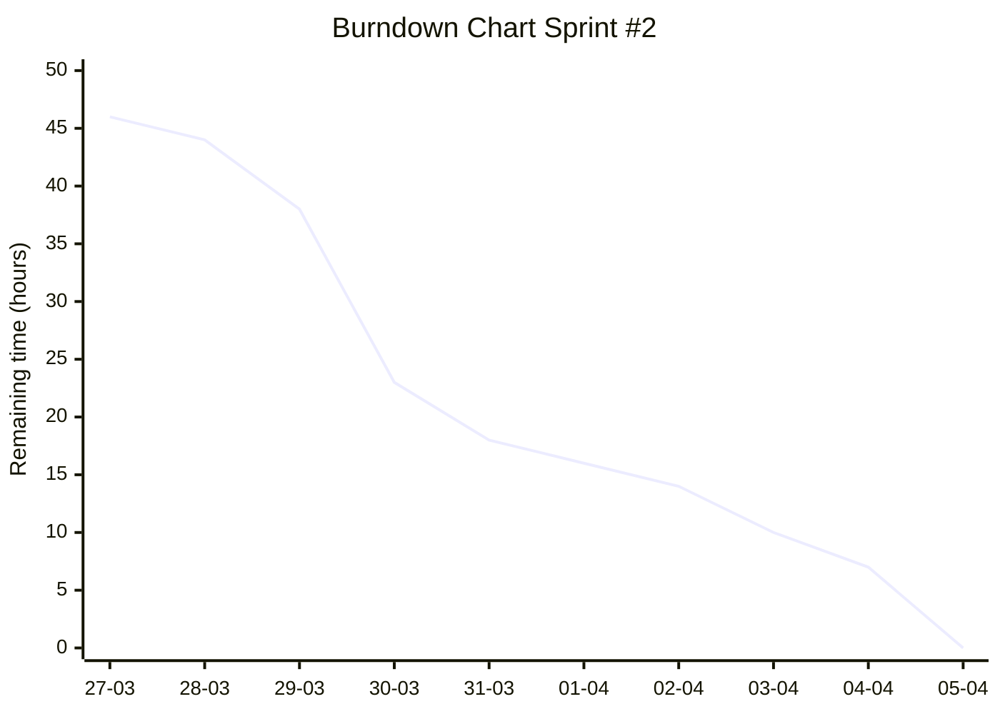
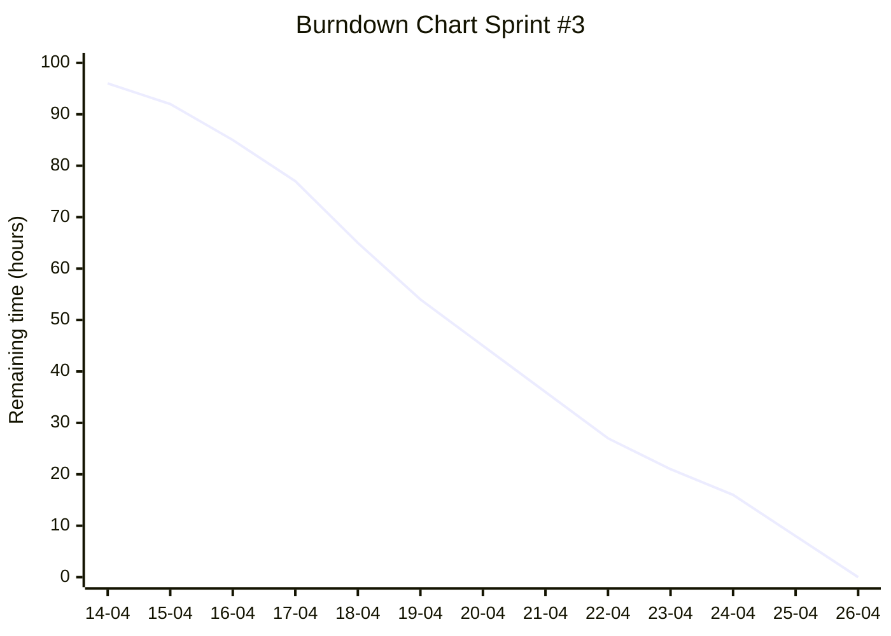
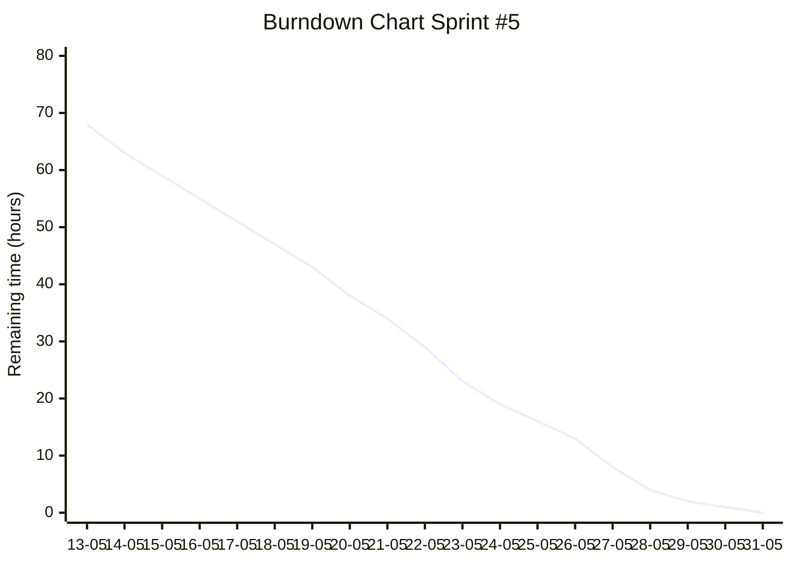

# Dokumen Pembangunan Perangkat Lunak — Scrum Document

**Mobile Survey** — Versi: Draft, 1 Juni 2026
Untuk: **PT eCentrix Teknologi Indonesia**

Dipersiapkan oleh Kelompok 02 — Program Studi Teknik Informatika, Institut Teknologi Bandung (Jl. Ganesha 10, Bandung 40132)

| NIM | Nama |
|---|---|
| 13523125 | Dita Maheswari |
| 13523128 | Andi Farhan Hidayat |
| 13523134 | Sebastian Enrico Nathanael |
| 13523146 | Rafael Marchel Darma Wijaya |
| 13523147 | Frederiko Eldad Mugiyono |
| 13523164 | Muhammad Rizain Firdaus |

| Nomor Dokumen | Revisi | Tanggal | Halaman asli |
|---|---|---|---|
| IF-ITB-IF3250-PPL-SD-2026 | 2 | 05-04-2026 | 64 |

> Catatan konversi: Ditranskripsi dari PDF *G02-K03-Dokumen Scrum PPL 2026*. Daftar Isi, teks petunjuk template, dan footer halaman tidak disalin. Screenshot **Kanban board** (GitLab Issue Boards) tidak dapat disertakan. Untuk setiap sprint, **burndown chart akhir** ditulis ulang sebagai Mermaid `xychart-beta` dengan nilai yang dibaca dari grafik (perkiraan, ±1 jam). Baris hambatan yang kosong di dokumen asli ditulis "Tidak ada hambatan tercatat". Typo kecil (mis. "Kamrea", "Testng", "of icer") diperbaiki.

---

## 1. Pendahuluan

### 1.1 Tujuan Penulisan Dokumen

Tujuan penulisan dokumen ini adalah untuk memberikan gambaran komprehensif mengenai teknis pengembangan perangkat lunak Mobile Survey. Mobile Survey merupakan perangkat lunak berbasis website dan aplikasi mobile yang direncanakan untuk PT eCentrix Teknologi Indonesia. Dokumen ini akan mencakup informasi gambaran proses bisnis, perangkat lunak yang dikembangkan, kebutuhan perangkat lunak, perancangan, implementasi, pengujian, hingga panduan penggunaan perangkat lunak. Selain itu, dokumen juga dimaksudkan untuk menjadi pedoman bagi target pembaca, yakni seluruh tim pengembang dan pemangku kepentingan dalam memahami ruang lingkup proyek.

### 1.2 Pemilik Perangkat Lunak

Pemilik perangkat lunak ini merupakan salah satu karyawan di perusahaan PT eCentrix Teknologi Indonesia, yaitu Pak Tri Juyanto selaku Product Owner dari Mobile Survey.

### 1.3 Manfaat Perangkat Lunak

Secara umum, perangkat lunak ini memberikan manfaat berupa optimalisasi efisiensi operasional dan akurasi data dalam proses penilaian kredit melalui integrasi teknologi digital yang komprehensif. Bagi surveyor, aplikasi ini mempermudah mobilitas dan manajemen tugas lewat fitur navigasi serta otomasi input data di lapangan, sementara bagi tim manajemen, sistem ini menjamin transparansi dan akuntabilitas melalui pemantauan lokasi secara real-time serta pelaporan performa yang terukur. Dengan adanya fitur validasi keamanan dan dokumentasi digital yang terpusat, perangkat lunak ini tidak hanya mempercepat siklus pengambilan keputusan kredit, tetapi juga meminimalisir risiko manipulasi data serta meningkatkan profesionalisme layanan kepada konsumen.

### 1.4 Aturan Penomoran

| Penomoran | Gaya Penomoran | Keterangan |
|---|---|---|
| PB | PB-XX | ID Product Backlog dengan nomor urut XX pada tabel Product Backlog |
| SB | SB-XX | ID Sprint Backlog dengan nomor urut XX pada tabel Sprint Backlog |

### 1.5 Referensi

Referensi yang digunakan selama pembuatan dokumen dan pengembangan perangkat lunak mencakup modul-modul perkuliahan mata kuliah IF3250 Proyek Perangkat Lunak, WI2022 Manajemen Proyek, dan IF2150 Rekayasa Perangkat Lunak. Selain itu, kami mendapatkan dokumen spesifikasi perangkat lunak Mobile Survey yang diberikan oleh Product Owner sebagai acuan utama dalam pengimplementasian perangkat lunak.

### 1.6 Deskripsi Umum Dokumen (Ikhtisar)

1. **Bab 1** — pendahuluan: tujuan penulisan dokumen, pemilik perangkat lunak, manfaat perangkat lunak, aturan penomoran, referensi, dan deskripsi umum dokumen.
2. **Bab 2** — kebutuhan perangkat lunak: deskripsi umum, daftar product backlog, sprint backlog, dan release planning.
3. **Bab 3–7** — dokumentasi hasil setiap sprint: sprint planning, daily meeting, sprint review, dan sprint retrospective.

---

## 2. Kebutuhan Perangkat Lunak

### 2.1 Deskripsi Umum

Sistem Mobile Survey adalah website dan aplikasi mobile yang dirancang untuk mendigitalisasi proses survei lapangan dengan mengintegrasikan modul Mobile Collection Web sebagai panel kontrol administratif dan aplikasi mobile sebagai alat input data bagi surveyor di lapangan. Sistem ini berfungsi sebagai jembatan antara manajemen data di kantor pusat — termasuk pengaturan user management, team management, hingga kustomisasi kuesioner — dengan aktivitas operasional seperti pengambilan foto, penentuan lokasi melalui GPS, serta verifikasi OTP untuk validasi data hasil survei secara real-time. Batasan sistem ini mencakup ketergantungan pada konektivitas jaringan dan interaksi dengan sistem eksternal untuk pemetaan rute serta komunikasi telepon, yang secara keseluruhan membentuk ekosistem kerja terpadu untuk memastikan akurasi dan akuntabilitas data survei yang dikumpulkan.

### 2.2 Product Backlog

**Tabel 2.2.1 Product Backlog**

| ID | Product Backlog | User Story | Aktor | Prioritas |
|---|---|---|---|---|
| PB-01 | Autentikasi & Manajemen Password (Web) | Sebagai pengguna (Admin/Supervisor), saya ingin login dan mengganti password agar dapat mengakses sistem dengan aman dan menjaga kerahasiaan akun | Admin, Supervisor | High |
| PB-02 | Manajemen User (CRUD + Approval) (Web) | Sebagai Admin, saya ingin membuat, mengubah, mencari, dan menghapus user dengan mekanisme approval agar hanya user valid yang dapat mengakses sistem. | Admin, Supervisor | High |
| PB-03 | Manajemen Role & Akses (User Group) (Web) | Sebagai Admin, saya ingin mengatur role dan hak akses user agar setiap pengguna hanya dapat mengakses fitur sesuai kewenangannya | Admin | High |
| PB-04 | Manajemen Tim Surveyor (Web) | Sebagai Admin, saya ingin membuat dan mengelola tim surveyor beserta approval agar proses assignment lebih terstruktur | Admin, Supervisor | High |
| PB-05 | Konfigurasi Survey & CSAT (Web) | Sebagai Admin, saya ingin mengelola pertanyaan survey dan CSAT agar surveyor dapat menggunakan pertanyaan yang sesuai di lapangan | Admin | High |
| PB-06 | Konfigurasi Data Masking (Web) | Sebagai Admin, saya ingin menentukan data sensitif yang perlu dimasking agar informasi konsumen tetap aman saat diakses surveyor | Admin | Medium |
| PB-07 | UI Konfigurasi OTP (Tanpa Integrasi) (Web) | Sebagai Admin, saya ingin melihat dan mengatur tampilan konfigurasi OTP agar sistem siap untuk integrasi di masa depan | Admin | Low |
| PB-08 | Upload Data Konsumen (Bulk + Approval) (Web) | Sebagai Admin, saya ingin mengunggah data konsumen secara massal dengan validasi dan approval agar data siap digunakan untuk assignment | Admin, Supervisor | High |
| PB-09 | Assignment & Reassignment Task (Web) | Sebagai Supervisor, saya ingin mendistribusikan dan memindahkan task ke surveyor agar pekerjaan dapat dikelola secara optimal | Supervisor | High |
| PB-10 | Request Management (Force Logout & Delete Account) (Web) | Sebagai Admin, saya ingin melakukan force logout dan penghapusan akun melalui mekanisme approval agar keamanan dan data tetap terjaga | Admin, Supervisor | Medium |
| PB-11 | Monitoring Operasional Harian (Web) | Sebagai Supervisor, saya ingin memantau task, hasil survey, CSAT, dan lokasi surveyor secara realtime agar dapat memastikan operasional berjalan dengan baik | Supervisor | High |
| PB-12 | Logging & Audit (Web) | Sebagai Admin, saya ingin melihat log aktivitas (login, OTP, audit trail, recording) agar dapat melakukan audit dan troubleshooting | Admin | High |
| PB-13 | Reporting & Analitik (Web) | Sebagai Supervisor, saya ingin melihat laporan historis task, hasil survey, dan CSAT agar dapat mengevaluasi kinerja tim | Supervisor | High |
| PB-14 | Autentikasi & Manajemen Password (Mobile) | Sebagai Surveyor, saya ingin login dan mengganti password agar dapat mengakses aplikasi dengan aman | Surveyor | High |
| PB-15 | Dashboard & Ringkasan Task (Mobile) | Sebagai Surveyor, saya ingin melihat ringkasan assignment dan status task agar mengetahui pekerjaan yang harus dilakukan | Surveyor | High |
| PB-16 | Manajemen Task (Untouched, Draft, Rescheduled, Finished) (Mobile) | Sebagai Surveyor, saya ingin mengelola task berdasarkan status agar pekerjaan dapat dilakukan secara terorganisir | Surveyor | High |
| PB-17 | Pengisian Survey Dinamis (Mobile) | Sebagai Surveyor, saya ingin mengisi form survey yang dinamis agar data yang dikumpulkan sesuai dengan konfigurasi dari web | Surveyor | High |
| PB-18 | Foto & Dokumentasi Survey (Mobile) | Sebagai Surveyor, saya ingin mengambil dan menyimpan foto survey agar dapat melengkapi bukti kunjungan | Surveyor | High |
| PB-19 | Navigasi & Tracking Lokasi (Mobile) | Sebagai Surveyor, saya ingin melihat lokasi konsumen dan navigasi GPS agar dapat mencapai lokasi dengan mudah | Surveyor | High |
| PB-20 | Validasi Geofencing (Mobile) | Sebagai Surveyor, saya ingin sistem memvalidasi lokasi saya saat survey agar kunjungan sesuai dengan lokasi yang ditentukan | Surveyor | High |
| PB-21 | UI OTP Request & Verification (Tanpa Backend) (Mobile) | Sebagai Surveyor, saya ingin melihat dan menginput OTP melalui tampilan aplikasi agar proses verifikasi dapat disimulasikan | Surveyor | Low |
| PB-22 | Telephony & Kontak Konsumen (Mobile) | Sebagai Surveyor, saya ingin menghubungi konsumen melalui aplikasi agar dapat melakukan konfirmasi atau komunikasi | Surveyor | Medium |

### 2.3 Release Planning

| Sprint | Goals | ID Product Backlog | Total Estimasi Waktu |
|---|---|---|---|
| 1 | Menyelesaikan setup repository website dan mobile app; menyediakan fondasi autentikasi backend (login, hashing password, basic auth flow) sebagai dasar pengembangan modul berikutnya. | PB-1 | 8 |
| 2 | Menyelesaikan seluruh modul manajemen pengguna, group, tim, survey, upload data konsumen, dan assignment. | PB-1, PB-2, PB-3, PB-4, PB-5, PB-8, PB-9, PB-15, PB-16 | 28 |
| 3 | Meningkatkan keamanan data dan kontrol operasional supervisor melalui masking, request management, dan monitoring. | PB-6, PB-7, PB-10, PB-11, PB-16 | 16 |
| 4 | Menyediakan kebutuhan audit dan evaluasi kinerja sekaligus membuka akses awal aplikasi mobile surveyor. | PB-12, PB-13, PB-14, PB-15 | 16 |
| 5 | Menyelesaikan eksekusi survey lapangan secara lengkap, tervalidasi lokasi, dan siap digunakan operasional. | PB-17, PB-18, PB-19, PB-20, PB-21, PB-22 | 12 |

---

## 3. Pelaksanaan Sprint 1

### 3.1 Sprint Planning

**Sprint Goal:**
1. Menyelesaikan setup repository website dan mobile app.
2. Menyediakan fondasi autentikasi backend (login, hashing password, basic auth flow) sebagai dasar pengembangan modul berikutnya.

| ID | Task | Estimasi Waktu | ID Product Backlog | PIC |
|---|---|---|---|---|
| SB-1 | Menyediakan fitur login pengguna pada halaman Menu Login (Web) untuk seluruh user terdaftar dengan validasi userID, password, session aktif, dan pembatasan login attempt. | 8 | PB-1 | Riko |

### 3.2 Daily Meeting

#### 3.2.1 Daily Meeting ke-1 (2 Maret)

| No | Nama | Yang sudah dikerjakan | Yang akan dikerjakan |
|---|---|---|---|
| 1 | Dita Maheswari | Meet PO & susun backlog | Buat timeline |
| 2 | Andi Farhan Hidayat | Meet PO & susun backlog | Buat timeline |
| 3 | Sebastian Enrico Nathanael | Meet PO & susun backlog | Buat timeline |
| 4 | Rafael Marchel Darma Wijaya | Meet PO & susun backlog | Buat timeline |
| 5 | Frederiko Eldad Mugiyono | Meet PO & susun backlog | Buat timeline |
| 6 | Muhammad Rizain Firdaus | Meet PO & susun backlog | Buat timeline |

**Hambatan:**
1. Spesifikasi yang terlalu rumit sehingga perlu konfirmasi ke PO.

#### 3.2.2 Daily Meeting ke-2 (3 Maret)

| No | Nama | Yang sudah dikerjakan | Yang akan dikerjakan |
|---|---|---|---|
| 1 | Dita Maheswari | Buat timeline | Membagi tugas |
| 2 | Andi Farhan Hidayat | Buat timeline | Membagi tugas |
| 3 | Sebastian Enrico Nathanael | Buat timeline | Membagi tugas |
| 4 | Rafael Marchel Darma Wijaya | Buat timeline | Membagi tugas |
| 5 | Frederiko Eldad Mugiyono | Buat timeline | Membagi tugas |
| 6 | Muhammad Rizain Firdaus | Buat timeline | Membagi tugas |

**Hambatan:**
1. Spesifikasi yang terlalu rumit sehingga perlu konfirmasi ke PO.

#### 3.2.3 Daily Meeting ke-3 (4 Maret)

| No | Nama | Yang sudah dikerjakan | Yang akan dikerjakan |
|---|---|---|---|
| 1 | Dita Maheswari | Membagi tugas | — |
| 2 | Andi Farhan Hidayat | Membagi tugas | — |
| 3 | Sebastian Enrico Nathanael | Membagi tugas | — |
| 4 | Rafael Marchel Darma Wijaya | Membagi tugas | — |
| 5 | Frederiko Eldad Mugiyono | Membagi tugas | — |
| 6 | Muhammad Rizain Firdaus | Membagi tugas | — |

**Hambatan:**
1. Spesifikasi yang terlalu rumit sehingga perlu konfirmasi ke PO.

#### 3.2.4 Daily Meeting ke-4 (5 Maret)

| No | Nama | Yang sudah dikerjakan | Yang akan dikerjakan |
|---|---|---|---|
| 1 | Dita Maheswari | — | Membuat burndown chart |
| 2 | Andi Farhan Hidayat | — | Membuat burndown chart |
| 3 | Sebastian Enrico Nathanael | — | Membuat burndown chart |
| 4 | Rafael Marchel Darma Wijaya | — | Membuat burndown chart |
| 5 | Frederiko Eldad Mugiyono | — | Membuat burndown chart |
| 6 | Muhammad Rizain Firdaus | — | Membuat burndown chart |

**Hambatan:**
1. Spesifikasi yang terlalu rumit sehingga perlu konfirmasi ke PO.

#### 3.2.5 Daily Meeting ke-5

| No | Nama | Yang sudah dikerjakan | Yang akan dikerjakan |
|---|---|---|---|
| 1 | Dita Maheswari | Membuat burndown chart | Mengerjakan Sprint Backlog 9 & membuat skema database |
| 2 | Andi Farhan Hidayat | Membuat burndown chart | Mengerjakan Sprint Backlog 2 & membuat skema database |
| 3 | Sebastian Enrico Nathanael | Membuat burndown chart | Mengerjakan Sprint Backlog 4 & membuat skema database |
| 4 | Rafael Marchel Darma Wijaya | Membuat burndown chart | Setup repo mobile, CI/CD (tentatif), dan membuat skema database |
| 5 | Frederiko Eldad Mugiyono | Membuat burndown chart | Mengerjakan Sprint Backlog 1 & membuat skema database |
| 6 | Muhammad Rizain Firdaus | Membuat burndown chart | Mengerjakan Sprint Backlog 6 & membuat skema database |

**Hambatan:**
1. Spesifikasi yang terlalu rumit sehingga perlu konfirmasi ke PO.
2. Logika bisnis yang cukup kompleks.
3. Skema database cukup besar.

#### 3.2.6 Daily Meeting ke-6

| No | Nama | Yang sudah dikerjakan | Yang akan dikerjakan |
|---|---|---|---|
| 1 | Dita Maheswari | Membuat skema database | Persiapan sprint-2 |
| 2 | Andi Farhan Hidayat | Membuat skema database | Persiapan sprint-2 |
| 3 | Sebastian Enrico Nathanael | Membuat skema database | Persiapan sprint-2 |
| 4 | Rafael Marchel Darma Wijaya | Setup repo mobile dan membuat skema database | Persiapan sprint-2 |
| 5 | Frederiko Eldad Mugiyono | Mengerjakan Sprint Backlog 1 & membuat skema database | Persiapan sprint-2 |
| 6 | Muhammad Rizain Firdaus | Membuat skema database | Persiapan sprint-2 |

**Hambatan:**
1. Spesifikasi yang terlalu rumit sehingga perlu konfirmasi ke PO.

### 3.3 Sprint Review

_Belum sprint review._

### 3.4 Sprint Retrospective

**Perlu dilanjutkan:**
- Task pada sprint sebelumnya yang belum diselesaikan
- Belajar mobile app development
- Setup debugging environment dan CI/CD pada mobile
- Menyelesaikan halaman login mobile
- Membuat kanban board dan burndown chart

**Perlu dimulai:**
- Task tambahan untuk sprint selanjutnya
- Deployment & CI/CD
- Ketepatan waktu mengerjakan task yang dilakukan sesuai jadwal yang disepakati
- Keterbukaan terkait hambatan yang dialami
- Keteraturan dokumen teknis dan dokumen scrum

**Perlu dihentikan:**
- Tidak memberi tahu ketika terdapat blocker
- Tidak memperhatikan dan mengingatkan jadwal pengerjaan task baik diri sendiri maupun anggota lainnya

---

## 4. Pelaksanaan Sprint 2

### 4.1 Sprint Planning

**Sprint Goal:** Menyelesaikan seluruh modul manajemen pengguna, group, tim, survey, upload data konsumen, dan assignment, serta tampilan untuk dashboard mobile dan manajemen task mobile.

| ID | Task | Estimasi Waktu | ID PB | PIC |
|---|---|---|---|---|
| SB-1 | Autentikasi web fullstack (UI login, ganti password, integrasi backend). | 3 | PB-01 | Farhan |
| SB-2 | Manajemen user fullstack (CRUD, approval, pencarian). | 6 | PB-02 | Farhan |
| SB-3 | Manajemen role & akses user (RBAC) fullstack. | 4 | PB-03 | Farhan |
| SB-4 | Manajemen tim surveyor fullstack dengan approval. | 4 | PB-04 | Farhan |
| SB-5 | Upload data konsumen massal fullstack dengan validasi & approval. | 4 | PB-08 | Rizain |
| SB-6 | Assignment & reassignment task surveyor fullstack. | 4 | PB-09 | Rizain |
| SB-7 | Backend konfigurasi survey & CSAT (API, model, validasi). | 2 | PB-05 | Riko |
| SB-8 | UI dashboard mobile ringkasan task surveyor (frontend saja). | 0.5 | PB-15 | Dita |
| SB-9 | UI manajemen task mobile (status task) – frontend saja. | 0.5 | PB-16 | Dita |
| SB-10 | Pembuatan *prototype* untuk optimisasi UI/UX | 3 | PB-01, PB-02, PB-03 | Sebastian |

### 4.2 Daily Meeting

#### 4.2.1 Daily Meeting ke-1

| No | Nama | Yang sudah dikerjakan | Yang akan dikerjakan |
|---|---|---|---|
| 1 | Dita Maheswari | Membuat tampilan awal halaman utama mobile | Membuat burndown chart |
| 2 | Andi Farhan Hidayat | Membuat skema database | Review ulang dan melakukan perubahan pada skema DB |
| 3 | Sebastian Enrico Nathanael | Membuat *Prototype* UI/UX | Mengimplementasikan FE |
| 4 | Rafael Marchel Darma Wijaya | Membuat sprint planning dan kanban untuk sprint 2 | Review ulang dan melakukan perubahan pada skema DB |
| 5 | Frederiko Eldad Mugiyono | Inisialisasi struktur folder untuk domain survey-questions dan analisis ulang skema DB | Migrasi tipe data pada field `survey_question_id` dari varchar ke int (sequence) |
| 6 | Muhammad Rizain Firdaus | Mengevaluasi *flow* untuk proses *bulk upload* data pelanggan dan menambahkan pengecekan *session*/token yang aktif di DB | Membuat UI untuk PB-08 dan PB-09 |

**Hambatan:** Tidak ada hambatan tercatat.

#### 4.2.2 Daily Meeting ke-2

| No | Nama | Yang sudah dikerjakan | Yang akan dikerjakan |
|---|---|---|---|
| 1 | Dita Maheswari | Membuat burndown chart | Redesign halaman utama (*frontend*) |
| 2 | Andi Farhan Hidayat | Review ulang dan melakukan perubahan pada skema DB | Redesign UI/UX halaman untuk PB-1, PB-2, PB-3, dan PB-4 termasuk *navigation bar* |
| 3 | Sebastian Enrico Nathanael | Mengimplementasikan FE | Optimasi UI/UX *website* |
| 4 | Rafael Marchel Darma Wijaya | Review ulang dan melakukan perubahan pada skema DB | Recovery repository untuk kode aplikasi mobile |
| 5 | Frederiko Eldad Mugiyono | *Update field* `survey_question_id` menjadi int (sequence) dan implementasi *layer repository* serta *schemas* untuk survey-questions | Melanjutkan implementasi *logic* pada *layer services* untuk domain survey-questions |
| 6 | Muhammad Rizain Firdaus | Menambahkan improvement pada log login termasuk error attempts agar intuitif | Mengerjakan UI untuk PB-08 dan PB-09 |

**Hambatan:** Tidak ada hambatan tercatat.

#### 4.2.3 Daily Meeting ke-3

| No | Nama | Yang sudah dikerjakan | Yang akan dikerjakan |
|---|---|---|---|
| 1 | Dita Maheswari | Redesign halaman utama | Membuat tampilan sementara halaman *task list* |
| 2 | Andi Farhan Hidayat | Redesign UI/UX halaman untuk PB-1, PB-2, PB-3, dan PB-4 termasuk *navigation bar* | Menyesuaikan kembali implementasi backend PB-1 dan mulai mengimplementasi frontend PB-1 serta fullstack PB-3 |
| 3 | Sebastian Enrico Nathanael | Optimasi UI/UX *website* | Menyesuaikan tampilan FE Dashboard |
| 4 | Rafael Marchel Darma Wijaya | Recovery repository mobile | Menyelesaikan tampilan PB-14 |
| 5 | Frederiko Eldad Mugiyono | Menyelesaikan sebagian besar *logic* pada *layer services* untuk survey-questions | Sinkronisasi mekanisme *maker-checker* (koordinasi terkait ambiguitas fitur) dan mencari data *product available* |
| 6 | Muhammad Rizain Firdaus | Membuat UI beserta *dummy* untuk PB-08 dan PB-09 | Melakukan integrasi PB-08 dan PB-09 lebih lanjut ke backend |

**Hambatan:**
1. Skema database yang belum sesuai untuk fitur CSAT.

#### 4.2.4 Daily Meeting ke-4

| No | Nama | Yang sudah dikerjakan | Yang akan dikerjakan |
|---|---|---|---|
| 1 | Dita Maheswari | Membuat tampilan sementara halaman *task list* | Final tampilan halaman *task list* |
| 2 | Andi Farhan Hidayat | Menyesuaikan kembali implementasi backend PB-1 dan mulai mengimplementasi frontend PB-1 serta fullstack PB-3 | Implementasi fullstack PB-2 |
| 3 | Sebastian Enrico Nathanael | Menyesuaikan tampilan FE Dashboard | Menyesuaikan tampilan FE settings |
| 4 | Rafael Marchel Darma Wijaya | Menyelesaikan tampilan PB-14 | Menyelesaikan tampilan PB-17 |
| 5 | Frederiko Eldad Mugiyono | Normalisasi tabel `csatquestion` menjadi `csatparent` dan `csatquestion` untuk fleksibilitas data | *Refactoring layer services* dan pembuatan *router* API untuk domain survey-questions |
| 6 | Muhammad Rizain Firdaus | Melakukan *improvement* pada proses integrasi dan menghilangkan *dummy state* | Melakukan integrasi PB-08 dan PB-09 lebih lanjut ke backend |

**Hambatan:** Tidak ada hambatan tercatat.

#### 4.2.5 Daily Meeting ke-5

| No | Nama | Yang sudah dikerjakan | Yang akan dikerjakan |
|---|---|---|---|
| 1 | Dita Maheswari | Final tampilan halaman *task list* | Finalisasi sequence diagram |
| 2 | Andi Farhan Hidayat | Implementasi fullstack PB-2 | Implementasi fullstack PB-4 |
| 3 | Sebastian Enrico Nathanael | Menyesuaikan tampilan FE settings | Menyesuaikan tampilan FE Request, Upload, Assignment |
| 4 | Rafael Marchel Darma Wijaya | Finalisasi PB-14 | Membuat kembali PB-14 dan PB-17 |
| 5 | Frederiko Eldad Mugiyono | Implementasi penuh domain csat (*repository, schemas, services*) dan pembuatan *router* | Integrasi sistem transaksi DB (ACID) untuk menjaga integritas data pada *input* survey-questions dan csat |
| 6 | Muhammad Rizain Firdaus | Melakukan *improvement* pada proses integrasi dan menghilangkan *dummy state* | Melakukan integrasi PB-08 dan PB-09 lebih lanjut ke backend |

**Hambatan:**
1. Perlu melakukan instalasi ulang karena ada gangguan pada laptop. Semua kode PB-14 dan PB-17 hilang.

#### 4.2.6 Daily Meeting ke-6

| No | Nama | Yang sudah dikerjakan | Yang akan dikerjakan |
|---|---|---|---|
| 1 | Dita Maheswari | Finalisasi sequence diagram | Persiapan sprint 3 |
| 2 | Andi Farhan Hidayat | Implementasi fullstack PB-4 | Penyesuaian kembali logika bisnis sesuai masukan dari PO terkait PB-1 |
| 3 | Sebastian Enrico Nathanael | Menyesuaikan tampilan FE Request, Upload, Assignment | Menyesuaikan tampilan FE Monitoring, Reporting |
| 4 | Rafael Marchel Darma Wijaya | Recovery development environment | Menyelesaikan PB-14 dan PB-17 |
| 5 | Frederiko Eldad Mugiyono | Finalisasi transaksi untuk survey-questions dan csat serta melakukan *unit testing internal* pada *endpoint backend* PB-06 | Persiapan pembuatan frontend |
| 6 | Muhammad Rizain Firdaus | Menyelesaikan PB-08 dan PB-09 | Melakukan rancangan dan evaluasi terkait *flow* PB-10 ke depan |

**Hambatan:**
1. Perlu dilakukan beberapa perubahan sebab aspek detail yang bertambah.
2. PB-09 sedang ke-*hold* dalam tahap integrasi karena waktu yang terbatas dan masih tersimpan di *local*.

#### Burndown Chart Sprint 2 (akhir)

### 4.3 Sprint Review

_(notul — belum diisi)_

### 4.4 Sprint Retrospective

**Perlu dilanjutkan:**
- Task pada sprint sebelumnya yang belum diselesaikan
- Belajar mobile app development
- Ketepatan waktu mengerjakan task yang dilakukan sesuai jadwal yang disepakati
- Keterbukaan terkait hambatan yang dialami

**Perlu dimulai:**
- Task tambahan untuk sprint selanjutnya
- Keteraturan dokumen teknis dan dokumen scrum

**Perlu dihentikan:**
- Tidak memberi tahu ketika terdapat blocker
- Tidak memperhatikan dan mengingatkan jadwal pengerjaan task baik diri sendiri maupun anggota lainnya

---

## 5. Pelaksanaan Sprint 3

### 5.1 Sprint Planning

| ID | Task | Estimasi Waktu | ID PB | PIC |
|---|---|---|---|---|
| SB-1 | Implementasi frontend untuk konfigurasi survey & CSAT (Web) dan integrasi dengan backend terkait yang sudah tersedia. | 16 | PB-05 | Riko |
| SB-2 | Telephony & Kontak Konsumen (Tanpa BackEnd) | 4 | PB-22 | Dita |
| SB-3 | Foto & Dokumentasi Survey (FrontEnd) | 8 | PB-18 | Rafael |
| SB-4 | Implementasi fullstack Konfigurasi Data Masking (Web) | 6 | PB-06 | Sebastian |
| SB-5 | Implementasi frontend untuk UI Konfigurasi OTP (Tanpa Integrasi) (Web) | 4 | PB-07 | Sebastian |
| SB-6 | Implementasi fullstack Request Management (Force Logout & Delete Account) (Web) | 6 | PB-10 | Sebastian |
| SB-7 | Implementasi fullstack Monitoring Operasional Harian (Web) | 6 | PB-11 | Rizain |
| SB-8 | Ubah Employee ID menjadi dalam bentuk huruf dan numerik (contoh: ID-123); ubah password menjadi minimum 8 karakter dengan setidaknya masing-masing satu huruf besar, huruf kecil, angka, dan *special character* | 2 | PB-01, PB-02 | Farhan |
| SB-9 | Tambah filtering untuk semua elemen yang ada pada table (user, group, dan team). | 4 | PB-02, PB-03, PB-04 | Farhan |
| SB-10 | Ubah login dengan username - password menjadi employee ID - password. | 4 | PB-01 | Farhan |
| SB-11 | Tambah status / informasi terkait pengguna yang sudah di-*assign* ke *officer* tertentu. | 10 | PB-09 | Rizain |
| SB-12 | Implementasi API endpoint untuk mobile app pada PB-15 dan PB-16 | 6 | PB-15, PB-16 | Farhan |
| SB-13 | UI OTP Request & Verification (Tanpa Backend) | 8 | PB-21 | Dita |
| SB-14 | Integrasi Autentikasi & Manajemen Password (Mobile) | 8 | PB-14 | Rafael |
| SB-15 | Implementasi halaman profil untuk surveyor | 4 | PB-14 | Dita |

### 5.2 Daily Meeting

#### 5.2.1 Daily Meeting ke-1

| No | Nama | Yang sudah dikerjakan | Yang akan dikerjakan |
|---|---|---|---|
| 1 | Dita Maheswari | Mempelajari endpoint API untuk data Dashboard dan Task List | Membuat UI kerangka awal untuk Telephony Mobile (SB-2) |
| 2 | Andi Farhan Hidayat | Penyesuaian kembali logika bisnis sesuai masukan dari PO terkait PB-1; mengubah Employee ID menjadi dalam bentuk huruf dan numerik (contoh: ID-123) (SB-8) | Mengubah password menjadi minimum 8 karakter dengan setidaknya masing-masing satu huruf besar, huruf kecil, angka, dan *special character* (SB-8) |
| 3 | Sebastian Enrico Nathanael | Mempersiapkan komponen UI/UX | Mengerjakan implementasi UI dan *mock data* untuk konfigurasi OTP (SB-5) |
| 4 | Rafael Marchel Darma Wijaya | Meninjau state management di aplikasi Mobile | Melakukan *refactor* kode mobile menjadi *component-based* dan menyatukan *styling* |
| 5 | Frederiko Eldad Mugiyono | Meninjau API backend Survey & CSAT yang sudah ada | Mengimplementasikan form frontend untuk Konfigurasi Survey & CSAT (SB-1) |
| 6 | Muhammad Rizain Firdaus | Meninjau kebutuhan data untuk monitoring operasional | Membuat kerangka halaman web untuk Monitoring Operasional Harian (SB-7) |

**Hambatan:**
1. Perlu penyesuaian dependensi mobile untuk render grafik di dashboard.

#### 5.2.2 Daily Meeting ke-2

| No | Nama | Yang sudah dikerjakan | Yang akan dikerjakan |
|---|---|---|---|
| 1 | Dita Maheswari | Membuat UI kerangka awal untuk Telephony Mobile (SB-2) | Mempersiapkan kerangka/desain untuk halaman profil surveyor (SB-15) |
| 2 | Andi Farhan Hidayat | Mengubah password menjadi minimum 8 karakter dengan setidaknya masing-masing satu huruf besar, huruf kecil, angka, dan *special character* (SB-8) | Tambah filtering untuk semua elemen yang ada pada table (user, group, dan team) (SB-9) |
| 3 | Sebastian Enrico Nathanael | Membuat *layout* dasar dan tabel konfigurasi OTP (SB-5) | Menyelesaikan fitur pencarian lokal dan finalisasi SB-5 |
| 4 | Rafael Marchel Darma Wijaya | Melakukan refactor kode mobile menjadi component-based dan menyatukan styling | Integrasi API login dan logout |
| 5 | Frederiko Eldad Mugiyono | Mengimplementasikan form frontend Konfigurasi Survey & CSAT | Menyambungkan form frontend dengan endpoint API Survey & CSAT (SB-1) |
| 6 | Muhammad Rizain Firdaus | Membuat kerangka halaman web Monitoring Operasional | Menampilkan data dummy ke dalam tabel monitoring (task dan tracking) (SB-7) |

**Hambatan:**
1. Format regex untuk masking nomor telepon dan NIK butuh penyesuaian agar tidak memotong data penting.
2. Ada sedikit isu pada navigasi antar-tab status task di mobile.
3. Kerangka monitoring yang bisa dikerjakan dalam waktu sprint ini hanya task dan tracking (mengingat keterbatasan waktu dan terhambat karena tugas lain).
4. Integrasi autentikasi mobile menunggu backend dari web.

#### 5.2.3 Daily Meeting ke-3

| No | Nama | Yang sudah dikerjakan | Yang akan dikerjakan |
|---|---|---|---|
| 1 | Dita Maheswari | Mempersiapkan kerangka/desain untuk halaman profil surveyor (SB-15) | Mengimplementasikan halaman profil untuk surveyor (SB-15) |
| 2 | Andi Farhan Hidayat | Tambah filtering untuk semua elemen yang ada pada table (user, group, dan team) (SB-9) | Mengubah skema database menyesuaikan perubahan `employeeId` sebagai credential login menjadi required, serta mengaplikasikan perubahan pada kode lain yang terdampak (SB-10) |
| 3 | Sebastian Enrico Nathanael | Menyelesaikan keseluruhan SB-5 (UI Konfigurasi OTP) | Mulai setup *branch* dan mengerjakan *backend endpoint* untuk Force Logout (SB-6) |
| 4 | Rafael Marchel Darma Wijaya | Refactor page login dan menambahkan kode backend | Integrasi API login dan logout lalu testing |
| 5 | Frederiko Eldad Mugiyono | Menyambungkan form dengan API Survey & CSAT | Menambahkan validasi input dan error handling pada form Survey (SB-1) |
| 6 | Muhammad Rizain Firdaus | Menampilkan data pada tabel monitoring | Integrasi API real data untuk Monitoring (SB-7) untuk task-monitoring dan tracking serta menambahkan status assigned officer (SB-11) |

**Hambatan:**
1. Perlu sinkronisasi dengan frontend karena parameter login berubah dari `username` ke `employee_id`.
2. Membutuhkan konfirmasi dari PO terkait flow Force Logout apakah perlu invalidate token dari Redis atau DB.

#### 5.2.4 Daily Meeting ke-4

| No | Nama | Yang sudah dikerjakan | Yang akan dikerjakan |
|---|---|---|---|
| 1 | Dita Maheswari | Mengimplementasikan halaman profil untuk surveyor (SB-15) | Mempersiapkan kerangka/desain dan implementasi FE halaman OTP Request (SB-13) |
| 2 | Andi Farhan Hidayat | Mengubah skema database menyesuaikan perubahan `employeeId` sebagai credential login menjadi required, serta mengaplikasikan perubahan pada kode lain yang terdampak (SB-10) | Ubah login dengan username - password menjadi employee ID - password, serta menyesuaikan kode lainnya yang terdampak (SB-10) |
| 3 | Sebastian Enrico Nathanael | Membuat struktur API Force Logout & Delete Account (SB-6) | Melanjutkan integrasi *service* IAM untuk penghapusan *session* aktif (SB-6) |
| 4 | Rafael Marchel Darma Wijaya | Integrasi API login dan logout | Menambahkan halaman survey question |
| 5 | Frederiko Eldad Mugiyono | Validasi input form Survey & CSAT | Testing edge cases untuk penambahan dan penghapusan pertanyaan Survey (SB-1) |
| 6 | Muhammad Rizain Firdaus | Integrasi real data Monitoring & Status Officer | Melakukan testing pada tabel monitoring dan memastikan auto-load berjalan (SB-7) |

**Hambatan:**
1. Terdapat kendala sinkronisasi saat mencoba menghapus session (active token) di service IAM pada SB-6, sehingga fitur Force Logout belum berjalan sempurna.

#### 5.2.5 Daily Meeting ke-5

| No | Nama | Yang sudah dikerjakan | Yang akan dikerjakan |
|---|---|---|---|
| 1 | Dita Maheswari | Mempersiapkan kerangka/desain dan implementasi FE halaman OTP Request (SB-13) | Implementasi FE telephony dan kontak konsumen (SB-2) |
| 2 | Andi Farhan Hidayat | Ubah login dengan username - password menjadi employee ID - password, serta menyesuaikan kode lainnya yang terdampak (SB-10) | Implementasi API endpoint untuk mobile app pada PB-15 dan PB-16, yaitu terkait data dashboard task, berbagai macam task, serta detailnya (SB-12) |
| 3 | Sebastian Enrico Nathanael | Mengerjakan UI Request Management (SB-6) dan inisialisasi UI Data Masking (SB-4) | Melakukan *debugging* pada *error* integrasi IAM (SB-6) dan merancang *logic masking* (SB-4) |
| 4 | Rafael Marchel Darma Wijaya | Menambahkan halaman survey question | Menambahkan halaman take photo |
| 5 | Frederiko Eldad Mugiyono | Memperbaiki bug cache pada CSAT | Melakukan end-to-end testing form konfigurasi Survey ke database |
| 6 | Muhammad Rizain Firdaus | Finalisasi halaman Monitoring dan Status Officer | Optimasi query backend untuk mempercepat load data di tabel Monitoring (task dan tracking) |

**Hambatan:**
1. Sampai daily meeting ke-5, mobile tidak di-testing di Expo Go, alhasil belum bisa testing navigasi di mobile dan baru bisa lewat web tapi tidak efektif.
2. Logic soft-delete pada SB-6 ternyata cukup rumit karena memiliki ketergantungan relasional (foreign key constraint) dengan tabel transaksi lainnya.

#### 5.2.6 Daily Meeting ke-6

| No | Nama | Yang sudah dikerjakan | Yang akan dikerjakan |
|---|---|---|---|
| 1 | Dita Maheswari | Implementasi FE telephony dan kontak konsumen (SB-2) | Testing navigasi untuk semua FE di mobile phone |
| 2 | Andi Farhan Hidayat | Implementasi API endpoint untuk mobile app pada PB-15 dan PB-16 (data dashboard task, berbagai macam task, serta detailnya); implementasi seeding yang lebih banyak menghasilkan data officer dan task-task yang ada (dengan berbagai tipe) (SB-12) | Integration test semua fitur website yang telah dikerjakan |
| 3 | Sebastian Enrico Nathanael | Mencoba implementasi *regex* untuk Data Masking (SB-4) | Memperbaiki *bug handling* pada fitur Force Logout (SB-6) dan finalisasi *logic* SB-4 |
| 4 | Rafael Marchel Darma Wijaya | Menambahkan halaman take photo | Testing login dan logout dan integrasi halaman survey question dan take photo ke tasklist |
| 5 | Frederiko Eldad Mugiyono | Melakukan end-to-end testing form konfigurasi Survey ke database | Menambah fitur aktivasi / deaktivasi survey dan CSAT |
| 6 | Muhammad Rizain Firdaus | — | — |

**Hambatan:**
1. Implementasi *logic filtering* dan *regex* untuk Data Masking (SB-4) di sisi *backend* cukup kompleks karena harus memastikan *response payload* utama tidak rusak (corrupt). Alokasi waktu habis untuk *debugging* SB-6.

#### Burndown Chart Sprint 3 (akhir)

### 5.3 Sprint Review

_(notul — belum diisi)_

### 5.4 Sprint Retrospective

**Perlu dilanjutkan:**
- Implementasi form konfigurasi Survey dan CSAT yang sudah berjalan secara fungsional di sisi *frontend* dan *backend*.
- Penggunaan standar keamanan baru untuk kredensial pengguna, termasuk penggunaan *Employee ID* dan kompleksitas *password* yang lebih ketat.
- Pengembangan aplikasi mobile dengan pendekatan *component-based* yang mempermudah integrasi fitur-fitur baru.
- Koordinasi intensif terkait sinkronisasi mekanisme *maker-checker* untuk menjaga integritas data.

**Perlu dimulai:**
- Pengujian wajib menggunakan perangkat fisik atau **Expo Go** untuk semua fitur mobile, terutama fitur kamera, *timestamp*, dan GPS.
- Pelaporan hambatan teknis (*blocker*) secara instan kepada Scrum Master agar solusi (seperti masalah integrasi IAM) bisa segera dicari.
- Pembuatan *Pull Request* (PR) segera setelah sebuah fitur selesai dikerjakan di lokal untuk menghindari kehilangan data atau konflik kode.
- Penyelesaian seluruh fitur sisa (Web & Mobile) secara total.

**Perlu dihentikan:**
- Melakukan pengujian fitur mobile hanya melalui *web browser* karena tidak dapat mensimulasikan fungsi *hardware* kamera dan lokasi dengan akurat.
- Menunda proses *push* kode ke GitLab yang berisiko menyebabkan hilangnya kode pengerjaan akibat kendala perangkat (seperti yang terjadi pada Sprint 2).
- Bekerja dalam isolasi saat menghadapi kendala integrasi layanan eksternal tanpa memberikan *update* status secara berkala kepada tim.

---

## 6. Pelaksanaan Sprint 4

### 6.1 Sprint Planning

| ID | Task | Estimasi Waktu | ID PB | PIC |
|---|---|---|---|---|
| SB-1 | Menyelesaikan perbaikan *Data Masking* (NIK/Telepon) | 4 | PB-06 | Ian |
| SB-2 | Memperbaharui *assignment page* serta menambahkan fungsi pencarian dan filter *officer* di modul *assignment* | 6 | PB-09 | Ican |
| SB-3 | Implementasi logika *reject* yang mengembalikan data ke kondisi sebelum diedit | 8 | PB-02, PB-03, PB-04, PB-05 | Farhan |
| SB-4 | Membuat halaman publik CSAT | 4 | PB-05 | Riko |
| SB-5 | Menghubungkan fitur CSAT dengan Survey untuk generasi halaman publik CSAT | 3 | PB-05 | Riko |
| SB-6 | Implementasi fitur *filter* untuk menu manajemen | 3 | PB-02, PB-03, PB-04, PB-05 | Riko |
| SB-7 | Menutup akses galeri dan mewajibkan foto langsung dari kamera dengan *watermark* | 8 | PB-18 | Dita |
| SB-8 | Integrasi penuh kuesioner dinamis dan validasi lokasi kunjungan di lapangan | 8 | PB-17 | El |
| SB-9 | Implementasi log aktivitas sistem secara menyeluruh | 8 | PB-12 | Farhan |
| SB-10 | Implementasi monitoring hasil survey dan CSAT | 3 | PB-11 | Riko |
| SB-11 | Implementasi reporting hasil survey dan CSAT | 3 | PB-13 | Riko |
| SB-12 | Melanjutkan implementasi monitoring tracking officer | 5 | PB-11 | Ican |
| SB-13 | Implementasi monitoring task | 8 | PB-11 | Ican |
| SB-14 | Implementasi *frontend Geofencing Mobile* | 6 | PB-20 | Dita |
| SB-15 | Implementasi *frontend* OTP Notification dan OTP Request | 6 | PB-07 | Ian |
| SB-16 | Implementasi *Force Logout* dan *Delete Account* | 6 | PB-10 | Ian |
| SB-17 | Mengintegrasikan *backend Mobile* dengan *Web* | 8 | PB-14, …, PB-22 | El |

### 6.2 Daily Meeting

#### 6.2.1 Daily Meeting ke-1

| No | Nama | Yang sudah dikerjakan | Yang akan dikerjakan |
|---|---|---|---|
| 1 | Dita Maheswari | Riset library camera watermark | Implementasi kamera dasar di Mobile |
| 2 | Andi Farhan Hidayat | Analisis flow Reverse | Membuat API endpoint reject |
| 3 | Sebastian Enrico Nathanael | Review bug masking Sprint 3 | Update schema Prisma untuk Masking |
| 4 | Rafael Marchel Darma Wijaya | Review bug Login Page | Memperbaiki backend Login Page |
| 5 | Frederiko Eldad Mugiyono | Setup directory public page CSAT | Membuat model database CsatAnswer & Token |
| 6 | Muhammad Rizain Firdaus | Analisis filter assignment | Implementasi UI Search officer |

**Hambatan:** Tidak ada hambatan tercatat.

#### 6.2.2 Daily Meeting ke-2

| No | Nama | Yang sudah dikerjakan | Yang akan dikerjakan |
|---|---|---|---|
| 1 | Dita Maheswari | Kamera mobile aktif | Lockdown galeri (disable image picker) |
| 2 | Andi Farhan Hidayat | API Reject dasar selesai | Implementasi Audit trail (logging) |
| 3 | Sebastian Enrico Nathanael | Schema Prisma Masking selesai | Frontend OTP Request UI |
| 4 | Rafael Marchel Darma Wijaya | Selesai memperbaiki Login Page | Integrasi User data ke Profile Page |
| 5 | Frederiko Eldad Mugiyono | Struktur CsatAnswer selesai | UI halaman publik CSAT |
| 6 | Muhammad Rizain Firdaus | UI Search Officer selesai | Integrasi Filter Assignment dengan Backend |

**Hambatan:** Tidak ada hambatan tercatat.

#### 6.2.3 Daily Meeting ke-3

| No | Nama | Yang sudah dikerjakan | Yang akan dikerjakan |
|---|---|---|---|
| 1 | Dita Maheswari | Lockdown galeri selesai | Implementasi Geofencing di sisi mobile |
| 2 | Andi Farhan Hidayat | Logging Audit Trail selesai | Integrasi Reject dengan Approval System |
| 3 | Sebastian Enrico Nathanael | Frontend OTP selesai | Fix Force Logout (IAM Integration) |
| 4 | Rafael Marchel Darma Wijaya | Profile Page dan header user data menampilkan data user dengan benar | Integrasi data-data tugas surveyor |
| 5 | Frederiko Eldad Mugiyono | Halaman public CSAT selesai | Integrasi generate link |
| 6 | Muhammad Rizain Firdaus | Filter assignment selesai | Implementasi Monitoring Tracking |

**Hambatan:** Tidak ada hambatan tercatat.

#### 6.2.4 Daily Meeting ke-4

| No | Nama | Yang sudah dikerjakan | Yang akan dikerjakan |
|---|---|---|---|
| 1 | Dita Maheswari | Geofencing mobile selesai | Testing GPS accuracy di Expo Go |
| 2 | Andi Farhan Hidayat | Integrasi Reject selesai | Testing menyeluruh mekanisme Maker-Checker |
| 3 | Sebastian Enrico Nathanael | Fix Force Logout selesai | Finalisasi Data Masking (NIK/Phone) |
| 4 | Rafael Marchel Darma Wijaya | Task List Page menampilkan tasks sesuai surveyor | Integrasi dashboard data |
| 5 | Frederiko Eldad Mugiyono | Link generation selesai | Dashboard monitoring CSAT |
| 6 | Muhammad Rizain Firdaus | Monitoring tracking selesai | Implementasi dashboard monitoring task |

**Hambatan:** Tidak ada hambatan tercatat.

#### 6.2.5 Daily Meeting ke-5

| No | Nama | Yang sudah dikerjakan | Yang akan dikerjakan |
|---|---|---|---|
| 1 | Dita Maheswari | GPS testing selesai | Penambahan watermark tanggal pada foto |
| 2 | Andi Farhan Hidayat | Testing maker-checker selesai | Review audit log untuk seluruh modul |
| 3 | Sebastian Enrico Nathanael | Data masking selesai | Test UI OTP request |
| 4 | Rafael Marchel Darma Wijaya | Dashboard page menampilkan data summary sesuai surveyor | Integrasi account details dan survey questions |
| 5 | Frederiko Eldad Mugiyono | Dashboard monitoring selesai | Implementasi export reporting |
| 6 | Muhammad Rizain Firdaus | Monitoring task selesai | Bug fixing pada modul Assignment |

**Hambatan:** Tidak ada hambatan tercatat.

#### 6.2.6 Daily Meeting ke-6

| No | Nama | Yang sudah dikerjakan | Yang akan dikerjakan |
|---|---|---|---|
| 1 | Dita Maheswari | Semua task selesai | Final QA Camera & Geofencing |
| 2 | Andi Farhan Hidayat | Semua task selesai | Final QA Data Integrity Reject & Audit |
| 3 | Sebastian Enrico Nathanael | Semua task selesai | Final QA Logout & Delete |
| 4 | Rafael Marchel Darma Wijaya | Setiap task menampilkan data account detail dan survey questions | Finalisasi Survey Question Flow |
| 5 | Frederiko Eldad Mugiyono | Semua task selesai | Final QA CSAT & Reporting |
| 6 | Muhammad Rizain Firdaus | Semua task selesai | Final QA Assignment & Tracking |

**Hambatan:** Tidak ada hambatan tercatat.

#### Burndown Chart Sprint 4 (akhir)

> Label tanggal pertama pada grafik asli tertulis "30-04-25" (kemungkinan typo); di sini ditulis sebagai titik awal sprint.

### 6.3 Sprint Review

_(notul — belum diisi)_

### 6.4 Sprint Retrospective

**Perlu dilanjutkan:**
- Kedisiplinan tim dalam memperbarui status pekerjaan dari tahap analisis hingga *final QA* pada setiap *Daily Meeting*, sehingga progres pengerjaan terpantau dengan transparan.
- Koordinasi intensif dan komunikasi aktif antar-anggota tim saat menyepakati alur logika kompleks (seperti *maker-checker*) demi menjaga konsistensi pemahaman fungsi sistem.
- Inisiatif tim dalam langsung menerapkan standarisasi keamanan dan restriksi baru pada sistem begitu kebutuhan tersebut disepakati bersama.
- Pembagian tanggung jawab pengerjaan tugas (*task assignment*) yang adaptif berdasarkan spesialisasi keahlian platform masing-masing anggota tim.

**Perlu dimulai:**
- Membiasakan evaluasi bersama terhadap skenario pengujian (*edge case*) dan validasi input sejak awal tahap *development*, bukan hanya mengandalkan fase *cleanup* di akhir.
- Sinkronisasi dan komunikasi kontrak API antar-platform (tim *Web* dan tim *Mobile*) sejak awal *sprint* dimulai untuk mencegah penumpukan kendala integrasi di akhir periode.
- Kolaborasi dalam mencicil penyusunan dokumentasi pengujian secara paralel dengan proses pengembangan agar beban kerja administratif tidak terpusat pada satu orang.
- Meningkatkan keterbukaan sesama anggota tim mengenai penyelesaian *technical debt* agar seluruh tim memiliki visibilitas yang sama terhadap sisa beban kerja yang nyata.

**Perlu dihentikan:**
- Kebiasaan menunda proses perapian tampilan (UI) dan penanganan validasi *error* ke *sprint* berikutnya, karena dapat mengganggu ritme kerja dan menciptakan hambatan besar (*bottleneck*).
- Menganggap suatu tugas telah selesai secara mandiri tanpa melakukan konfirmasi pengujian integrasi awal (*end-to-end*) bersama platform pasangannya.
- Bekerja dalam isolasi atau berspekulasi sendiri ketika menghadapi kendala integrasi antar-platform tanpa segera memberikan pembaruan status (*update*) berkala kepada tim.

---

## 7. Pelaksanaan Sprint 5

### 7.1 Sprint Planning

| ID | Task | Estimasi Waktu | ID PB | PIC |
|---|---|---|---|---|
| SB-1 | Menyelesaikan perbaikan Data Masking dengan validasi testing | 4 | PB-06 | Sebastian |
| SB-2 | Implementasi *frontend Geofencing* mobile | 8 | PB-20 | Rafael |
| SB-3 | Implementasi *Force Logout* dan *Delete Account* | 8 | PB-10 | Rizain |
| SB-4 | Integrasi CSAT/survey *mobile* dengan *endpoint* website | 4 | PB-05, PB-17 | Rafael |
| SB-5 | (SIT) fitur Login, Session Management, dan RBAC antara mobile dan website | 3 | PB-01, PB-03, PB-14 | Rizain, Dita |
| SB-6 | (SIT) fitur Assignment Management dan sinkronisasi task ke mobile surveyor | 4 | PB-09, PB-15, PB-16 | Rizain |
| SB-7 | (SIT) fitur Survey Submission termasuk upload foto, validasi lokasi, dan penyimpanan database | 4 | PB-17, PB-18, PB-19, PB-20 | Rafael, Dita |
| SB-8 | (SIT) fitur CSAT flow mulai dari generate link hingga submission jawaban publik | 4 | PB-05, PB-13 | Frederiko |
| SB-9 | (SIT) fitur force logout dan delete account | 3 | PB-10 | Rizain |
| SB-10 | (SIT) Maker-Checker mulai dari upload, approval, reject, hingga audit trail | 5 | PB-02, PB-04, PB-08, PB-12 | Farhan |
| SB-11 | (SIT) fitur geofencing dan navigasi GPS mobile | 2 | PB-19, PB-20 | Dita |
| SB-12 | (SIT) fitur monitoring dan reporting hasil survey, tracking officer, dan CSAT | 4 | PB-11, PB-13 | Rizain |
| SB-13 | Pembuatan dokumentasi SIT dan skenario test case untuk semua modul yang masuk dalam proses SIT | 6 | PB-01 s.d. PB-22 | Rizain |
| SB-14 | Merapikan UI mobile dan merapikan tampilan validasi error | 6 | PB-14 s.d. PB-22 | Rafael, Dita |
| SB-15 | Merapikan UI website dan merapikan tampilan validasi error | 6 | PB-01 s.d. PB-13 | Rizain, Farhan, Frederiko, Sebastian |
| SB-16 | Implementasi *frontend* OTP Notification dan OTP Request | 4 | PB-07, PB-21 | Sebastian |

### 7.2 Daily Meeting

#### 7.2.1 Daily Meeting ke-1

| No | Nama | Yang sudah dikerjakan | Yang akan dikerjakan |
|---|---|---|---|
| 1 | Dita Maheswari | Mengerjakan scheduling dan reschedule survey | Melakukan perapihan UI mobile lanjutan dan melakukan validasi error |
| 2 | Andi Farhan Hidayat | Merapikan UI website dan melakukan validasi error | Melakukan perapihan UI website lanjutan dan melakukan validasi error |
| 3 | Sebastian Enrico Nathanael | Finalisasi fitur data masking | Mengimplementasi frontend OTP Notification dan OTP Request |
| 4 | Rafael Marchel Darma Wijaya | Implementasi frontend geofencing mobile | Melanjutkan implementasi frontend geofencing mobile |
| 5 | Frederiko Eldad Mugiyono | Merapikan UI website dan melakukan validasi error | (SIT) flow CSAT hingga generate link |
| 6 | Muhammad Rizain Firdaus | Menyusun SIT plan dan test case | Membuat fitur force logout dan delete account |

**Hambatan:** Tidak ada hambatan tercatat.

#### 7.2.2 Daily Meeting ke-2

| No | Nama | Yang sudah dikerjakan | Yang akan dikerjakan |
|---|---|---|---|
| 1 | Dita Maheswari | Melakukan perapihan UI mobile lanjutan dan melakukan validasi error | Melanjutkan perapihan UI mobile lanjutan dan melakukan validasi error |
| 2 | Andi Farhan Hidayat | Melakukan perapihan UI website lanjutan dan melakukan validasi error | Melanjutkan perapihan UI website lanjutan dan melakukan validasi error |
| 3 | Sebastian Enrico Nathanael | Mengimplementasi frontend OTP Notification dan OTP Request | Merapikan UI OTP config yang kurang konsisten sebelumnya |
| 4 | Rafael Marchel Darma Wijaya | Melanjutkan implementasi frontend geofencing mobile | Integrasi lanjutan untuk Geofencing termasuk GPS dan lokasi dari mobile ke website |
| 5 | Frederiko Eldad Mugiyono | (SIT) flow CSAT hingga generate link | Memperbaiki validasi input password yang bisa lebih dari 64 karakter |
| 6 | Muhammad Rizain Firdaus | Menyelesaikan fitur force logout | Menyelesaikan fitur delete account |

**Hambatan:** Tidak ada hambatan tercatat.

#### 7.2.3 Daily Meeting ke-3

| No | Nama | Yang sudah dikerjakan | Yang akan dikerjakan |
|---|---|---|---|
| 1 | Dita Maheswari | Perapihan UI mobile lanjutan dan melakukan validasi error | (SIT) pengecekan fitur Login, Session Management mobile |
| 2 | Andi Farhan Hidayat | Melanjutkan perapihan UI website lanjutan dan melakukan validasi error | (SIT) pengecekan Maker-Checker mulai dari upload, approval, reject, hingga audit trail |
| 3 | Sebastian Enrico Nathanael | Merapikan UI OTP config yang kurang konsisten sebelumnya | Membantu melanjutkan pengecekan UI website dan validasi error |
| 4 | Rafael Marchel Darma Wijaya | Integrasi lanjutan untuk Geofencing termasuk GPS dan lokasi dari mobile ke website | Melanjutkan integrasi CSAT/survey *mobile* dengan *endpoint* website |
| 5 | Frederiko Eldad Mugiyono | Berhasil memperbaiki edge case password input | (SIT) pengecekan fitur CSAT flow hingga submission jawaban publik |
| 6 | Muhammad Rizain Firdaus | Menyelesaikan fitur delete account | (SIT) melakukan validasi RBAC dan login untuk mengembalikan validasi session website |

**Hambatan:** Tidak ada hambatan tercatat.

#### 7.2.4 Daily Meeting ke-4

| No | Nama | Yang sudah dikerjakan | Yang akan dikerjakan |
|---|---|---|---|
| 1 | Dita Maheswari | (SIT) pengecekan fitur Login, Session Management mobile | (SIT) pengecekan fitur Survey Submission |
| 2 | Andi Farhan Hidayat | Melanjutkan perapihan UI website lanjutan dan melakukan validasi error | (SIT) pengecekan Maker-Checker mulai dari upload, approval, reject, hingga audit trail |
| 3 | Sebastian Enrico Nathanael | Melakukan pengecekan UI website dan validasi error | Task selesai |
| 4 | Rafael Marchel Darma Wijaya | Integrasi CSAT/survey *mobile* dengan *endpoint* website | (SIT) pengecekan fitur Survey Submission |
| 5 | Frederiko Eldad Mugiyono | (SIT) pengecekan fitur CSAT flow hingga submission jawaban publik | Merapikan UI website dan merapikan tampilan validasi error |
| 6 | Muhammad Rizain Firdaus | (SIT) melakukan validasi RBAC dan login untuk mengembalikan validasi session website | (SIT) melakukan pengecekan terhadap Assignment Management dan sinkronisasi task ke mobile surveyor |

**Hambatan:** Tidak ada hambatan tercatat.

#### 7.2.5 Daily Meeting ke-5

| No | Nama | Yang sudah dikerjakan | Yang akan dikerjakan |
|---|---|---|---|
| 1 | Dita Maheswari | (SIT) pengecekan fitur Survey Submission | Task selesai |
| 2 | Andi Farhan Hidayat | (SIT) pengecekan Maker-Checker mulai dari upload dan approval | (SIT) pengecekan Maker-Checker mulai dari upload, approval, reject, hingga audit trail |
| 3 | Sebastian Enrico Nathanael | Task selesai | Task selesai |
| 4 | Rafael Marchel Darma Wijaya | (SIT) pengecekan fitur Survey Submission | Pengecekan UI mobile dan validasi error |
| 5 | Frederiko Eldad Mugiyono | Merapikan UI website dan merapikan tampilan validasi error | Task selesai |
| 6 | Muhammad Rizain Firdaus | (SIT) melakukan pengecekan terhadap Assignment Management dan sinkronisasi task ke mobile surveyor | (SIT) pengecekan fitur force logout dan delete account |

**Hambatan:** Tidak ada hambatan tercatat.

#### 7.2.6 Daily Meeting ke-6

| No | Nama | Yang sudah dikerjakan | Yang akan dikerjakan |
|---|---|---|---|
| 1 | Dita Maheswari | Task selesai | Task selesai |
| 2 | Andi Farhan Hidayat | (SIT) pengecekan Maker-Checker mulai dari upload, approval, reject, hingga audit trail | Task selesai |
| 3 | Sebastian Enrico Nathanael | Task selesai | Task selesai |
| 4 | Rafael Marchel Darma Wijaya | Task selesai | Task selesai |
| 5 | Frederiko Eldad Mugiyono | Task selesai | Task selesai |
| 6 | Muhammad Rizain Firdaus | (SIT) pengecekan fitur force logout dan delete account, serta (SIT) pengecekan fitur monitoring dan reporting hasil survey, tracking officer, dan CSAT | Task selesai |

**Hambatan:** Tidak ada hambatan tercatat.

#### Burndown Chart Sprint 5 (akhir)

### 7.3 Sprint Review

_Belum sprint review._

### 7.4 Sprint Retrospective

**Perlu dilanjutkan:**
- _(belum diisi)_

**Perlu dimulai:**
- Kolaborasi penuh dengan sesama tim baik dari website dan mobile untuk membantu proses testing lebih teratur dan konfirmasi terhadap PO atas deliverables akhir yang telah dibuat.

**Perlu dihentikan:**
- Kurangnya komunikasi/kolaborasi sesama tim dalam proses SIT.
