# Dokumen Pembangunan Perangkat Lunak — Technical Document

**Mobile Survey** — Versi: Final, 1 Juni 2026
Untuk: **PT eCentrix Teknologi Indonesia**

Dipersiapkan oleh Kelompok 02 — Program Studi Teknik Informatika, Institut Teknologi Bandung (Jl. Ganesha 10, Bandung 40132)

| NIM | Nama |
|---|---|
| 13523125 | Dita Maheswari |
| 13523128 | Andi Farhan Hidayat |
| 13523134 | Sebastian Enrico Nathanael |
| 13523146 | Rafael Marchel Darma Wijaya |
| 13523147 | Frederiko Eldad Mugiyono |
| 13523164 | Muhammad Rizain Firdaus |

| Nomor Dokumen | Revisi | Tanggal | Halaman asli |
|---|---|---|---|
| IF-ITB-IF3250-PPL-TD-2026 | 0 | 27-02-2026 | 121 |

> Catatan konversi: Ditranskripsi dari PDF *G02-K03-Dokumen Teknis PPL 2026*. Daftar Isi, Daftar Tabel, Daftar Gambar, dan footer tiap halaman tidak disalin karena sudah diwakili oleh heading Markdown. Diagram (proses bisnis, use case, komponen, kelas, sequence, deployment) ditulis ulang sebagai Mermaid. Screenshot UI pada Bab 8 diganti dengan deskripsi singkat dalam huruf miring.

---

## 1. Pendahuluan

### 1.1 Tujuan Penulisan Dokumen

Tujuan penulisan dokumen ini adalah untuk memberikan gambaran komprehensif mengenai teknis pengembangan perangkat lunak Mobile Survey. Mobile Survey merupakan perangkat lunak berbasis *website* dan aplikasi *mobile* yang direncanakan untuk PT eCentrix Teknologi Indonesia. Dokumen ini akan mencakup informasi gambaran proses bisnis, perangkat lunak yang dikembangkan, kebutuhan perangkat lunak, perancangan, implementasi, pengujian, hingga panduan penggunaan perangkat lunak. Selain itu, dokumen juga dimaksudkan untuk menjadi pedoman bagi target pembaca, yakni seluruh tim pengembang dan pemangku kepentingan dalam memahami ruang lingkup proyek.

### 1.2 Pemilik Perangkat Lunak

Pemilik perangkat lunak ini merupakan salah satu karyawan di perusahaan PT eCentrix Teknologi Indonesia, yaitu Pak Tri Juyanto selaku Product Owner dari Mobile Survey.

### 1.3 Manfaat Perangkat Lunak

Secara umum, perangkat lunak ini memberikan manfaat berupa optimalisasi efisiensi operasional dan akurasi data dalam proses penilaian kredit melalui integrasi teknologi digital yang komprehensif. Bagi surveyor, aplikasi ini mempermudah mobilitas dan manajemen tugas lewat fitur navigasi serta otomasi input data di lapangan, sementara bagi tim manajemen, sistem ini menjamin transparansi dan akuntabilitas melalui pemantauan lokasi secara real-time serta pelaporan performa yang terukur. Dengan adanya fitur validasi keamanan dan dokumentasi digital yang terpusat, perangkat lunak ini tidak hanya mempercepat siklus pengambilan keputusan kredit, tetapi juga meminimalisir risiko manipulasi data serta meningkatkan profesionalisme layanan kepada konsumen.

### 1.4 Aturan Penomoran

**Tabel 1.4 Aturan Penomoran Dokumen**

| Penomoran | Gaya Penomoran | Keterangan |
|---|---|---|
| PB | PB-XX | ID Product Backlog dengan nomor urut XX pada tabel Product Backlog |
| UC | UC-XX | ID Use Case dengan nomor urut XX pada tabel Use Case |
| SS | SS-XX | ID Dekomposisi Fungsional dengan nomor urut XX pada tabel Dekomposisi Fungsional |

### 1.5 Referensi

Referensi yang digunakan selama pembuatan dokumen dan pengembangan perangkat lunak mencakup modul-modul perkuliahan mata kuliah IF3250 Proyek Perangkat Lunak, WI2022 Manajemen Proyek, dan IF2150 Rekayasa Perangkat Lunak. Selain itu, kami mendapatkan dokumen spesifikasi perangkat lunak Mobile Survey yang diberikan oleh Product Owner sebagai acuan utama dalam pengimplementasian perangkat lunak.

### 1.6 Deskripsi Umum Dokumen (Ikhtisar)

1. **Bab 1** — pendahuluan: tujuan penulisan dokumen, pemilik perangkat lunak, manfaat perangkat lunak, aturan penomoran, referensi, dan deskripsi umum dokumen.
2. **Bab 2** — proses kerja pada organisasi terkait: unit organisasi, gambaran proses bisnis, dan deskripsi kebutuhan perangkat lunak.
3. **Bab 3** — kebutuhan perangkat lunak: deskripsi umum sistem, stakeholder, dan hasil identifikasi perangkat lunak berupa product backlog dan sprint backlog.
4. **Bab 4** — deskripsi perancangan arsitektur: deskripsi arsitektur, dekomposisi fungsional, architectural view, structural view, behavioural view, dan deployment view.
5. **Bab 5** — implementasi perangkat lunak: struktur folder dan file implementasi serta matriks kerunutan (traceability).
6. **Bab 6** — pengujian perangkat lunak: kasus pengujian, pre-kondisi, aksi, hasil yang diharapkan, dan hasil pengujian.
7. **Bab 7** — panduan instalasi perangkat lunak Mobile Survey ke perangkat Android.
8. **Bab 8** — panduan penggunaan perangkat lunak Mobile Survey untuk beberapa skenario yang mungkin terjadi.

---

## 2. Proses Kerja / Proses Bisnis

### 2.1 Unit Organisasi

Perangkat lunak ini digunakan oleh unit kerja yang bertanggung jawab atas aktivitas survei lapangan, verifikasi data konsumen, dan manajemen operasional petugas lapangan. Unit ini terdiri dari tiga peran utama:

#### 1. Admin

Administrator sistem yang bertanggung jawab atas persiapan data dan konfigurasi teknis sebelum survei dilakukan.

**Tugas:**
- Menambahkan dan mengelola data pengguna (user management) serta struktur tim.
- Menyusun dan memperbarui instrumen survei (daftar pertanyaan dan parameter CSAT).
- Mengunggah basis data konsumen yang akan menjadi target kunjungan.
- Mendistribusikan penugasan (assignment) kepada surveyor yang tersedia.

**Wewenang:**
- Akses penuh untuk memasukkan dan memodifikasi data mentah ke dalam sistem Web Management.
- Mengatur hak akses dan grup pengguna di dalam sistem.

#### 2. Surveyor

Ujung tombak organisasi di lapangan yang berinteraksi langsung dengan konsumen atau objek survei.

**Tugas:**
- Melaksanakan kunjungan sesuai daftar tugas yang diterima pada aplikasi mobile.
- Melakukan verifikasi kehadiran melalui sistem OTP (One Time Password) bersama konsumen.
- Mengumpulkan data melalui pengisian formulir digital, pengambilan foto agunan, dan pendataan lokasi (GPS tagging).
- Menghubungi konsumen melalui sistem jika diperlukan koordinasi jadwal.

**Wewenang:**
- Akses terbatas pada aplikasi mobile untuk menginput hasil survei lapangan sesuai akun konsumen yang ditugaskan kepadanya.

#### 3. Supervisor

Pengawas operasional yang memastikan kualitas data dan memantau kinerja tim di lapangan secara real-time.

**Tugas:**
- Melakukan validasi dan memberikan persetujuan (approval) terhadap setiap perubahan data atau konfigurasi yang dibuat Admin (mekanisme Maker-Checker).
- Memantau posisi geografis surveyor melalui fitur GPS tracking.
- Menganalisis hasil survei dan mengunduh laporan final.
- Melakukan tindakan darurat seperti force logout jika terjadi kendala teknis atau indikasi penyalahgunaan akun oleh petugas lapangan.

**Wewenang:**
- Otoritas tertinggi dalam pengambilan keputusan verifikasi data (menyetujui atau menolak input dari Admin).
- Mengawasi seluruh log aktivitas sistem dan pergerakan personel lapangan.

### 2.2 Gambaran Proses Bisnis

#### 2.2.1 Proses Persiapan dan Konfigurasi Master Data

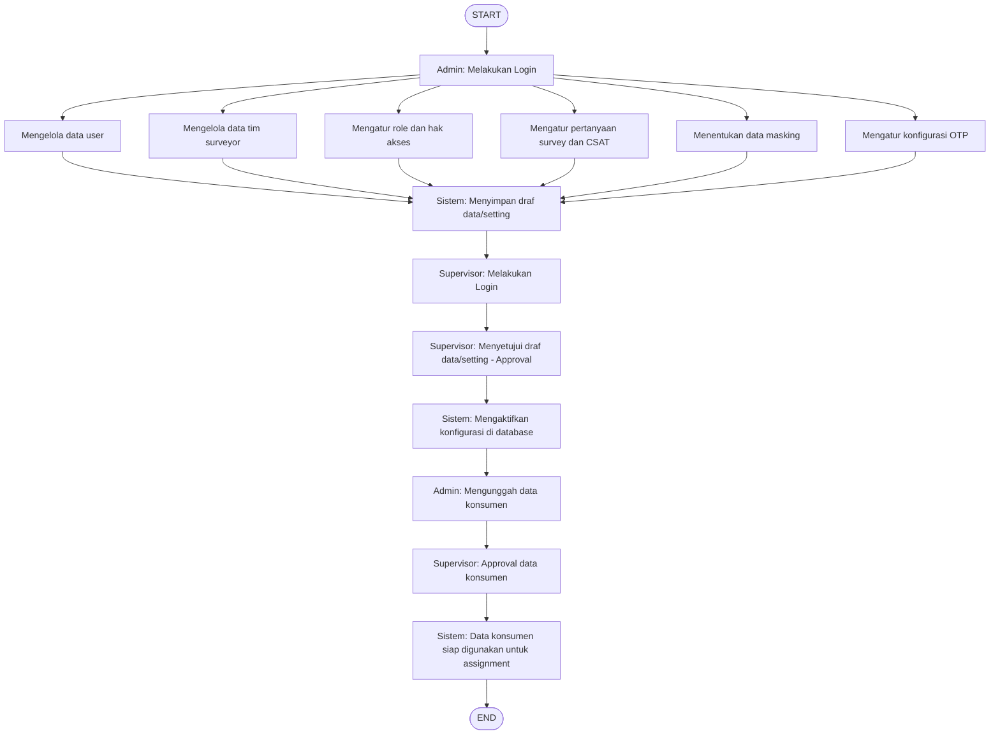

#### 2.2.2 Proses Assignment & Eksekusi Survey di Lapangan

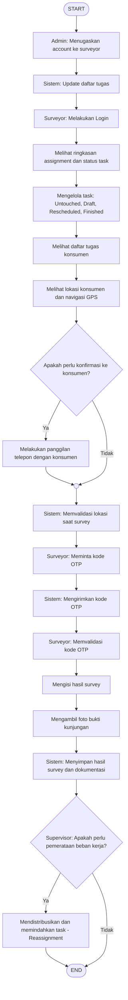

#### 2.2.3 Proses Monitoring, Reporting, dan Keamanan Sistem

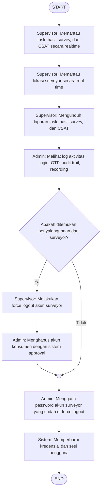

### 2.3 Deskripsi Kebutuhan Perangkat Lunak

Perangkat lunak ini dibutuhkan untuk mengotomasi tahap persiapan dan penugasan (assignment) melalui panel web, mulai dari validasi data akun hingga penunjukan surveyor yang siap bertugas secara real-time. Di sisi operasional lapangan, aplikasi mobile memfasilitasi surveyor dalam melakukan verifikasi dan interaksi konsumen, termasuk fitur penjadwalan ulang hingga navigasi rute kunjungan yang presisi. Terakhir, aplikasi berfungsi sebagai instrumen kendali mutu dan monitoring, di mana hasil survei diinput secara digital untuk kemudian dipantau performanya oleh team leader dan diakhiri dengan pengiriman tautan kepuasan pelanggan (CSAT).

---

## 3. Kebutuhan Perangkat Lunak

### 3.1 Deskripsi Umum Sistem

Gambar 3.1 — Gambaran Sistem Mobile Survey (transkripsi dari *system flow mobile survey.png*):

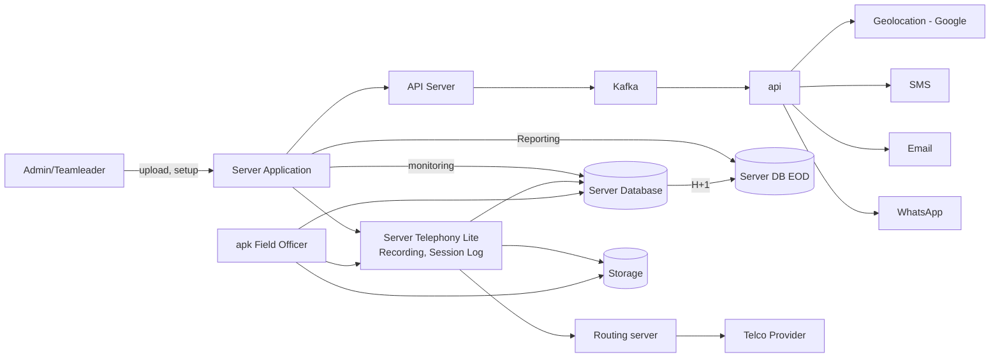

Sistem Mobile Survey adalah website dan aplikasi mobile yang dirancang untuk mendigitalisasi proses survei lapangan dengan mengintegrasikan modul Mobile Collection Web sebagai panel kontrol administratif dan aplikasi mobile sebagai alat input data bagi surveyor di lapangan. Sistem ini berfungsi sebagai jembatan antara manajemen data di kantor pusat — termasuk pengaturan user management, team management, hingga kustomisasi kuesioner — dengan aktivitas operasional seperti pengambilan foto, penentuan lokasi melalui GPS, serta verifikasi OTP untuk validasi data hasil survei secara real-time. Batasan sistem ini mencakup ketergantungan pada konektivitas jaringan dan interaksi dengan sistem eksternal untuk pemetaan rute serta komunikasi telepon, yang secara keseluruhan membentuk ekosistem kerja terpadu untuk memastikan akurasi dan akuntabilitas data survei yang dikumpulkan.

### 3.2 Stakeholder

| No | Stakeholder | Deskripsi |
|---|---|---|
| 1 | Pak Tri Juyanto | Product Owner P/L Mobile Survey |

### 3.3 Identifikasi Kebutuhan Perangkat Lunak

#### 3.3.1 Product Backlog

**Tabel 3.3.1 Product Backlog**

| ID | Product Backlog | User Story | Aktor | Prioritas |
|---|---|---|---|---|
| PB-01 | Autentikasi & Manajemen Password | Sebagai pengguna (Admin/Supervisor), saya ingin login dan mengganti password agar dapat mengakses sistem dengan aman dan menjaga kerahasiaan akun | Admin, Supervisor | High |
| PB-02 | Manajemen User (CRUD + Approval) | Sebagai Admin, saya ingin membuat, mengubah, mencari, dan menghapus user dengan mekanisme approval agar hanya user valid yang dapat mengakses sistem. | Admin, Supervisor | High |
| PB-03 | Manajemen Role & Akses (User Group) | Sebagai Admin, saya ingin mengatur role dan hak akses user agar setiap pengguna hanya dapat mengakses fitur sesuai kewenangannya | Admin | High |
| PB-04 | Manajemen Tim Surveyor | Sebagai Admin, saya ingin membuat dan mengelola tim surveyor beserta approval agar proses assignment lebih terstruktur | Admin, Supervisor | High |
| PB-05 | Konfigurasi Survey & CSAT | Sebagai Admin, saya ingin mengelola pertanyaan survey dan CSAT agar surveyor dapat menggunakan pertanyaan yang sesuai di lapangan | Admin | High |
| PB-06 | Konfigurasi Data Masking | Sebagai Admin, saya ingin menentukan data sensitif yang perlu dimasking agar informasi konsumen tetap aman saat diakses surveyor | Admin | Medium |
| PB-07 | UI Konfigurasi OTP (Tanpa Integrasi) | Sebagai Admin, saya ingin melihat dan mengatur tampilan konfigurasi OTP agar sistem siap untuk integrasi di masa depan | Admin | Low |
| PB-08 | Upload Data Konsumen (Bulk + Approval) | Sebagai Admin, saya ingin mengunggah data konsumen secara massal dengan validasi dan approval agar data siap digunakan untuk assignment | Admin, Supervisor | High |
| PB-09 | Assignment & Reassignment Task | Sebagai Supervisor, saya ingin mendistribusikan dan memindahkan task ke surveyor agar pekerjaan dapat dikelola secara optimal | Supervisor | High |
| PB-10 | Request Management (Force Logout & Delete Account) | Sebagai Admin, saya ingin melakukan force logout dan penghapusan akun melalui mekanisme approval agar keamanan dan data tetap terjaga | Admin, Supervisor | Medium |
| PB-11 | Monitoring Operasional Harian | Sebagai Supervisor, saya ingin memantau task, hasil survey, CSAT, dan lokasi surveyor secara realtime agar dapat memastikan operasional berjalan dengan baik | Supervisor | High |
| PB-12 | Logging & Audit | Sebagai Admin, saya ingin melihat log aktivitas (login, OTP, audit trail, recording) agar dapat melakukan audit dan troubleshooting | Admin | High |
| PB-13 | Reporting & Analitik (Web) | Sebagai Supervisor, saya ingin melihat laporan historis task, hasil survey, dan CSAT agar dapat mengevaluasi kinerja tim | Supervisor | High |
| PB-14 | Autentikasi & Manajemen Password (Mobile) | Sebagai Surveyor, saya ingin login dan mengganti password agar dapat mengakses aplikasi dengan aman | Surveyor | High |
| PB-15 | Dashboard & Ringkasan Task | Sebagai Surveyor, saya ingin melihat ringkasan assignment dan status task agar mengetahui pekerjaan yang harus dilakukan | Surveyor | High |
| PB-16 | Manajemen Task (Untouched, Draft, Rescheduled, Finished) | Sebagai Surveyor, saya ingin mengelola task berdasarkan status agar pekerjaan dapat dilakukan secara terorganisir | Surveyor | High |
| PB-17 | Pengisian Survey Dinamis | Sebagai Surveyor, saya ingin mengisi form survey yang dinamis agar data yang dikumpulkan sesuai dengan konfigurasi dari web | Surveyor | High |
| PB-18 | Foto & Dokumentasi Survey | Sebagai Surveyor, saya ingin mengambil dan menyimpan foto survey agar dapat melengkapi bukti kunjungan | Surveyor | High |
| PB-19 | Navigasi & Tracking Lokasi | Sebagai Surveyor, saya ingin melihat lokasi konsumen dan navigasi GPS agar dapat mencapai lokasi dengan mudah | Surveyor | High |
| PB-20 | Validasi Geofencing | Sebagai Surveyor, saya ingin sistem memvalidasi lokasi saya saat survey agar kunjungan sesuai dengan lokasi yang ditentukan | Surveyor | High |
| PB-21 | UI OTP Request & Verification (Tanpa Backend) | Sebagai Surveyor, saya ingin melihat dan menginput OTP melalui tampilan aplikasi agar proses verifikasi dapat disimulasikan | Surveyor | Low |
| PB-22 | Telephony & Kontak Konsumen | Sebagai Surveyor, saya ingin menghubungi konsumen melalui aplikasi agar dapat melakukan konfirmasi atau komunikasi | Surveyor | Medium |

#### 3.3.2 Model Kebutuhan

Gambar 3.3.2.1 — Diagram Use Case Aplikasi Mobile Survey (transkripsi):

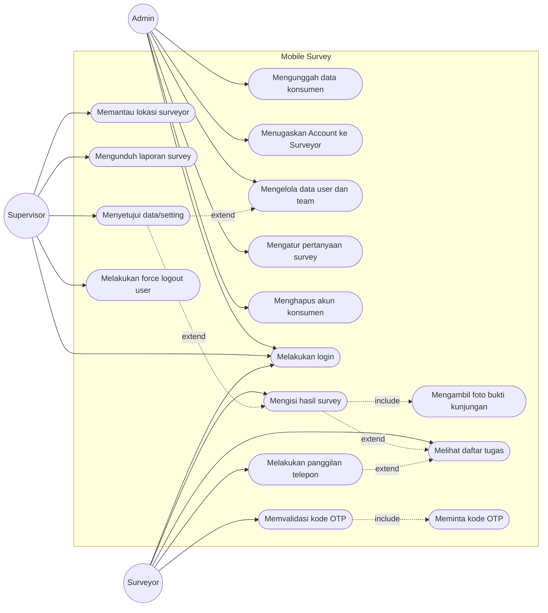

Diagram tersebut meringkas aksi yang dapat dilakukan oleh aktor sebagai interaksi penggunaan sistem Mobile Survey. Terdapat tiga aktor, yakni Admin, Surveyor, dan Supervisor. Panah `<<include>>` artinya sebuah aksi bergantung secara wajib pada aksi lain — contoh: untuk mengisi hasil survei, sistem mewajibkan pengambilan foto bukti kunjungan dan validasi kode OTP. Panah `<<extend>>` artinya aksi lanjutan opsional atau bersyarat — contoh: saat memvalidasi kode OTP, boleh meminta kode OTP terlebih dahulu jika diperlukan. Seluruh aksi yang dilakukan ketiga aktor memerlukan prekondisi login.

**Tabel 3.3.2.1 Skenario Use Case**

| ID | Use Case | Aktor | Deskripsi (Skenario) |
|---|---|---|---|
| UC-01 | Melakukan Login | Admin, Supervisor, Surveyor | Pengguna memasukkan *username* dan *password* untuk mengakses sistem (Web atau Mobile) sesuai hak akses masing-masing. |
| UC-02 | Mengelola Data User & Team | Admin, Supervisor | Admin membuat atau mengubah data pengguna dan struktur tim. Supervisor memberikan persetujuan (*approval*) terhadap data tersebut. |
| UC-03 | Mengatur Pertanyaan Survei | Admin, Supervisor | Admin menyusun daftar pertanyaan survei dan CSAT. Supervisor memvalidasi dan menyetujui pertanyaan sebelum dipublikasikan ke aplikasi mobile. |
| UC-04 | Mengunggah Data Konsumen | Admin | Admin mengunggah file berisi daftar akun konsumen yang akan disurvei ke dalam sistem Web. |
| UC-05 | Menugaskan Account ke Surveyor | Admin | Admin memilih akun konsumen tertentu dan menetapkannya kepada Surveyor yang sedang aktif untuk diproses. |
| UC-06 | Melihat Daftar Tugas | Surveyor | Surveyor mengisi formulir hasil verifikasi data di lapangan dan mengambil foto agunan atau lokasi sebagai bukti dokumentasi. |
| UC-07 | Mengisi Hasil Survei | Surveyor | Surveyor mengisi formulir elektronik berdasarkan hasil wawancara dan observasi langsung di lokasi konsumen. |
| UC-08 | Mengambil Foto Bukti Kunjungan | Surveyor | Surveyor mengambil foto bukti kunjungan menggunakan kamera ponsel sebagai bukti fisik yang tidak dapat dimanipulasi. |
| UC-09 | Meminta Kode OTP | Surveyor | Surveyor menekan tombol request OTP yang akan dikirimkan ke nomor ponsel konsumen untuk memvalidasi bahwa Surveyor benar-benar bertemu konsumen. |
| UC-10 | Memvalidasi Kode OTP | Surveyor | Surveyor memasukkan kode yang diterima konsumen ke dalam aplikasi untuk menyelesaikan proses verifikasi kunjungan. |
| UC-11 | Memantau Lokasi Surveyor | Surveyor | Supervisor memantau posisi geografis (GPS) Surveyor secara real-time dan melihat jalur pergerakan (tracking) mereka di peta. |
| UC-12 | Mengunduh Laporan Survei | Supervisor | Supervisor menarik data hasil survei yang telah selesai dan mengunduhnya dalam format laporan untuk kebutuhan analisis lebih lanjut. |
| UC-13 | Melakukan Force Logout | Supervisor | Supervisor memutuskan sesi aktif pengguna (Surveyor) secara paksa melalui panel admin jika ditemukan indikasi penyalahgunaan atau keperluan teknis. |
| UC-14 | Menghapus Akun Konsumen | Admin | Admin menghapus data akun konsumen dari sistem jika terjadi kesalahan data atau pembatalan survei berdasarkan alasan tertentu. |
| UC-15 | Melakukan Panggilan Telepon | Surveyor | Surveyor melakukan panggilan telepon kepada konsumen secara langsung melalui aplikasi mobile untuk keperluan koordinasi atau verifikasi. Sistem akan memvalidasi koneksi jaringan sebelum panggilan diteruskan dan aktivitas panggilan ini dapat tercatat di dalam sistem pemantauan (log/rekaman telephony). |
| UC-16 | Menyetujui Data/Setting | Supervisor | Supervisor melakukan peninjauan (review), validasi, dan memberikan persetujuan (approval) terhadap penambahan atau perubahan data pengaturan (seperti manajemen pengguna, tim, masking data, maupun draf pertanyaan survei) yang telah dibuat oleh Admin agar draf tersebut aktif dan dapat digunakan dalam sistem. |

> Catatan transkripsi: di dokumen asli, aktor UC-11 tertulis "Surveyor" meskipun deskripsinya menyebut Supervisor; deskripsi UC-06 juga tampak tertukar dengan UC-07/UC-08. Dibiarkan sesuai aslinya.

---

## 4. Deskripsi Perancangan Perangkat Lunak

### 4.1 Deskripsi Arsitektur

Arsitektur yang digunakan dalam pengembangan perangkat lunak *Mobile Survey* adalah **Arsitektur *Client-Server*** dengan pendekatan **Unified REST API**. Dalam arsitektur ini, sisi antarmuka (*Client*) yang terdiri dari aplikasi Web (*Admin Portal*) dan aplikasi *Mobile* (*Surveyor App*) berkomunikasi dengan satu layanan *Backend* tersentralisasi yang sama. Sistem ini secara tegas **tidak** menggunakan pola *Backend-for-Frontend* (BFF), melainkan mengimplementasikan *endpoint* API universal yang melayani kebutuhan operasional Web dan Mobile secara terpadu.

*Architectural Drivers* utama dan motivasi pemilihannya:

1. **Performa Tinggi dan Skalabilitas (*High Performance*):** *Backend API* dibangun menggunakan framework Hono.js yang berjalan di atas *runtime* Bun. Pemilihan teknologi ini dimotivasi oleh kebutuhan komputasi yang sangat cepat (*low-latency*) dan efisiensi manajemen sumber daya (*resource efficiency*) saat memproses data survei massal dan *tracking* lokasi.
2. **Keterpaduan Domain (*Domain-Driven Directory Structure*):** Logika *backend* dipisahkan berdasarkan domain fungsionalitas (misalnya `src/domains/iam/`, `src/domains/survey/`, `src/domains/assignment/`). Pemisahan skema, *controller*, dan *service* ini bertujuan menjaga *maintainability*, mempertegas pemisahan tanggung jawab (*separation of concerns*), dan mempermudah skalabilitas tim.
3. **Keamanan dan Visibilitas Sesi (*Stateful Authentication*):** Sistem otentikasi tidak menggunakan JWT yang *stateless*, melainkan mengimplementasikan Stateful Database Sessions. Hal ini wajib untuk memenuhi regulasi bisnis, yaitu mendukung fitur *Force Logout* oleh Admin, pemantauan riwayat aktivitas *login* secara *real-time*, serta pembatasan percobaan masuk (*rate-limiting* menggunakan kombinasi `failedAttempts` dan `lockedUntil` di basis data). Proses komputasi sandi menggunakan algoritma *hashing* bawaan Bun (Argon2id).
4. **Konsistensi Validasi Data (*Strict Validation*):** Penggunaan integrasi Zod dengan *middleware* Hono (`@hono/zod-validator`) memastikan seluruh beban data (*payload*) yang masuk dari Web maupun Mobile selalu memiliki format yang ketat sebelum diproses oleh ORM (Prisma) menuju basis data (PostgreSQL).

### 4.2 Dekomposisi Fungsional

Perangkat lunak ini didekomposisikan ke dalam beberapa subsistem dan komponen berdasarkan pemisahan domain kerja aplikasi, menggunakan klasifikasi *Role-Stereotype*.

**Tabel 4.2.1 Dekomposisi Fungsional**

| ID | Nama subsistem/komponen/kelas | Role-Stereotype |
|---|---|---|
| SS-01 | Web Portal (Next.js) | *Interfacer* (IT) |
| SS-02 | IAM Domain (Identity & Access Management) | *Coordinator* (CO) & *Service Provider* (SP) |
| SS-03 | Setting & Config Domain | *Controller* (CT) |
| SS-04 | Assignment & Upload Domain | *Service Provider* (SP) |
| SS-05 | Survey & Task Domain | *Controller* (CT) & *Service Provider* (SP) |
| SS-06 | Monitoring & Reporting Domain | *Coordinator* (CO) |
| SS-07 | Integration Service (Core Utilities) | *Service Provider* (SP) |
| SS-08 | Database (PostgreSQL via Prisma) | *Information Holder* (IH) & *Structurer* (ST) |

**Gambar 4.2 Role-Stereotypes** (ringkasan):

| Stereotype | Peran | Ciri implementasi |
|---|---|---|
| Service Provider (SP) | Melakukan pekerjaan spesifik, menawarkan layanan | `-er`/`-or`; public static methods; dapat berisi logika untuk tugas spesifik |
| Information Holder (IH) | Mengetahui/menyimpan informasi, menyediakan informasi | Enkapsulasi data; get/set; method private/internal |
| Interfacer (IT) | Mentransformasi/mengonversi informasi dan request antar-layer | GUI, storefront, API, extension points |
| Controller (CT) | Membuat keputusan, mengendalikan tugas kompleks | `controller`, `manager`; logic statements; mengenal IH, SP, CO |
| Coordinator (CO) | Mendelegasikan pekerjaan, meneruskan info/request | Tanpa/sedikit logika; mengenal requester & requestee |
| Structurer (ST) | Menjaga relasi, mengumpulkan & menata objek | Collection; `sort()`, `compare()`, `validate()`, `add()`, `remove()` |

### 4.3 Architectural View

#### 4.3.1 Structural View

Struktur sistem menggambarkan komponen fisik dan logika operasional dari keseluruhan perangkat lunak.

##### 4.3.1.1 Diagram Komponen

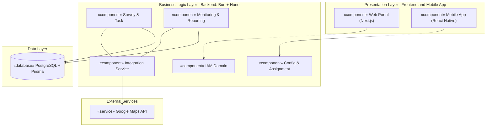

Sistem terbagi menjadi tiga lapisan besar:

- **Presentation Layer (Frontend):** Komponen *Web App* (Next.js) dan *Mobile APK* (React Native). Keduanya bertindak sebagai *client* murni yang merender antarmuka pengguna. Pada lapisan ini, fitur OTP dan Telephony dikerjakan murni sebagai desain antarmuka (*UI-only*) tanpa koneksi fungsional ke layanan eksternal.
- **Business Logic Layer (Backend):** Server API *Hono.js* pada *runtime Bun*, dikelompokkan menjadi modul berbasis domain. Terdapat *Core Middleware* yang menangani *Global Error Handling*, otorisasi sesi, dan validasi Zod. Backend ini **hanya** berkomunikasi dengan servis eksternal *Google Maps API*.
- **Data Layer:** *Prisma Client* yang melakukan pemetaan objek (ORM) ke *PostgreSQL Database*.

##### 4.3.1.2 Diagram Kelas (Domain Model)

Gambar 4.3.1.2 — Domain Model:

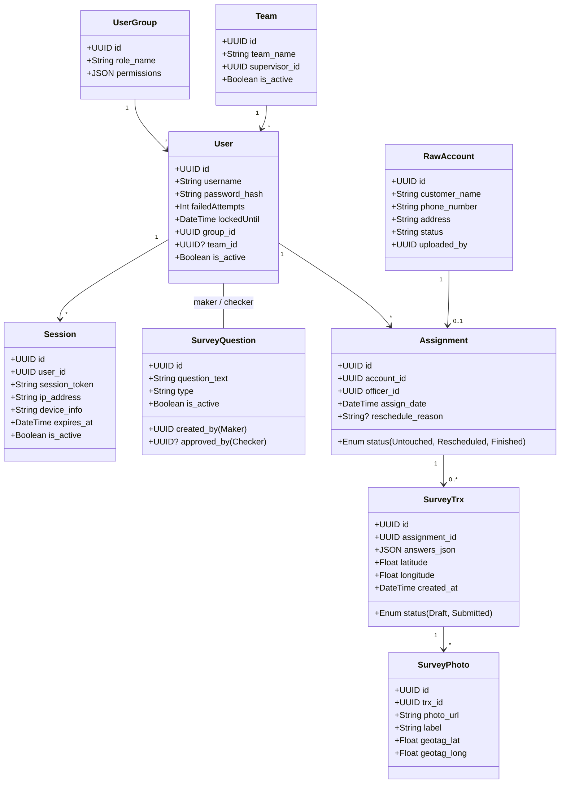

Gambar 4.3.1.3 — Diagram Kelas (Boundary-Control-Entity):

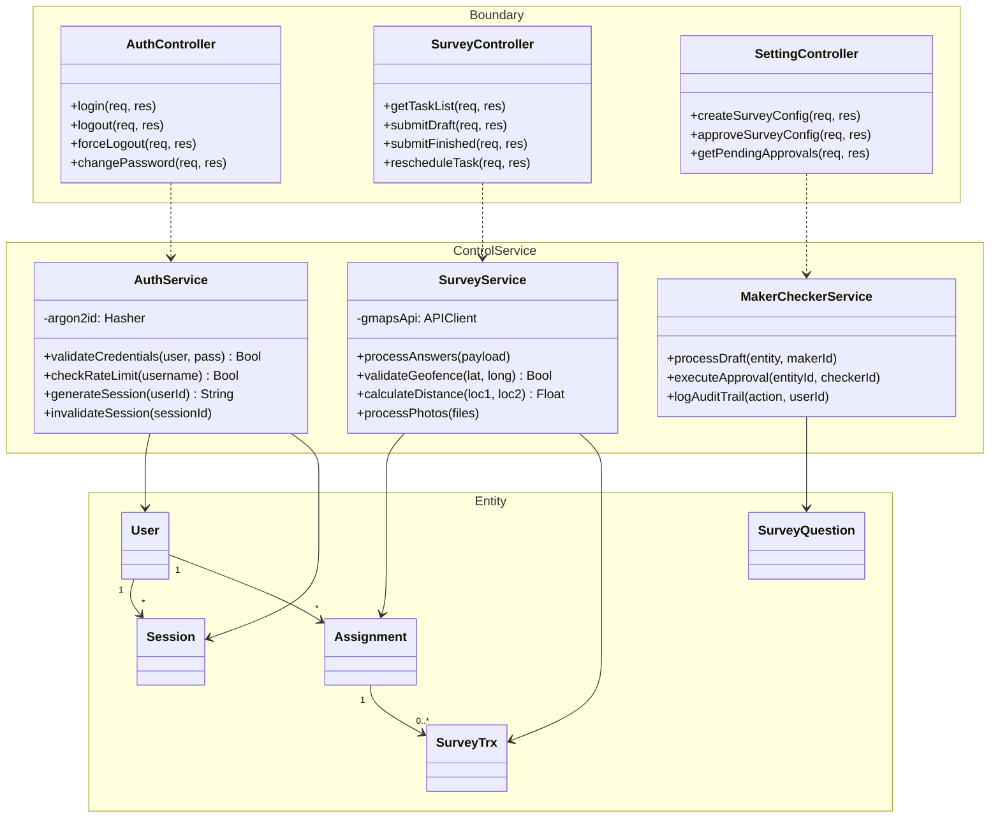

Diagram kelas ini dimodelkan menggunakan pendekatan Boundary-Control-Entity untuk merepresentasikan struktur logika kode di dalam sistem Backend:

- **Boundary/Controller Classes:** Antarmuka penerima permintaan (*request*) API. Contoh: AuthController (menangani `/login`, `/logout`), SurveyController, dan AssignmentController.
- **Control/Service Classes:** Mengandung *business logic* utama. Contoh: AuthService yang memiliki metode pemrosesan enkripsi Argon2id (`validatePassword()`), pengecekan batas percobaan masuk (`checkRateLimit()`), dan SurveyService yang mengkalkulasi batas *geofencing* (`calculateDistance()`).
- **Entity Classes (Domain Model):** Struktur data yang disimpan oleh Prisma ORM di PostgreSQL. Entitas meliputi User (terhubung ke UserGroup dan Team), Session (*stateful login*), Assignment, hingga SurveyTrx (transaksi survei) yang berelasi dengan SurveyPhoto. Seluruh entitas pengaturan (*setting*) turut mengakomodasi *flagging* proses *Maker-Checker* melalui atribut `created_by` dan `approved_by`.

#### 4.3.2 Behavioural View

##### 4.3.2.1 Sequence Diagram: Melakukan Login

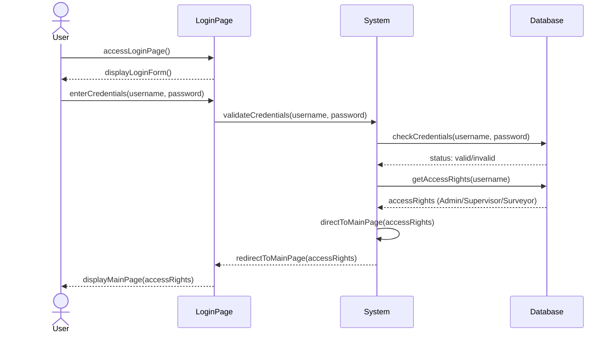

Pengguna (Admin, Supervisor, atau Surveyor) memasukkan *username* dan *password* di halaman Login, lalu sistem memvalidasinya ke database. Apabila valid, sistem memeriksa hak akses pengguna dan mengarahkannya ke halaman utama sesuai otoritasnya.

##### 4.3.2.2 Sequence Diagram: Mengelola Data User & Team

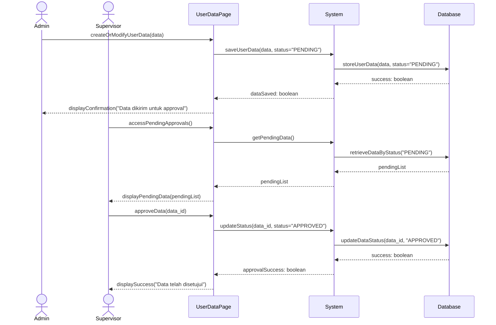

Data pengguna baru atau perubahan disimpan dengan status "PENDING". Pihak berwenang melihat daftar data tertunda dan melakukan *approve*, yang mengubah status di database menjadi "APPROVED".

##### 4.3.2.3 Sequence Diagram: Mengatur Pertanyaan Survei

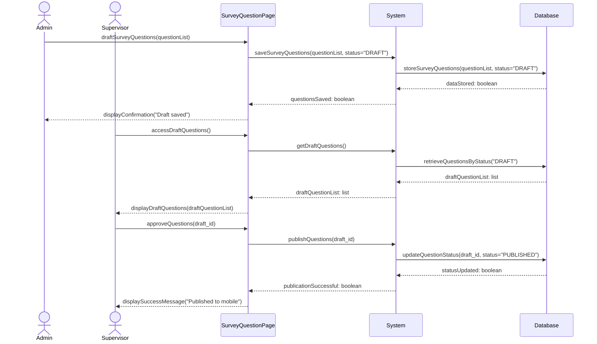

Daftar pertanyaan disimpan sementara dengan status "DRAFT". Setelah ditinjau dan disetujui, statusnya diperbarui menjadi "PUBLISHED" sehingga dapat diakses melalui aplikasi mobile.

##### 4.3.2.4 Sequence Diagram: Mengunggah Data Konsumen

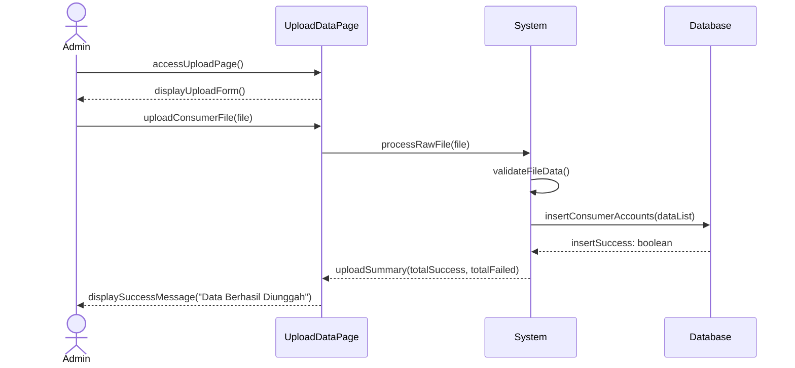

Sistem memproses file konsumen yang diunggah, memvalidasi kelayakan data, memasukkannya ke database, lalu menampilkan ringkasan jumlah data yang sukses dan gagal diunggah.

##### 4.3.2.5 Sequence Diagram: Menugaskan Account ke Surveyor

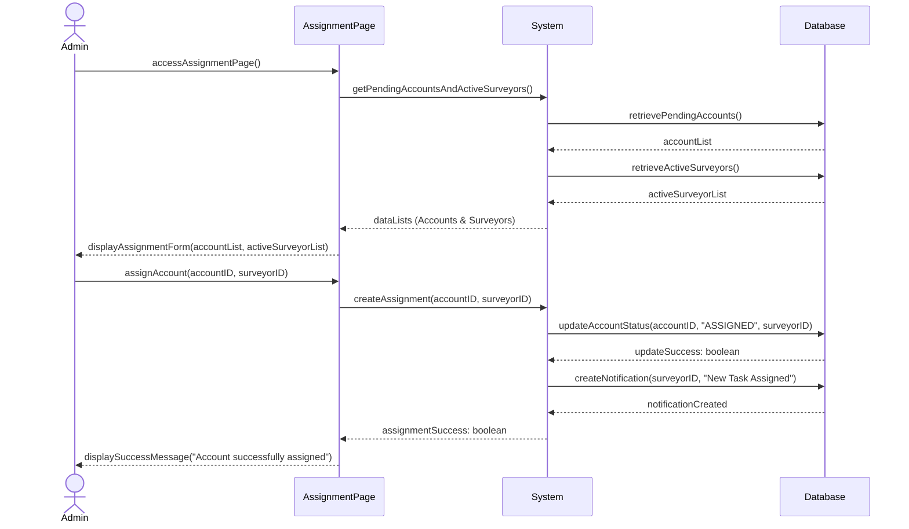

Admin melihat daftar akun *pending* dan Surveyor aktif, lalu menugaskan akun ke Surveyor. Sistem mengubah status akun menjadi "ASSIGNED" dan membuat notifikasi tugas baru bagi Surveyor.

##### 4.3.2.6 Sequence Diagram: Melihat Daftar Tugas

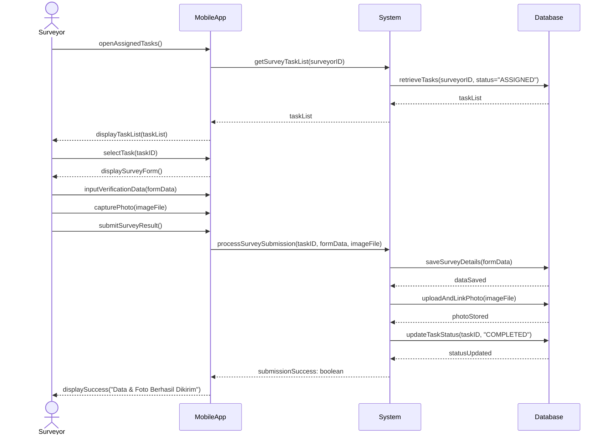

Surveyor membuka daftar tugas berstatus "ASSIGNED", memilih tugas, mengisi formulir, mengambil foto bukti, dan submit. Sistem menyimpan data dan foto lalu mengubah status tugas menjadi "COMPLETED".

##### 4.3.2.7 Sequence Diagram: Mengisi Hasil Survei

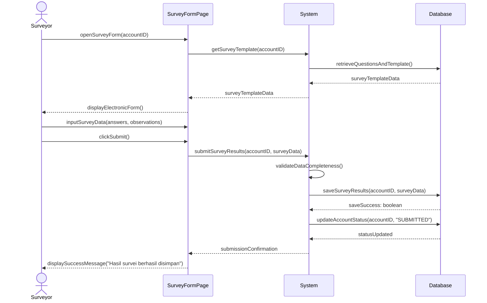

Sistem mengambil templat survei berdasarkan ID akun. Setelah Surveyor mengisi jawaban dan submit, sistem memvalidasi kelengkapan data, menyimpannya, dan mengubah status akun menjadi "SUBMITTED".

##### 4.3.2.8 Sequence Diagram: Mengambil Foto Bukti Kunjungan

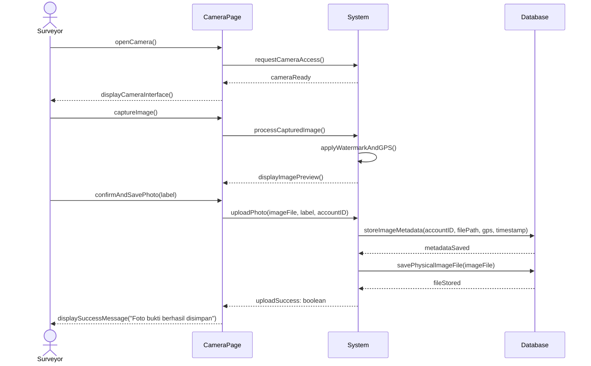

Sistem menambahkan *watermark* dan koordinat GPS ke foto, lalu menyimpan metadata (lokasi file, GPS, cap waktu) beserta file fisik foto.

##### 4.3.2.9 Sequence Diagram: Meminta Kode OTP

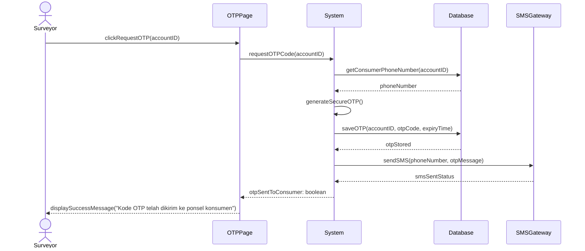

Sistem menarik nomor telepon konsumen, menghasilkan OTP unik dengan waktu kedaluwarsa, menyimpannya, dan mengirimkannya via SMS Gateway.

##### 4.3.2.10 Sequence Diagram: Memvalidasi Kode OTP

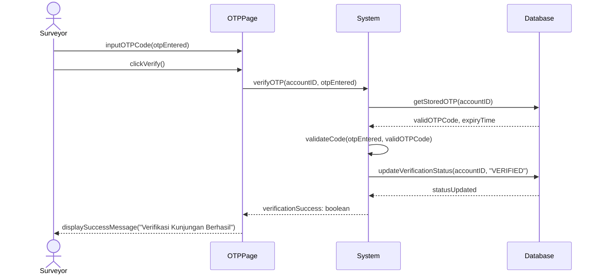

Sistem menarik OTP tersimpan beserta batas waktunya; jika cocok dan belum kedaluwarsa, status verifikasi akun diperbarui menjadi "VERIFIED".

##### 4.3.2.11 Sequence Diagram: Memantau Lokasi Surveyor

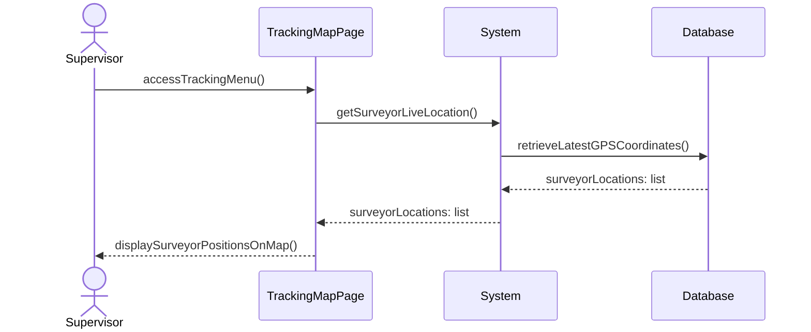

Sistem menarik koordinat GPS terbaru para Surveyor dan memvisualisasikannya sebagai *pinpoint* di peta interaktif.

##### 4.3.2.12 Sequence Diagram: Mengunduh Laporan Survei

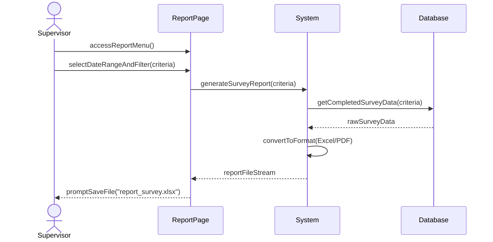

Berdasarkan rentang tanggal dan filter, sistem mencari data survei selesai, mengonversinya ke Excel/PDF, dan mengirimkannya untuk diunduh.

##### 4.3.2.13 Sequence Diagram: Melakukan Force Logout

```mermaid
sequenceDiagram
    actor Supervisor
    participant UserSessionPage
    participant System
    participant Database
    Supervisor->>UserSessionPage: viewActiveSessions()
    UserSessionPage->>System: getActiveUsers()
    System->>Database: retrieveOnlineUsers()
    Database-->>System: onlineUserList
    System-->>UserSessionPage: onlineUserList
    Supervisor->>UserSessionPage: clickForceLogout(surveyorID)
    UserSessionPage->>System: invalidateUserSession(surveyorID)
    System->>Database: deleteSessionToken(surveyorID)
    Database-->>System: sessionDeleted
    System-->>UserSessionPage: logoutSuccessful
    UserSessionPage-->>Supervisor: displayMessage("User has been logged out")
```

Supervisor memilih pengguna *online*; sistem membatalkan sesinya dan menghapus token sesi di database.

##### 4.3.2.14 Sequence Diagram: Menghapus Akun Konsumen

```mermaid
sequenceDiagram
    actor Admin
    participant AccountManagementPage
    participant System
    participant Database
    Admin->>AccountManagementPage: searchAccount(accountID)
    AccountManagementPage->>System: getAccountDetails(accountID)
    System->>Database: findAccount(accountID)
    Database-->>System: accountData
    System-->>AccountManagementPage: accountData
    Admin->>AccountManagementPage: clickDeleteAccount(reason)
    AccountManagementPage->>System: deleteAccountProcess(accountID, reason)
    System->>Database: logDeletionHistory(accountID, adminID, reason)
    Database-->>System: logSaved
    System->>Database: removeAccountRecord(accountID)
    Database-->>System: deletionSuccess
    System-->>AccountManagementPage: confirmDeletionSuccess
    AccountManagementPage-->>Admin: displayMessage("Account successfully deleted")
```

Penghapusan wajib menyertakan alasan. Sebelum akun dihapus permanen, sistem menyimpan riwayat penghapusan (ID akun, ID Admin, alasan) sebagai log.

##### 4.3.2.15 Sequence Diagram: Melakukan Panggilan Telepon

```mermaid
sequenceDiagram
    actor Surveyor
    participant CallInterface
    participant System
    participant Database
    participant TelephonyGateway
    Surveyor->>CallInterface: clickCallConsumer(accountID)
    CallInterface->>System: checkNetworkStability()
    System-->>CallInterface: networkStatus: GREEN
    CallInterface->>System: initiateCallRequest(accountID)
    System->>Database: getConsumerPhoneNumber(accountID)
    Database-->>System: phoneNumber
    System->>TelephonyGateway: setupCall(surveyorPhone, phoneNumber)
    TelephonyGateway-->>System: callConnected: boolean
    System-->>CallInterface: triggerNativeDialer()
    CallInterface-->>Surveyor: openVoiceCallBridge()
    Surveyor->>CallInterface: endCall()
    CallInterface->>System: logCallActivity(accountID, duration)
    System->>Database: insertCallHistoryLog(accountID, surveyorID, duration, timestamp)
    Database-->>System: logSaved
    System-->>CallInterface: logSynchronized
```

Sistem memeriksa stabilitas jaringan; jika memadai (hijau), sistem menarik nomor konsumen dan membangun jalur panggilan via Telephony Gateway. Setelah panggilan selesai, log aktivitas (durasi, cap waktu) disimpan.

##### 4.3.2.16 Sequence Diagram: Menyetujui Data/Setting

```mermaid
sequenceDiagram
    actor Supervisor
    participant ApprovalDashboard
    participant System
    participant Database
    Supervisor->>ApprovalDashboard: accessApprovalMenu()
    ApprovalDashboard->>System: getAllPendingSettings()
    System->>Database: retrieveSettingsByStatus("PENDING")
    Database-->>System: pendingSettingsList
    System-->>ApprovalDashboard: pendingSettingsList
    ApprovalDashboard-->>Supervisor: displayPendingSettings(pendingSettingsList)
    Supervisor->>ApprovalDashboard: selectSettingDetail(settingID)
    ApprovalDashboard->>System: getSettingDetail(settingID)
    System->>Database: fetchDetailRecord(settingID)
    Database-->>System: detailedRecordData
    System-->>ApprovalDashboard: detailedRecordData
    ApprovalDashboard-->>Supervisor: displayDetails()
    Supervisor->>ApprovalDashboard: clickApprove(settingID)
    ApprovalDashboard->>System: processApproval(settingID, supervisorID)
    System->>Database: updateSettingStatus(settingID, "ACTIVE")
    Database-->>System: updateSuccess
    System->>Database: createAuditTrail(settingID, supervisorID, "APPROVED")
    Database-->>System: auditLogged
    System-->>ApprovalDashboard: operationSuccess: boolean
    ApprovalDashboard-->>Supervisor: displaySuccessMessage("Pengaturan telah aktif dan diterapkan")
```

Supervisor meninjau pengaturan berstatus "PENDING"; setelah disetujui, status menjadi "ACTIVE" dan jejak audit dicatat.

#### 4.3.3 Deployment View

```mermaid
flowchart TB
    subgraph SP["«Device» Smartphone"]
        MA["Mobile App — React Native"]
    end
    subgraph PC["«Device» HP/Laptop/PC"]
        subgraph BR["«Execution Environment» Web Browser"]
            WP["Web Portal — Next.js"]
        end
    end
    subgraph AS["«Server» Application Server"]
        subgraph BUN["«Execution Environment» Bun Runtime"]
            API["Backend API Server — Hono.js<br/>Boundary Layer (Controllers)<br/>Controller Layer (Services)"]
            PRISMA["Prisma Client"]
        end
    end
    subgraph DBS["«Server» Database Server"]
        PG[("«Database» PostgreSQL<br/>Domain Model/Entities: User, Assignment, SurveyTrx, dll.")]
    end
    subgraph EXT["«Environment» External Services"]
        GM["Google Maps API"]
    end
    MA -. "HTTPS/REST API" .-> API
    WP -. "HTTPS/REST API" .-> API
    API -- "Internal Call" --> PRISMA
    PRISMA -. "TCP/IP (Port 5432)" .-> PG
    API -. "HTTPS/REST API" .-> GM
```

Deployment diagram memvisualisasikan distribusi komponen perangkat lunak ke infrastruktur fisik dan jaringan, berpusat pada empat node utama: perangkat *client* (smartphone untuk aplikasi React Native dan HP/Laptop/PC untuk Web Portal Next.js), *application server* yang mengeksekusi logika bisnis (backend Hono.js dan Prisma ORM) di atas runtime Bun, *database server* PostgreSQL, serta lingkungan cloud eksternal untuk integrasi Google Maps API. Interaksi antara klien, backend, dan layanan eksternal dihubungkan melalui HTTPS/REST API, sementara backend berkomunikasi langsung ke database melalui protokol TCP/IP internal.

---

## 5. Implementasi Perangkat Lunak

Tuliskan hasil implementasi mencakup **struktur direktori** dan **daftar file** hasil implementasi. Lengkapi dengan **Traceability Table** yang memperlihatkan keterhubungan setiap file kode program dengan elemen model perancangan.

### 5.1 Struktur Direktori Implementasi Mobile

Aplikasi Mobile Survey (Mobile) dikembangkan menggunakan React Native dengan Expo dan TypeScript. Struktur proyek disusun secara modular untuk memisahkan logika aplikasi, komponen antarmuka, aset, serta konfigurasi sistem.

```
MobileSurvey/
│   .gitignore
│   app.json
│   eas.json
│   eslint.config.js
│   expo-env.d.ts
│   package-lock.json
│   package.json
│   README.md
│   tsconfig.json
│
├───android/
│   │   .gitignore
│   │   build.gradle
│   │   gradle.properties
│   │   gradlew
│   │   gradlew.bat
│   │   settings.gradle
│   │
│   ├───app/
│   │   │   build.gradle
│   │   │   debug.keystore
│   │   │   proguard-rules.pro
│   │   │
│   │   └───src/
│   │       ├───debug/
│   │       │       AndroidManifest.xml
│   │       ├───debugOptimized/
│   │       │       AndroidManifest.xml
│   │       └───main/
│   │           │   AndroidManifest.xml
│   │           ├───java/com/itx/MobileSurvey/
│   │           │       MainActivity.kt
│   │           │       MainApplication.kt
│   │           └───res/
│   │               ├───drawable/
│   │               ├───mipmap-*/
│   │               └───values/
│   │
│   ├───build/
│   └───gradle/wrapper/
│           gradle-wrapper.jar
│           gradle-wrapper.properties
│
├───app/
│   │   ComingSoon.tsx
│   │   index.tsx
│   │   _layout.tsx
│   │
│   ├───(auth)/
│   │       login.styles.ts
│   │       login.tsx
│   │
│   ├───(dashboard)/
│   │       BottomNavbar.tsx
│   │       Dashboard.tsx
│   │       Header.tsx
│   │       OTPRequest.tsx
│   │       RecentActivity.tsx
│   │       TaskOverview.tsx
│   │
│   ├───(otp)/
│   │       otp.styles.ts
│   │       OTP.tsx
│   │
│   ├───(profile)/
│   │       profile.styles.ts
│   │       Profile.tsx
│   │
│   ├───(reports)/
│   │       SurveyQuestions.tsx
│   │
│   └───(tasklist)/
│           TaskCard.tsx
│           TaskList.tsx
│           TaskListHeader.tsx
│
├───assets/
│   └───images/
│           android-icon-background.png
│           android-icon-foreground.png
│           android-icon-monochrome.png
│           favicon.png
│           icon.png
│           splash-icon.png
│           (+ react-logo files)
│
├───components/
│       AlertBanner.tsx
│       AppButton.tsx
│       FormTextField.tsx
│       LedgerField.tsx
│       NetworkStatusBar.tsx
│       OTPInput.tsx
│       ProfileAvatar.tsx
│       ProfileInfoRow.tsx
│       ProfileSectionCard.tsx
│       ProfileStatTile.tsx
│       ToastMessage.tsx
│
├───constants/
│       colors.ts
│       dashboard.ts
│       otp.theme.ts
│       profile.theme.ts
│       survey.theme.ts
│       tasklist.ts
│       theme.ts
│       typography.ts
│
├───hooks/
│       useNetworkQuality.ts
│
├───scripts/
│       reset-project.js
│
└───services/
        api.ts
        auth.ts
        storage.ts
```

### 5.2 Deskripsi Komponen Implementasi Mobile

**Tabel 5.2.1 Deskripsi Komponen Mobile**

| Direktori/File | Deskripsi |
|---|---|
| `app/` | Entry point + routes groups Expo Router |
| `app/(auth)/` | Halaman login |
| `app/(dashboard)/` | Dashboard, navbar, header, activity |
| `app/(otp)/` | OTP flow (UI) |
| `app/(profile)/` | Profil Surveyor |
| `app/(reports)/` | Halaman survey atau pertanyaan |
| `app/(tasklist)/` | Daftar tugas survey |
| `components/` | Komponen reusable UI |
| `constants/` | Warna, tema, tipografi |
| `hooks/` | Custom React hooks |
| `services/` | API, auth, storage |
| `assets/` | Gambar dan ikon |
| `android/` | Build files native Android |

### 5.3 Traceability Table Mobile

**Tabel 5.3.1 Traceability Mobile**

| Folder | Deskripsi | Terkait Use Case | Terkait Product Backlog |
|---|---|---|---|
| `app/(auth)/` | Halaman login beserta styling-nya (login.tsx, login.styles.ts) | UC-01 | PB-14 |
| `app/(dashboard)/` | Dashboard utama, header, navbar, ringkasan task, activity, dan tombol OTP Request (Dashboard.tsx, TaskOverview.tsx, RecentActivity.tsx, OTPRequest.tsx, Header.tsx, BottomNavbar.tsx) | UC-06, UC-09 | PB-15, PB-21 |
| `app/(otp)/` | Halaman input dan verifikasi OTP (OTP.tsx, otp.styles.ts) | UC-09, UC-10 | PB-21 |
| `app/(profile)/` | Halaman profil pengguna, termasuk manajemen akun/password (Profile.tsx, profile.styles.ts) | UC-01 | PB-14 |
| `app/(reports)/` | Halaman pengisian formulir survei dinamis (SurveyQuestions.tsx) | UC-07, UC-08 | PB-17, PB-18 |
| `app/(tasklist)/` | Daftar dan kartu task berdasarkan status (TaskList.tsx, TaskCard.tsx, TaskListHeader.tsx) | UC-06 | PB-16 |
| `hooks/` | Custom React hooks (useNetworkQuality.ts) | UC-15 | PB-22 |
| `services/` | Layer komunikasi dengan backend (api.ts, auth.ts, storage.ts) | UC-01, UC-06, UC-07, UC-09, UC-10 | PB-14, PB-15, PB-16, PB-17, PB-21 |

### 5.4 Struktur Direktori Implementasi Website

Implementasi sistem **Mobile Survey (Web Application)** menggunakan arsitektur **client–server** yang terdiri dari:

- **Backend** sebagai penyedia API dan pengelola logika bisnis
- **Frontend** sebagai antarmuka pengguna berbasis web

Backend dikembangkan menggunakan **TypeScript dengan runtime Bun dan ORM Prisma**, sedangkan frontend menggunakan **Next.js (React Framework)**.

```
if3250_k03_g02_itx_web/
backend/
├── prisma/
│   │   schema.prisma
│   └───migrations/
│       │   migration_lock.toml
│       ├───20260312144407_init/
│       │       migration.sql
│       ├───20260312155327_add_session_and_lockout/
│       │       migration.sql
│       ├───20260328191849_revision_1/
│       │       migration.sql
│       ├───20260329014451_change_password_char_length/
│       │       migration.sql
│       ├───20260331061810/
│       │       migration.sql
│       ├───20260404230141/
│       │       migration.sql
│       ├───20260427190759_add_missing_tables/
│       │       migration.sql
│       ├───20260509053029/
│       │       migration.sql
│       └───20260509104947_add_gps_log/
│               migration.sql
│
├── src/
│   │   index.ts
│   │
│   ├───core/
│   │   │   db.ts
│   │   │   error-handler.ts
│   │   │   errors.ts
│   │   │   logger.ts
│   │   │   validator.ts
│   │   └───middlewares/
│   │           auth.middleware.ts
│   │           require-menu.middleware.ts
│   │
│   ├───domains/
│   │   ├───account-assignment/
│   │   │       account-assignment.controller.ts
│   │   │       account-assignment.repository.ts
│   │   │       account-assignment.schema.ts
│   │   │       account-assignment.service.ts
│   │   ├───csat/
│   │   │       csat.controller.ts
│   │   │       csat.repository.ts
│   │   │       csat.schema.ts
│   │   │       csat.service.ts
│   │   │       index.ts
│   │   ├───data-masking/
│   │   │       data-masking.controller.ts
│   │   │       data-masking.helper.ts
│   │   │       data-masking.repository.ts
│   │   │       data-masking.schema.ts
│   │   │       data-masking.service.ts
│   │   │       index.ts
│   │   ├───delete-account/
│   │   │       delete-account.controller.ts
│   │   │       delete-account.repository.ts
│   │   │       delete-account.schema.ts
│   │   │       delete-account.service.ts
│   │   │       index.ts
│   │   ├───force-logout/
│   │   │       force-logout.controller.ts
│   │   │       force-logout.repository.ts
│   │   │       force-logout.schema.ts
│   │   │       force-logout.service.ts
│   │   │       index.ts
│   │   ├───iam/
│   │   │       iam.controller.ts
│   │   │       iam.repository.ts
│   │   │       iam.schema.ts
│   │   │       iam.service.ts
│   │   │       index.ts
│   │   ├───mobile-survey/
│   │   │       index.ts
│   │   │       mobile-survey.controller.ts
│   │   │       mobile-survey.repository.ts
│   │   │       mobile-survey.schema.ts
│   │   │       mobile-survey.service.ts
│   │   ├───mobile-task/
│   │   │       index.ts
│   │   │       mobile-task.controller.ts
│   │   │       mobile-task.repository.ts
│   │   │       mobile-task.schema.ts
│   │   │       mobile-task.service.ts
│   │   ├───monitoring/
│   │   │   │   index.ts
│   │   │   ├───csat-monitoring/
│   │   │   │       csat-monitoring.controller.ts
│   │   │   │       csat-monitoring.repository.ts
│   │   │   │       csat-monitoring.schema.ts
│   │   │   │       csat-monitoring.service.ts
│   │   │   │       index.ts
│   │   │   ├───logs/
│   │   │   │       index.ts
│   │   │   │       logs.controller.ts
│   │   │   │       logs.schema.ts
│   │   │   │       logs.service.ts
│   │   │   ├───officer-tracking/
│   │   │   │       index.ts
│   │   │   │       officer-tracking.controller.ts
│   │   │   │       officer-tracking.repository.ts
│   │   │   │       officer-tracking.schema.ts
│   │   │   │       officer-tracking.service.ts
│   │   │   └───task-monitoring/
│   │   │           index.ts
│   │   │           task-monitoring.controller.ts
│   │   │           task-monitoring.repository.ts
│   │   │           task-monitoring.schema.ts
│   │   │           task-monitoring.service.ts
│   │   ├───otp-request/
│   │   │       otp-request.controller.ts
│   │   │       otp-request.repository.ts
│   │   │       otp-request.schema.ts
│   │   │       otp-request.service.ts
│   │   ├───otp-setup/
│   │   │       otp-setup.controller.ts
│   │   │       otp-setup.repository.ts
│   │   │       otp-setup.schema.ts
│   │   │       otp-setup.service.ts
│   │   ├───product/
│   │   │       index.ts
│   │   │       product.controller.ts
│   │   │       product.repository.ts
│   │   │       product.schema.ts
│   │   │       product.service.ts
│   │   ├───survey-monitoring/
│   │   │       survey-monitoring.controller.ts
│   │   │       survey-monitoring.repository.ts
│   │   │       survey-monitoring.schema.ts
│   │   │       survey-monitoring.service.ts
│   │   ├───survey-questions/
│   │   │       index.ts
│   │   │       survey-questions.controller.ts
│   │   │       survey-questions.repository.ts
│   │   │       survey-questions.schema.ts
│   │   │       survey-questions.service.ts
│   │   ├───team-management/
│   │   │       team-management.controller.ts
│   │   │       team-management.repository.ts
│   │   │       team-management.schema.ts
│   │   │       team-management.service.ts
│   │   ├───upload-account/
│   │   │       upload-account.controller.ts
│   │   │       upload-account.repository.ts
│   │   │       upload-account.schema.ts
│   │   │       upload-account.service.ts
│   │   ├───user-group/
│   │   │       index.ts
│   │   │       user-group.controller.ts
│   │   │       user-group.repository.ts
│   │   │       user-group.schema.ts
│   │   │       user-group.service.ts
│   │   └───user-management/
│   │           index.ts
│   │           user-management.controller.ts
│   │           user-management.repository.ts
│   │           user-management.schema.ts
│   │           user-management.service.ts
│   │
│   ├───seed/
│   │       index.ts
│   │       index_backup.ts
│   │       reset.ts
│   │
│   └───utils/
│           file.util.ts
│           filter.util.ts
│           hash.util.ts
│           search.util.ts
│           token.util.ts
│
├── tests/
│       account-assignment.test.ts
│       csat.test.ts
│       delete-account.test.ts
│       force-logout.test.ts
│       helpers.ts
│       iam.test.ts
│       mobile-survey.test.ts
│       mobile-tasks.test.ts
│       monitoring.test.ts
│       product.test.ts
│       survey-questions.test.ts
│       team-management.test.ts
│       upload-account.test.ts
│       user-group.test.ts
│       user-management.test.ts
│
└── uploads/
    └───surveys/

frontend/
├── app/
│   ├───(dashboard)/
│   │   ├───monitoring/
│   │   │   ├───csat-monitoring/
│   │   │   │       page.tsx
│   │   │   ├───officer-tracking/
│   │   │   │   │   page.tsx
│   │   │   │   └───components/
│   │   │   │           officer-stat-chip.tsx
│   │   │   │           online-badge.tsx
│   │   │   ├───otp-delivery/
│   │   │   │       page.tsx
│   │   │   ├───recording-log/
│   │   │   │       page.tsx
│   │   │   ├───survey-result/
│   │   │   │   │   page.tsx
│   │   │   │   └───[applyId]/
│   │   │   │           page.tsx
│   │   │   └───task-monitoring/
│   │   │           page.tsx
│   │   │           tasklist-accounts-tab.tsx
│   │   ├───reporting/
│   │   │   ├───csat-result/
│   │   │   │       page.tsx
│   │   │   ├───officer-tasklist/
│   │   │   │       page.tsx
│   │   │   └───survey-result/
│   │   │           page.tsx
│   │   ├───requests/
│   │   │   ├───account/
│   │   │   │   │   page.tsx
│   │   │   │   └───components/
│   │   │   │           account-upload-and-assignment-client.tsx
│   │   │   │           account-upload-dropzone.tsx
│   │   │   │           batch-preview-table.tsx
│   │   │   │           csat-picker-modal.tsx
│   │   │   │           dispatch-assignment-panel.tsx
│   │   │   │           invalid-rows-log.tsx
│   │   │   │           question-parent-picker-modal.tsx
│   │   │   │           validation-status-card.tsx
│   │   │   └───otp-request/
│   │   │           page.tsx
│   │   ├───security/
│   │   │   ├───delete-account/
│   │   │   │       page.tsx
│   │   │   ├───force-logout/
│   │   │   │       page.tsx
│   │   │   └───otp-notification/
│   │   │           page.tsx
│   │   └───setting/
│   │       ├───csat-management/
│   │       │   │   page.tsx
│   │       │   └───[csatId]/
│   │       │           page.tsx
│   │       ├───data-masking/
│   │       │       page.tsx
│   │       ├───otp-config/
│   │       │       page.tsx
│   │       ├───survey-question/
│   │       │   │   page.tsx
│   │       │   └───[questionId]/
│   │       │           page.tsx
│   │       ├───team-management/
│   │       │       page.tsx
│   │       ├───user-group/
│   │       │       page.tsx
│   │       └───user-management/
│   │           │   page.tsx
│   │           ├───create/
│   │           │       page.tsx
│   │           └───[id]/
│   │                   page.tsx
│   ├───api/
│   │   ├───iam/
│   │   │   │   route.ts
│   │   │   └───logout/
│   │   │           route.ts
│   │   └───v1/
│   └───csat/
│       └───[token]/
│               page.tsx
│
├── components/
│   ├───forms/
│   ├───layout/
│   │       Sidebar.tsx
│   │       Topbar.tsx
│   ├───tables/
│   └───ui/
│           alert-dialog.tsx
│           alert.tsx
│           avatar.tsx
│           badge.tsx
│           button.tsx
│           card.tsx
│           checkbox.tsx
│           column-filter-popover.tsx
│           confirmation-modal.tsx
│           dialog.tsx
│           filter-popover.tsx
│           InfoPopup.tsx
│           input.tsx
│           label.tsx
│           lookup-modal.tsx
│           progress.tsx
│           radio-group.tsx
│           scroll-area.tsx
│           select.tsx
│           separator.tsx
│           sheet.tsx
│           skeleton.tsx
│           sonner.tsx
│           status-badge.tsx
│           table.tsx
│           tabs.tsx
│           textarea.tsx
│
├── features/
│   ├───assignment/
│   │       index.ts
│   ├───csat/
│   │       CheckerPanel.tsx
│   │       CsatChildFormOverlay.tsx
│   │       CsatContainer.tsx
│   │       CsatDetailContainer.tsx
│   │       CsatFormOverlay.tsx
│   │       MakerPanel.tsx
│   ├───data-masking/
│   │       CheckerPanel.tsx
│   │       DataMaskingContainer.tsx
│   │       MakerPanel.tsx
│   ├───logs/
│   │   └───components/
│   │           audit-trail-log.tsx
│   │           gps-request-log.tsx
│   │           login-activity-log.tsx
│   │           logs-client.tsx
│   │           otp-delivery-log.tsx
│   │           recording-log.tsx
│   ├───monitoring/
│   │       index.ts
│   ├───otp-request/
│   │       CheckerPanel.tsx
│   │       MakerPanel.tsx
│   │       OtpRequestContainer.tsx
│   │       OtpRequestModal.tsx
│   ├───otp-setup/
│   │       CheckerPanel.tsx
│   │       MakerPanel.tsx
│   │       OtpSetupContainer.tsx
│   │       OtpSetupModal.tsx
│   ├───reporting/
│   │       index.ts
│   ├───survey/
│   │       CheckerPanel.tsx
│   │       MakerPanel.tsx
│   │       QuestionChildFormOverlay.tsx
│   │       QuestionFormOverlay.tsx
│   │       SurveyQuestionContainer.tsx
│   │       SurveyQuestionDetailContainer.tsx
│   ├───survey-monitoring/
│   │       SurveyMonitoringContainer.tsx
│   │       SurveyMonitoringDetail.tsx
│   │       SurveyMonitoringTable.tsx
│   ├───team-management/
│   │       CheckerPanel.tsx
│   │       MakerPanel.tsx
│   │       TeamFormOverlay.tsx
│   │       TeamManagementContainer.tsx
│   ├───user/
│   │       index.ts
│   ├───user-group/
│   │       CheckerPanel.tsx
│   │       GroupFormOverlay.tsx
│   │       MakerPanel.tsx
│   │       UserGroupContainer.tsx
│   └───user-management/
│           CheckerPanel.tsx
│           MakerPanel.tsx
│           UserFormOverlay.tsx
│           UserManagementContainer.tsx
│
├── hooks/
│       useAuth.ts
│       useFetch.ts
│       usePagination.ts
│
├── lib/
│   │   api.ts
│   │   auth.ts
│   │   constants.ts
│   │   session.ts
│   │   utils.ts
│   └───account/
│           parse-account.ts
│           validate-account-batch.ts
│
├── public/
│       bg-login.svg
│
├── services/
│       account-assignment.ts
│       csat-monitoring.ts
│       csat.ts
│       data-masking.ts
│       delete-account.ts
│       force-logout.ts
│       logs.ts
│       officer-tracking.ts
│       otp-request.ts
│       otp-setup.ts
│       survey-monitoring.ts
│       survey-questions.ts
│       task-monitoring.ts
│       team-management.ts
│       upload-account.ts
│       user-group.ts
│       user-management.ts
│       user.service.ts
│
└── types/
        account.ts
        survey.ts
        task.ts
        user.ts
```

### 5.5 Deskripsi Komponen Implementasi Website

**Tabel 5.5.1 Deskripsi Komponen Website**

| Folder | Deskripsi |
|---|---|
| **Backend** | |
| `prisma/` | Schema database & migration history |
| `src/` | Entry point aplikasi (index.ts) |
| `src/core/` | Konfigurasi inti: DB, logger, error handler, validator |
| `src/core/middlewares/` | Middleware auth & validasi akses menu |
| `src/domains/` | Fitur-fitur utama (per domain bisnis) |
| `src/domains/iam/` | Login, autentikasi, session |
| `src/domains/monitoring/` | CSAT monitoring, task, officer tracking, logs |
| `src/domains/csat/` | Manajemen CSAT |
| `src/domains/survey-questions/` | Manajemen pertanyaan survei |
| `src/domains/user-management/` | Manajemen pengguna |
| `src/domains/user-group/` | Manajemen grup pengguna |
| `src/domains/team-management/` | Manajemen tim |
| `src/domains/account-assignment/` | Penugasan akun ke surveyor |
| `src/domains/upload-account/` | Upload batch akun |
| `src/domains/delete-account/` | Hapus akun |
| `src/domains/force-logout/` | Paksa logout user |
| `src/domains/otp-request/` | Request OTP |
| `src/domains/otp-setup/` | Konfigurasi OTP |
| `src/domains/data-masking/` | Masking data sensitif |
| `src/domains/mobile-survey/` | API survei untuk mobile |
| `src/domains/mobile-task/` | API tugas untuk mobile |
| `src/domains/product/` | Manajemen produk |
| `src/seed/` | Seed & reset data database |
| `src/utils/` | Helper: file, filter, hash, search, token |
| `tests/` | Unit & integration test per domain |
| `uploads/` | File upload (e.g. gambar survei) |
| **Frontend** | |
| `app/` | Entry point + route groups (Next.js App Router) |
| `app/(dashboard)/monitoring/` | Halaman monitoring: CSAT, task, officer tracking, logs |
| `app/(dashboard)/reporting/` | Halaman laporan: CSAT result, survey result, officer tasklist |
| `app/(dashboard)/requests/` | Upload & assignment akun, OTP request |
| `app/(dashboard)/security/` | Delete account, force logout, OTP notification |
| `app/(dashboard)/setting/` | Pengaturan: CSAT, survey, user, group, team, data masking |
| `app/api/` | Route handler Next.js (IAM, logout) |
| `app/csat/` | Halaman publik pengisian CSAT via token |
| `components/ui/` | Komponen reusable UI (button, modal, table, badge, dll.) |
| `components/layout/` | Layout global: Sidebar & Topbar |
| `features/` | Logika & UI per fitur (Maker/Checker pattern) |
| `features/csat/` | Form & container CSAT |
| `features/survey/` | Form & container Survey Questions |
| `features/monitoring/` | Komponen monitoring |
| `features/logs/` | Komponen log: audit trail, GPS, login, OTP |
| `features/user-management/` | Form & container manajemen user |
| `features/team-management/` | Form & container manajemen tim |
| `features/otp-request/` | Form & container OTP request |
| `features/otp-setup/` | Form & container OTP setup |
| `hooks/` | Custom React hooks: auth, fetch, pagination |
| `lib/` | Utilitas: API client, auth, session, constants |
| `services/` | Fungsi pemanggilan API per domain |
| `types/` | TypeScript types: user, account, survey, task |
| `public/` | Aset statis (gambar, SVG) |
| **Deployment** | |
| `Dockerfile` (backend) | Konfigurasi container untuk menjalankan backend service. |
| `Dockerfile` (frontend) | Konfigurasi container untuk menjalankan frontend web application. |
| `compose.yml` | Konfigurasi Docker Compose untuk menjalankan seluruh service secara terintegrasi. |
| `compose.override.yml` | Konfigurasi tambahan untuk lingkungan development. |
| `compose.prod.yml` | Konfigurasi deployment untuk lingkungan production. |

### 5.6 Traceability Table Website

**Tabel 5.6.1 Traceability Website**

| Folder | Deskripsi | Terkait Use Case | Terkait Product Backlog |
|---|---|---|---|
| **Backend** | | | |
| `src/core/middlewares/` | Auth & validasi akses menu | UC-01 | PB-01, PB-03 |
| `src/domains/iam/` | Login, autentikasi, session | UC-01 | PB-01 |
| `src/domains/user-management/` | CRUD user + approval | UC-02, UC-16 | PB-02 |
| `src/domains/user-group/` | Role & hak akses user | UC-02 | PB-03 |
| `src/domains/team-management/` | Manajemen tim surveyor | UC-02, UC-16 | PB-04 |
| `src/domains/survey-questions/` | Konfigurasi pertanyaan survei & CSAT | UC-03, UC-16 | PB-05 |
| `src/domains/csat/` | Manajemen CSAT | UC-03, UC-16 | PB-05 |
| `src/domains/data-masking/` | Masking data sensitif | UC-16 | PB-06 |
| `src/domains/otp-setup/` | Konfigurasi OTP | — | PB-07 |
| `src/domains/otp-request/` | Request & validasi OTP di lapangan | UC-09, UC-10 | PB-07 |
| `src/domains/upload-account/` | Upload bulk data konsumen + validasi | UC-04 | PB-08 |
| `src/domains/account-assignment/` | Assignment & reassignment task ke surveyor | UC-05 | PB-09 |
| `src/domains/force-logout/` | Force logout user aktif | UC-13 | PB-10 |
| `src/domains/delete-account/` | Hapus akun konsumen | UC-14 | PB-10 |
| `src/domains/monitoring/csat-monitoring/` | Monitoring hasil CSAT | UC-11 | PB-11 |
| `src/domains/monitoring/task-monitoring/` | Monitoring task harian | UC-11 | PB-11 |
| `src/domains/monitoring/officer-tracking/` | Tracking lokasi GPS surveyor realtime | UC-11 | PB-11 |
| `src/domains/monitoring/logs/` | Log aktivitas sistem | UC-11, UC-12 | PB-12 |
| `src/domains/survey-monitoring/` | Monitoring hasil survei | UC-12 | PB-13 |
| `src/domains/mobile-survey/` | API pengisian survei dari mobile | UC-07, UC-08 | PB-05 |
| `src/domains/mobile-task/` | API daftar tugas untuk mobile | UC-06 | PB-09 |
| `src/domains/product/` | Manajemen produk terkait konsumen | UC-04, UC-05 | PB-08 |
| `src/utils/` | Helper: token, hash, file, filter, search | UC-01, UC-09 | PB-01, PB-06 |
| `src/seed/` | Seed & reset data DB (dev/testing) | - | - |
| `tests/` | Unit & integration test per domain | Semua UC | Semua PB |
| `uploads/` | Penyimpanan file upload (gambar survei) | UC-08 | PB-05 |
| `prisma/` | Schema & migrasi database | - | Semua PB |
| **Frontend** | | | |
| `app/api/iam/` | Route handler login & logout | UC-01 | PB-01 |
| `app/csat/[token]/` | Halaman publik pengisian CSAT via token | UC-07 | PB-05 |
| `app/(dashboard)/setting/user-management/` | Halaman CRUD user | UC-02, UC-16 | PB-02 |
| `app/(dashboard)/setting/user-group/` | Halaman manajemen role & akses | UC-02 | PB-03 |
| `app/(dashboard)/setting/team-management/` | Halaman manajemen tim surveyor | UC-02, UC-16 | PB-04 |
| `app/(dashboard)/setting/survey-question/` | Halaman konfigurasi pertanyaan survei | UC-03, UC-16 | PB-05 |
| `app/(dashboard)/setting/csat-management/` | Halaman konfigurasi CSAT | UC-03, UC-16 | PB-05 |
| `app/(dashboard)/setting/data-masking/` | Halaman konfigurasi data masking | UC-16 | PB-06 |
| `app/(dashboard)/setting/otp-config/` | Halaman konfigurasi OTP | — | PB-07 |
| `app/(dashboard)/requests/account/` | Halaman upload & assignment akun | UC-04, UC-05 | PB-08, PB-09 |
| `app/(dashboard)/requests/otp-request/` | Halaman request OTP | UC-09, UC-10 | PB-07 |
| `app/(dashboard)/security/force-logout/` | Halaman force logout | UC-13, UC-16 | PB-10 |
| `app/(dashboard)/security/delete-account/` | Halaman hapus akun konsumen | UC-14, UC-16 | PB-10 |
| `app/(dashboard)/security/otp-notification/` | Halaman notifikasi OTP | UC-09 | PB-07 |
| `app/(dashboard)/monitoring/task-monitoring/` | Halaman monitoring task harian | UC-11 | PB-11 |
| `app/(dashboard)/monitoring/csat-monitoring/` | Halaman monitoring CSAT | UC-11 | PB-11 |
| `app/(dashboard)/monitoring/officer-tracking/` | Halaman tracking lokasi GPS surveyor | UC-11 | PB-11 |
| `app/(dashboard)/monitoring/survey-result/` | Halaman hasil survei (monitoring) | UC-11, UC-12 | PB-11 |
| `app/(dashboard)/monitoring/otp-delivery/` | Halaman log pengiriman OTP | UC-09 | PB-12 |
| `app/(dashboard)/monitoring/recording-log/` | Halaman log rekaman aktivitas | UC-15 | PB-12 |
| `app/(dashboard)/reporting/survey-result/` | Laporan historis hasil survei | UC-12 | PB-13 |
| `app/(dashboard)/reporting/csat-result/` | Laporan historis CSAT | UC-12 | PB-13 |
| `app/(dashboard)/reporting/officer-tasklist/` | Laporan daftar tugas officer | UC-12 | PB-13 |
| `features/csat/` | Logika & form CSAT (Maker/Checker) | UC-03, UC-16 | PB-05 |
| `features/survey/` | Logika & form pertanyaan survei (Maker/Checker) | UC-03, UC-16 | PB-05 |
| `features/data-masking/` | Logika masking data (Maker/Checker) | UC-16 | PB-06 |
| `features/otp-request/` | Logika request OTP | UC-09, UC-10 | PB-07 |
| `features/otp-setup/` | Logika setup OTP | — | PB-07 |
| `features/user-management/` | Form & logika manajemen user | UC-02, UC-16 | PB-02 |
| `features/user-group/` | Form & logika manajemen grup | UC-02 | PB-03 |
| `features/team-management/` | Form & logika manajemen tim | UC-02, UC-16 | PB-04 |
| `features/monitoring/` | Logika komponen monitoring | UC-11 | PB-11 |
| `features/survey-monitoring/` | Tabel & detail monitoring survei | UC-11, UC-12 | PB-11, PB-13 |
| `features/logs/` | Komponen log: audit trail, GPS, login, OTP, recording | UC-11, UC-15 | PB-12 |
| `features/reporting/` | Logika komponen laporan | UC-12 | PB-13 |
| `features/assignment/` | Logika assignment akun ke surveyor | UC-05 | PB-09 |
| `services/` | Fungsi pemanggilan API per domain | Semua UC (Web) | Semua PB |
| `hooks/` | Custom hooks: auth, fetch, pagination | UC-01, UC-12 | PB-01, PB-13 |
| `lib/` | API client, auth config, session, constants | UC-01 | PB-01, PB-03 |
| `types/` | TypeScript types global | - | Semua PB |
| `components/ui/` | Komponen reusable UI (button, modal, table, dll.) | Semua UC (Web) | Semua PB |
| `components/layout/` | Sidebar & Topbar navigasi dashboard | UC-01 | PB-01, PB-03 |
| `public/` | Aset statis (gambar, SVG) | - | - |

---

## 6. Pengujian Perangkat Lunak

> Seluruh test case pada bab ini menggunakan jenis pengujian **Blackbox** dan berkesimpulan **Berhasil**, sehingga kedua kolom tersebut tidak diulang di setiap tabel.

### 6.1 Login & Session Management

| Masukan | Test Case | Keluaran yang Diharapkan | Hasil yang Didapat |
|---|---|---|---|
| Pengguna membuka halaman login | Memasukkan username dan password yang benar lalu menekan tombol Login | Sistem mengarahkan pengguna ke halaman dashboard, sesi aktif terbentuk, dan navigasi utama tampil | Sesuai harapan |
| Pengguna membuka halaman login | Memasukkan password yang salah lalu menekan tombol Login | Sistem menampilkan pesan 'Invalid credentials. 4 attempt(s) remaining.' dan pengguna tetap di halaman login | Sesuai harapan |
| Pengguna telah gagal login 4 kali sebelumnya | Memasukkan password yang salah untuk ke-5 kalinya | Sistem menampilkan 'Maximum login attempts exceeded. Account has been locked.' dan akun tidak dapat digunakan kembali | Sesuai harapan |
| Pengguna membuka halaman login dengan akun yang dinonaktifkan | Memasukkan kredensial yang benar lalu menekan tombol Login | Sistem menampilkan 'Account is inactive or locked' dan pengguna tidak dapat masuk | Sesuai harapan |
| Pengguna sudah login di perangkat lain dan sesi masih aktif | Mencoba login dari perangkat atau browser berbeda | Sistem menampilkan 'Account is already logged in on another session.' dan akses ditolak | Sesuai harapan |
| Pengguna memiliki sesi kedaluwarsa (token >24 jam) | Mencoba mengakses halaman yang memerlukan autentikasi | Sistem mengarahkan kembali ke halaman login; setelah login ulang, pengguna berhasil mengakses halaman tersebut | Sesuai harapan |
| Pengguna sedang login di dalam sistem | Menekan tombol Logout | Sistem mengakhiri sesi, mengarahkan ke halaman login, dan halaman terautentikasi tidak dapat diakses kembali | Sesuai harapan |
| Pengguna memiliki cookie dengan token yang tidak valid | Mencoba logout dengan token kedaluwarsa atau rusak | Sistem tetap memproses logout dengan sukses, cookie dihapus, dan pengguna diarahkan ke halaman login | Sesuai harapan |

### 6.2 User Management — Maker Flow

| Masukan | Test Case | Keluaran yang Diharapkan | Hasil yang Didapat |
|---|---|---|---|
| Maker membuka halaman User Management | Maker mengakses menu User Management | Halaman berhasil ditampilkan dengan tabel daftar pengguna | Halaman User Management tampil dengan benar |
| Maker melakukan pencarian data | Memasukkan nama/username di kolom pencarian lalu menekan Search | Sistem mengembalikan daftar pengguna yang cocok dengan keyword | Daftar terfilter sesuai keyword |
| Maker memfilter berdasarkan role | Memilih role tertentu pada filter lalu menekan Search | Sistem menampilkan hanya pengguna dengan role yang dipilih | Filter role bekerja |
| Maker menambah user baru | Klik Add, mengisi form lengkap (nama, email, password, role) lalu Submit | Akun tersimpan dengan status PENDING, mengembalikan status 201 Created | Akun tersimpan berstatus PENDING |
| Maker menambah user dengan field kosong | Mengosongkan field wajib (seperti email) lalu Submit | Sistem menampilkan validasi error karena email wajib diisi | Validasi error muncul |
| Maker mengedit data user yang sudah ACTIVE | Klik Edit pada user, mengubah role/data diri, lalu Submit | Data diperbarui, status perubahan menjadi PENDING | Data diperbarui dan berstatus PENDING |
| Maker mengedit user yang sedang PENDING | Klik Edit pada akun yang masih PENDING | Sistem menampilkan pesan bahwa data sedang menunggu persetujuan Checker | Pesan waiting approval muncul |

### 6.3 User Management — Checker Flow

| Masukan | Test Case | Keluaran yang Diharapkan | Hasil yang Didapat |
|---|---|---|---|
| Checker membuka halaman Pending Approvals | Mengakses tab Pending di User Management | Daftar akun berstatus PENDING tampil | Daftar pending tampil |
| Checker melihat detail perubahan akun | Klik View Detail pada salah satu akun pending | Detail perbandingan data akun (lama vs baru) ditampilkan dengan benar | Detail tampil dengan benar |
| Checker menyetujui penambahan user baru | Klik Approve pada akun baru (pertama kali) | Status akun menjadi ACTIVE, pengguna kini bisa login | Status menjadi ACTIVE |
| Checker menolak penambahan user baru | Klik Reject pada akun baru (pertama kali) | Status akun menjadi REJECTED / draf pending dihapus | Draf pending terhapus |
| Checker menyetujui update data user | Klik Approve pada akun aktif yang diupdate Maker | Entri diperbarui dengan data terbaru di basis data utama, status tetap ACTIVE | Data berhasil diperbarui |
| Checker menolak update data user | Klik Reject pada akun aktif yang diupdate Maker | Data dikembalikan ke entri sebelumnya (revert), draf pending dihapus | Data kembali ke entri sebelumnya |
| Checker menonaktifkan akun (Deactivate) | Menekan tombol Deactivate pada user yang aktif | Akses pengguna dicabut dan status berubah menjadi INACTIVE | Status menjadi INACTIVE |

### 6.4 User Group — Maker Flow

| Masukan | Test Case | Keluaran yang Diharapkan | Hasil yang Didapat |
|---|---|---|---|
| Maker membuka halaman User Group | Mengakses menu User Group | Halaman User Group ditampilkan dengan tabel daftar group | Halaman User Group tampil |
| Maker mencari group tertentu | Memasukkan nama group di kolom pencarian lalu Search | Sistem mengembalikan daftar group yang cocok dengan keyword | Daftar terfilter sesuai keyword |
| Maker membuat User Group baru | Klik Add, mengisi nama grup, memilih hak akses menu/menu privileges lalu Submit | Data tersimpan dengan status PENDING menunggu approval | Data tersimpan berstatus PENDING |
| Maker membuat group tanpa nama | Mengosongkan field nama grup dan menekan Submit | Sistem menampilkan validasi error wajib mengisi nama grup | Validasi error muncul |
| Maker mengedit hak akses group yang ACTIVE | Klik Edit, menambah/mengurangi centang akses menu, lalu Submit | Data diperbarui dan berstatus PENDING | Perubahan berstatus PENDING |

### 6.5 User Group — Checker Flow

| Masukan | Test Case | Keluaran yang Diharapkan | Hasil yang Didapat |
|---|---|---|---|
| Checker membuka tab Pending User Group | Mengakses antrean pending di User Group | Daftar pembuatan/perubahan group berstatus PENDING tampil | Daftar pending tampil |
| Checker menyetujui pembuatan Group baru | Menekan Approve pada usulan group baru | Status grup menjadi ACTIVE, hak akses menu resmi tercipta | Status grup menjadi ACTIVE |
| Checker menolak pembuatan Group baru | Menekan Reject pada usulan group baru | Usulan grup dibatalkan / draf dihapus | Usulan dibatalkan |
| Checker menyetujui perubahan akses Group | Menekan Approve pada group lama yang akses menunya diedit Maker | Hak akses group diperbarui di sistem, status tetap ACTIVE | Akses grup berhasil diperbarui |

### 6.6 Team Management — Maker Flow

| Masukan | Test Case | Keluaran yang Diharapkan | Hasil yang Didapat |
|---|---|---|---|
| Maker membuka halaman Team Management | Mengakses menu Team Management | Tabel daftar tim beserta nama Team Leader ditampilkan | Halaman daftar tim tampil |
| Maker mencari tim | Memasukkan nama tim di kolom pencarian | Tabel terfilter menampilkan tim yang dicari | Tabel terfilter dengan benar |
| Maker menambah tim baru | Klik Add, mengisi nama tim, memilih Leader dan Member lalu Submit | Tim berhasil dibuat dengan status PENDING | Data tersimpan berstatus PENDING |
| Maker menambah tim tanpa Team Leader | Membuat tim baru tanpa menunjuk Team Leader lalu Submit | Validasi error muncul karena Team Leader wajib diisi | Validasi error muncul |
| Maker mengedit komposisi tim | Klik Edit pada tim aktif, mengganti Leader atau menambah Member lalu Submit | Perubahan direkam sementara dan status tim menjadi PENDING | Data diperbarui berstatus PENDING |

### 6.7 Team Management — Checker Flow

| Masukan | Test Case | Keluaran yang Diharapkan | Hasil yang Didapat |
|---|---|---|---|
| Checker membuka tab Pending Teams | Mengakses daftar pending di Team Management | Daftar tim yang direstrukturisasi atau baru dibuat tampil | Daftar pending tampil |
| Checker melihat detail tim | Klik View Detail pada draf tim | Hierarki tim (Leader dan Member) ditampilkan dengan detail | Komposisi tim tampil dengan benar |
| Checker menyetujui pembentukan tim baru | Klik Approve pada pengajuan tim baru | Tim disahkan dan statusnya menjadi ACTIVE | Status menjadi ACTIVE |
| Checker menyetujui restrukturisasi tim | Klik Approve pada tim yang anggotanya baru diedit Maker | Komposisi anggota di database diperbarui secara definitif | Anggota tim berhasil diperbarui |
| Checker menolak restrukturisasi tim | Klik Reject pada perubahan susunan tim oleh Maker | Perubahan dibatalkan, tim kembali menggunakan susunan anggota sebelumnya | Susunan tim kembali ke versi lama |

### 6.8 Data Masking — Maker Flow

| Masukan | Test Case | Keluaran yang Diharapkan | Hasil yang Didapat |
|---|---|---|---|
| Maker membuka halaman Data Masking | Mengakses menu Data Masking | Daftar aturan masking yang sedang aktif ditampilkan pada tabel | Halaman aturan masking tampil |
| Maker menambah aturan masking baru | Klik Add, memilih field (misal: NIK), mengisi pola (pattern), memilih role target, lalu Submit | Aturan penyensoran tersimpan dengan status PENDING | Data tersimpan berstatus PENDING |
| Maker menambah aturan tanpa mengisi pola | Tidak mengisi format pattern lalu Submit | Muncul pesan validasi error bahwa format/pola sensor wajib diisi | Validasi error muncul |
| Maker mengedit aturan masking yang ada | Klik Edit pada aturan lama, mengubah role yang dikecualikan, lalu Submit | Perubahan policy direkam dan status menjadi PENDING | Perubahan berstatus PENDING |

### 6.9 Data Masking — Checker Flow

| Masukan | Test Case | Keluaran yang Diharapkan | Hasil yang Didapat |
|---|---|---|---|
| Checker membuka antrean Data Masking | Mengakses tab Pending Approvals pada Data Masking | Daftar draf aturan masking baru atau perubahan aturan tampil | Daftar pending tampil |
| Checker melihat detail aturan | Klik View Detail pada draf aturan masking | Detail sasaran field, pola sensor, dan role yang terpengaruh ditampilkan | Detail konfigurasi tampil jelas |
| Checker menyetujui aturan masking baru | Menekan Approve pada aturan sensor baru | Status aturan menjadi ACTIVE, data sensitif mulai disensor di UI untuk role terkait | Aturan masking langsung aktif |
| Checker menolak aturan masking | Menekan Reject pada aturan sensor baru | Aturan batal diterapkan dan draf permohonan dihapus | Usulan masking dibatalkan |
| Checker menyetujui update pola masking | Menekan Approve pada aturan yang polanya baru diganti Maker | Pola penyensoran di database terbarui dan berlaku di seluruh sistem | Perubahan pola berhasil diterapkan |

### 6.10 Survey Management — Maker Flow

| Masukan | Test Case | Keluaran yang Diharapkan | Hasil yang Didapat |
|---|---|---|---|
| Maker membuka halaman Survey Management | Membuka halaman Survey Questions | Halaman ditampilkan dengan tabel daftar pertanyaan | Halaman berhasil ditampilkan |
| Maker melakukan pencarian dengan query 'lorem' | Memasukkan 'lorem' di kolom pencarian lalu Search | Sistem mengembalikan daftar pertanyaan yang cocok dengan keyword | Daftar terfilter sesuai keyword |
| Maker memfilter berdasarkan status ACTIVE | Memilih status='ACTIVE' pada filter lalu Search | Sistem menampilkan hanya pertanyaan berstatus ACTIVE | Filter status bekerja |
| Maker memfilter berdasarkan produk tertentu | Mengisi kolom product di filter lalu Search | Sistem menampilkan pertanyaan sesuai produk | Filter produk bekerja |
| Maker klik Add untuk membuat Survey Question baru | Klik tombol Add pada halaman Survey Management | Form tambah Survey Parent terbuka | Form tambah terbuka dengan benar |
| Maker mengisi Parent Name dan Product lalu Submit | Mengisi parentDesc dan product lalu menekan Create | Data tersimpan dengan status PENDING, API `POST /api/survey-questions` mengembalikan 201 Created | Data tersimpan berstatus PENDING |
| Maker mengisi Parent Name kosong lalu Submit | Mengosongkan parentDesc lalu menekan Create | Validasi error karena parentDesc wajib diisi | Validasi error muncul |
| Maker klik Children untuk menambah soal | Memilih parent lalu klik menu Children | Halaman daftar soal anak dari parent tersebut ditampilkan | Daftar soal anak tampil |
| Maker menambah soal tipe FREETEXT | Mengisi sequence (1–50), survDesc, typeOfAnswer=FREETEXT, freetextValue (opsional) lalu Submit | Soal tersimpan, API `PUT /api/survey-questions/{parentId}/questions/bulk` mengembalikan 200 | Soal FREETEXT tersimpan |
| Maker menambah soal tipe OPTION | Mengisi sequence, survDesc, typeOfAnswer=OPTION, 1–10 opsi lalu Submit | Soal tersimpan dengan opsi-opsi yang dimasukkan | Soal OPTION tersimpan |
| Maker menambah soal OPTION tanpa opsi | Memilih OPTION tanpa mengisi opsi lalu Submit | Validasi error karena optionValue wajib minimum 1 item | Validasi error muncul |
| Maker memasukkan sequence >50 | Mengisi sequence=51 lalu Submit | Sistem menolak input (sequence max 50) | Validasi error muncul |
| Maker mengedit parent yang sudah ada | Klik Edit pada parent, mengubah parentDesc/product, lalu Submit | Data parent diperbarui, status kembali ke PENDING (API `PATCH /api/survey-questions/{id}`) | Data diperbarui berstatus PENDING |
| Maker mencoba mengedit parent yang PENDING | Klik Edit pada parent berstatus PENDING | Sistem menampilkan pesan bahwa data sedang menunggu persetujuan | Pesan waiting approval muncul |

### 6.11 Survey Management — Checker Flow

| Masukan | Test Case | Keluaran yang Diharapkan | Hasil yang Didapat |
|---|---|---|---|
| Checker membuka halaman Pending Survey Questions | Mengakses tab Pending di Survey Management | Daftar survey questions PENDING tampil (API `GET /api/survey-questions/pending`) | Daftar pending tampil |
| Checker melihat detail parent dan soal-soalnya | Klik View Detail pada salah satu pending parent | Detail parent beserta daftar soal anak ditampilkan dengan benar | Detail tampil dengan benar |
| Checker menyetujui Survey Question baru (pertama kali) | Klik Approve pada parent yang baru pertama kali dibuat | Status menjadi ACTIVE, API `POST /api/survey-questions/{id}/approve` mengembalikan 200 | Status menjadi ACTIVE |
| Checker menolak Survey Question baru (pertama kali) | Klik Reject pada parent yang baru pertama kali dibuat | Status menjadi INACTIVE, API `POST /api/survey-questions/{id}/reject` mengembalikan 200 | Status menjadi INACTIVE |
| Checker menyetujui Survey Question yang diperbarui | Klik Approve pada parent aktif yang diupdate Maker | Entri diperbarui dengan data terbaru, status tetap ACTIVE | Entri diperbarui |
| Checker menolak Survey Question yang diperbarui | Klik Reject pada parent aktif yang diupdate Maker | Data dikembalikan ke entri sebelumnya (revert), API `POST /api/survey-questions/{id}/reject` mengembalikan 200 | Data kembali ke entri sebelumnya |
| Checker mengaktifkan parent INACTIVE | Klik Activate pada parent berstatus INACTIVE | Status menjadi ACTIVE (API `POST /api/survey-questions/{id}/activate`) | Status menjadi ACTIVE |
| Checker menonaktifkan parent ACTIVE | Klik Deactivate pada parent berstatus ACTIVE | Status menjadi INACTIVE (API `POST /api/survey-questions/{id}/deactivate`) | Status menjadi INACTIVE |

### 6.12 CSAT Management — Maker Flow

| Masukan | Test Case | Keluaran yang Diharapkan | Hasil yang Didapat |
|---|---|---|---|
| Maker membuka halaman CSAT Management | Mengakses halaman CSAT Questions | Halaman CSAT Management berhasil ditampilkan | Halaman berhasil ditampilkan |
| Maker melakukan pencarian CSAT parent | Memasukkan keyword lalu Search | Daftar CSAT parent terfilter sesuai keyword (API `GET /api/csat?q=<value>`) | Filter berjalan |
| Maker memfilter CSAT berdasarkan status | Memilih status ACTIVE/INACTIVE/PENDING lalu Search | Daftar CSAT terfilter sesuai status | Filter status berjalan |
| Maker membuat CSAT Parent baru | Klik Add, mengisi csatDesc, lalu Submit | CSAT Parent tersimpan berstatus PENDING (API `POST /api/csat` 201 Created) | CSAT Parent tersimpan PENDING |
| Maker membuat CSAT Parent dengan csatDesc kosong | Mengosongkan csatDesc lalu Submit | Validasi error karena csatDesc wajib diisi | Validasi error muncul |
| Maker menambah soal CSAT tipe FREETEXT | Mengisi sequence (1–5), description, respondType=FREETEXT, freeTextValue (opsional) lalu Submit | Soal FREETEXT tersimpan (API `PUT /api/csat/{parentId}/questions/bulk`) | Soal FREETEXT tersimpan |
| Maker menambah soal CSAT tipe OPTION | Mengisi sequence, description, respondType=OPTION, 1–5 opsi lalu Submit | Soal OPTION dengan pilihan tersimpan dengan benar | Soal OPTION tersimpan |
| Maker menambah soal CSAT OPTION tanpa pilihan | Memilih OPTION tanpa mengisi opsi lalu Submit | Validasi error (optionDesc wajib min 1 item) | Validasi error muncul |
| Maker memasukkan sequence CSAT >5 | Mengisi sequence=6 lalu Submit | Sistem menolak input karena sequence CSAT maksimal 5 | Validasi error muncul |
| Maker mengedit CSAT Parent yang ada | Klik Edit pada CSAT Parent, mengubah csatDesc, lalu Submit | Data diperbarui, status kembali ke PENDING (API `PATCH /api/csat/{id}`) | Data diperbarui berstatus PENDING |

### 6.13 CSAT Management — Checker Flow

| Masukan | Test Case | Keluaran yang Diharapkan | Hasil yang Didapat |
|---|---|---|---|
| Checker membuka halaman Pending CSAT | Mengakses tab Pending di CSAT Management | Daftar CSAT berstatus PENDING tampil (API `GET /api/csat/pending`) | Daftar pending tampil |
| Checker menyetujui CSAT baru (pertama kali) | Klik Approve pada CSAT Parent yang baru pertama kali dibuat | Status menjadi ACTIVE (API `POST /api/csat/{id}/approve`) | Status menjadi ACTIVE |
| Checker menolak CSAT baru (pertama kali) | Klik Reject pada CSAT Parent baru | Status menjadi INACTIVE (API `POST /api/csat/{id}/reject`) | Status menjadi INACTIVE |
| Checker menyetujui CSAT yang diperbarui | Klik Approve pada CSAT aktif yang diupdate | Entri diperbarui dengan data terbaru, status tetap ACTIVE | Entri diperbarui |
| Checker menolak CSAT yang diperbarui | Klik Reject pada CSAT yang diupdate | Data dikembalikan ke entri sebelumnya (revert) | Data revert ke sebelumnya |
| Checker mengaktifkan CSAT Parent | Klik Activate pada CSAT berstatus INACTIVE | Status menjadi ACTIVE (API `POST /api/csat/{id}/activate`) | Status menjadi ACTIVE |
| Checker menonaktifkan CSAT Parent | Klik Deactivate pada CSAT berstatus ACTIVE | Status menjadi INACTIVE (API `POST /api/csat/{id}/deactivate`) | Status menjadi INACTIVE |

### 6.14 CSAT Monitoring

| Masukan | Test Case | Keluaran yang Diharapkan | Hasil yang Didapat |
|---|---|---|---|
| Pengguna membuka halaman CSAT Monitoring Today | Mengakses menu CSAT Monitoring Today | Halaman tampil dengan ringkasan Total CSATs, Completed, Pending dan tabel CSAT Submissions (API `GET /api/monitoring/csat-monitoring/today`) | Halaman tampil dengan ringkasan dan tabel |
| Pengguna memfilter berdasarkan Supervisor | Memilih supervisor dari dropdown lalu Search | Tabel menampilkan hanya data dari supervisor yang dipilih (API `?supervisorIds=<id>`) | Filter supervisor berjalan |
| Pengguna memfilter berdasarkan Officer | Memilih officer dari dropdown lalu Search | Tabel menampilkan hanya data dari officer yang dipilih (API `?officerIds=<id>`) | Filter officer berjalan |
| Pengguna melakukan pencarian teks bebas | Mengetik keyword di kolom Search lalu klik Search | Tabel terfilter sesuai keyword (apply ID, officer name, atau applicant name) | Pencarian berjalan |
| Dropdown Supervisor menampilkan daftar supervisor | Membuka dropdown Supervisor Name | Daftar supervisor tersedia dari API `GET /api/monitoring/csat-monitoring/filters/supervisors` | Daftar supervisor tampil |
| Dropdown Officer menampilkan daftar officer | Membuka dropdown Officer Name | Daftar officer tersedia dari API `GET /api/monitoring/csat-monitoring/filters/officers` | Daftar officer tampil |
| Tabel menampilkan kolom yang benar | Melihat header tabel CSAT Submissions | Kolom DATE, OFFICER NAME, APPLY ID, APPLICANT NAME, ANSWER 1–5 tampil | Kolom tabel sesuai |
| Navigasi halaman (pagination) berfungsi | Klik tombol navigasi halaman (< dan >) | Halaman berpindah dan data diperbarui sesuai page (API `?page=<n>&limit=<n>`) | Pagination berjalan |
| Tombol Refresh memperbarui data | Klik tombol Refresh di pojok kanan atas | Data tabel diperbarui dengan memanggil ulang API monitoring | Data diperbarui |
| Tombol Download tersedia | Klik tombol Download | File data monitoring hari ini dapat diunduh | File berhasil diunduh |
| Tidak ada data hari ini | Tidak ada transaksi CSAT pada hari ini | Tabel menampilkan pesan 'No data found for today.' | Pesan kosong tampil |
| Filter Columns berfungsi | Klik Filter Columns dan memilih/menyembunyikan kolom tertentu | Kolom yang dipilih tampil atau tersembunyi sesuai pilihan | Filter columns berjalan |

### 6.15 CSAT Reporting

| Masukan | Test Case | Keluaran yang Diharapkan | Hasil yang Didapat |
|---|---|---|---|
| Pengguna membuka halaman CSAT Reporting | Mengakses menu CSAT Reporting | Halaman tampil dengan filter tanggal, supervisor, officer, dan tabel CSAT Submissions Range (API `GET /api/monitoring/csat-monitoring/reporting`) | Halaman berhasil tampil |
| Pengguna memilih rentang tanggal | Mengisi Start Date dan End Date lalu Search | Tabel menampilkan data sesuai rentang tanggal (API `?startDate=&endDate=`) | Filter tanggal berjalan |
| Pengguna memilih Start Date > End Date | Mengisi Start Date > End Date lalu Search | Sistem menampilkan validasi error atau tidak mengembalikan data | Validasi rentang tanggal berjalan |
| Pengguna memfilter berdasarkan Supervisor | Memilih supervisor dari dropdown lalu Search | Data difilter berdasarkan supervisor terpilih (API `?supervisorIds=<id>`) | Filter supervisor berjalan |
| Pengguna memfilter berdasarkan Officer | Memilih officer dari dropdown lalu Search | Data difilter berdasarkan officer terpilih (API `?officerIds=<id>`) | Filter officer berjalan |
| Pengguna melakukan pencarian keyword | Memasukkan keyword lalu Search | Tabel terfilter sesuai keyword | Pencarian berjalan |
| Tabel menampilkan subtitle rentang tanggal | Melihat subtitle tabel CSAT Submissions Range | Subtitle 'Showing individual CSAT transactions for &lt;startDate&gt; to &lt;endDate&gt;' | Subtitle sesuai rentang |
| Tidak ada data untuk rentang yang dipilih | Memilih rentang tanggal tanpa data | Tabel menampilkan pesan 'No data found for selected range.' | Pesan kosong tampil |
| Navigasi halaman (pagination) berfungsi | Klik tombol halaman (< dan >) | Halaman berpindah sesuai page yang dipilih | Pagination berjalan |
| Tombol Download tersedia | Klik Download | File data reporting untuk rentang yang dipilih dapat diunduh | File berhasil diunduh |

### 6.16 Autentikasi (Mobile)

| Masukan | Test Case | Keluaran yang Diharapkan | Hasil yang Didapat |
|---|---|---|---|
| Surveyor memasukkan username dan password yang valid | Login dengan kredensial benar | Surveyor masuk dan diarahkan ke Dashboard (API `POST /api/auth/login`) | Berhasil masuk ke halaman Dashboard |
| Surveyor memasukkan username atau password salah | Login dengan kredensial salah | Muncul pesan error "Username atau password salah" dan tidak dapat masuk | Pesan error ditampilkan |
| Surveyor mengosongkan field username dan/atau password lalu Login | Login dengan field kosong | Muncul validasi "Field tidak boleh kosong" | Validasi field kosong muncul |
| Surveyor membuka Ganti Password dan memasukkan password lama benar serta password baru | Ganti password dengan input valid | Password diperbarui dan surveyor diminta login ulang (API `PUT /api/auth/change-password`) | Password berhasil diubah |
| Surveyor memasukkan password lama yang salah | Ganti password dengan password lama salah | Muncul pesan error "Password lama tidak sesuai" | Pesan error ditampilkan |
| Surveyor memasukkan password baru <8 karakter | Ganti password dengan password baru tidak valid | Muncul validasi "Password minimal 8 karakter" | Validasi ditampilkan |
| Surveyor menekan tombol Logout | Logout dari aplikasi | Sesi dihapus dan surveyor diarahkan ke halaman Login (API `POST /api/auth/logout`) | Berhasil keluar dan kembali ke Login |

### 6.17 Dashboard & Ringkasan Task (Mobile)

| Masukan | Test Case | Keluaran yang Diharapkan | Hasil yang Didapat |
|---|---|---|---|
| Surveyor membuka Dashboard setelah login | Menampilkan ringkasan task | Dashboard menampilkan jumlah Total Assignment, Untouched, Draft, Rescheduled, dan Finished (API `GET /api/dashboard/summary`) | Ringkasan task berhasil ditampilkan |
| Surveyor membuka Dashboard tanpa koneksi internet | Menampilkan Dashboard dalam kondisi offline | Menampilkan data cache terakhir atau pesan "Tidak ada koneksi internet" | Pesan offline atau data cache ditampilkan |
| Surveyor melakukan pull-to-refresh | Refresh data Dashboard | Data ringkasan diperbarui sesuai kondisi terkini dari server | Data berhasil diperbarui |
| Surveyor menekan kartu ringkasan status (misal: Untouched) | Navigasi ke daftar task berdasarkan status | Aplikasi berpindah ke daftar task dengan filter status yang sesuai | Berhasil berpindah ke halaman task yang difilter |

### 6.18 Manajemen Task (Mobile)

| Masukan | Test Case | Keluaran yang Diharapkan | Hasil yang Didapat |
|---|---|---|---|
| Surveyor membuka tab Untouched | Menampilkan daftar task Untouched | Daftar task Untouched dengan nama konsumen, alamat, dan tanggal (API `GET /api/tasks?status=untouched`) | Daftar berhasil ditampilkan |
| Surveyor membuka tab Draft | Menampilkan daftar task Draft | Daftar task Draft (API `GET /api/tasks?status=draft`) | Daftar berhasil ditampilkan |
| Surveyor membuka tab Rescheduled | Menampilkan daftar task Rescheduled | Daftar task Rescheduled beserta tanggal reschedule (API `GET /api/tasks?status=rescheduled`) | Daftar berhasil ditampilkan |
| Surveyor membuka tab Finished | Menampilkan daftar task Finished | Daftar task Finished (API `GET /api/tasks?status=finished`) | Daftar berhasil ditampilkan |
| Surveyor membuka detail task | Melihat detail task | Detail task menampilkan informasi konsumen, alamat, nomor telepon, dan status (API `GET /api/tasks/{id}`) | Detail task berhasil ditampilkan |
| Surveyor menjadwalkan ulang task dengan tanggal baru | Reschedule task | Status task menjadi Rescheduled dengan tanggal baru tersimpan (API `PUT /api/tasks/{id}/reschedule`) | Task berhasil di-reschedule |
| Surveyor mencari task berdasarkan nama konsumen | Pencarian task | Daftar task yang sesuai kata kunci ditampilkan | Hasil pencarian relevan ditampilkan |

### 6.19 Pengisian Survey Dinamis (Mobile)

| Masukan | Test Case | Keluaran yang Diharapkan | Hasil yang Didapat |
|---|---|---|---|
| Surveyor membuka form survey pada task tertentu | Menampilkan form survey dinamis | Form sesuai konfigurasi web (pertanyaan, tipe input, urutan) (API `GET /api/survey/form/{taskId}`) | Form berhasil ditampilkan sesuai konfigurasi |
| Surveyor mengisi field wajib lalu Simpan sebagai Draft | Menyimpan survey sebagai Draft | Data tersimpan sebagai draft, status task menjadi Draft (API `POST /api/survey/draft`) | Survey berhasil disimpan sebagai Draft |
| Surveyor submit tanpa mengisi field wajib | Validasi field wajib | Muncul pesan "Field ini wajib diisi" pada setiap field wajib yang kosong | Validasi field wajib muncul |
| Surveyor mengisi form lalu Submit | Submit survey | Data terkirim ke server dan status task menjadi Finished (API `POST /api/survey/submit`) | Survey berhasil disubmit dan status berubah |
| Surveyor membuka kembali form Draft | Melanjutkan pengisian Draft | Form ditampilkan dengan data yang sebelumnya diisi | Data draft berhasil ditampilkan kembali |
| Form memiliki pertanyaan bersyarat (conditional) | Menampilkan pertanyaan bersyarat sesuai jawaban sebelumnya | Pertanyaan lanjutan muncul/tersembunyi sesuai jawaban sebelumnya | Pertanyaan bersyarat tampil/tersembunyi dengan benar |
| Surveyor membuka form survey pada task tertentu | Menampilkan form survey dinamis | Form sesuai konfigurasi web (API `GET /api/survey/form/{taskId}`) | Form berhasil ditampilkan sesuai konfigurasi |

> Baris terakhir merupakan duplikasi baris pertama di dokumen asli.

### 6.20 Foto & Dokumentasi Survey (Mobile)

| Masukan | Test Case | Keluaran yang Diharapkan | Hasil yang Didapat |
|---|---|---|---|
| Surveyor menekan tombol Ambil Foto | Mengakses kamera | Kamera perangkat terbuka dan surveyor dapat mengambil foto | Kamera berhasil dibuka |
| Surveyor mengambil foto dan mengonfirmasi | Menyimpan foto ke form survey | Foto ditambahkan ke form dan pratinjau ditampilkan | Foto tersimpan dan pratinjau ditampilkan |
| Surveyor menekan tombol Pilih dari Galeri | Memilih foto dari galeri | Galeri terbuka dan surveyor dapat memilih foto | Galeri berhasil dibuka dan foto dipilih |
| Surveyor submit tanpa foto padahal wajib | Validasi foto wajib | Muncul pesan "Foto wajib ditambahkan" dan form tidak dapat disubmit | Validasi foto wajib muncul |
| Surveyor menghapus foto | Menghapus foto dari form | Foto dihapus dan slot foto kembali kosong | Foto berhasil dihapus |
| Surveyor mengupload foto saat survey disubmit | Upload foto ke server | Foto terunggah dan URL tersimpan bersama data survey (API `POST /api/survey/upload-photo`) | Foto berhasil diunggah ke server |

### 6.21 Navigasi & Tracking Lokasi (Mobile)

| Masukan | Test Case | Keluaran yang Diharapkan | Hasil yang Didapat |
|---|---|---|---|
| Surveyor membuka detail task dan menekan tombol Navigasi | Membuka navigasi ke lokasi konsumen | Aplikasi maps (Google Maps / Waze) terbuka dengan tujuan sesuai koordinat/alamat konsumen | Aplikasi maps terbuka dengan tujuan yang benar |
| Surveyor membuka halaman task dengan izin lokasi aktif | Menampilkan lokasi konsumen di peta | Peta dengan marker lokasi konsumen dan posisi surveyor saat ini | Peta dan marker berhasil ditampilkan |
| Surveyor membuka halaman task tanpa izin lokasi | Menampilkan halaman task tanpa izin lokasi | Muncul dialog permintaan izin lokasi | Dialog izin lokasi ditampilkan |
| Surveyor bergerak mendekati lokasi konsumen | Tracking posisi secara real-time | Posisi surveyor pada peta diperbarui real-time mengikuti GPS | Posisi berhasil diperbarui secara real-time |
| Surveyor menekan tombol "Petunjuk Arah" | Mendapatkan petunjuk arah | Rute dari lokasi surveyor ke lokasi konsumen ditampilkan | Petunjuk arah berhasil ditampilkan |

### 6.22 Validasi Geofencing (Mobile)

| Masukan | Test Case | Keluaran yang Diharapkan | Hasil yang Didapat |
|---|---|---|---|
| Surveyor submit survey di dalam radius geofence | Validasi geofencing — lokasi valid | Survey berhasil disubmit (API `POST /api/survey/validate-location`) | Survey berhasil disubmit |
| Surveyor submit survey di luar radius geofence | Validasi geofencing — lokasi tidak valid | Muncul error "Anda berada di luar jangkauan lokasi survey" dan survey tidak dapat disubmit | Pesan error lokasi ditampilkan |
| Surveyor submit survey dengan GPS nonaktif | Submit tanpa GPS aktif | Muncul dialog "Aktifkan GPS untuk melanjutkan" | Dialog aktivasi GPS ditampilkan |
| Surveyor berada tepat di batas radius geofence | Validasi geofencing di batas radius | Sistem memvalidasi masuk/keluar radius secara akurat | Validasi batas radius berfungsi dengan benar |
| Surveyor membuka detail task, sistem mendeteksi lokasi otomatis | Deteksi lokasi otomatis | Sistem mendeteksi koordinat surveyor dan membandingkan dengan koordinat task (API `GET /api/tasks/{id}/location`) | Deteksi lokasi otomatis berjalan |

### 6.23 OTP Request & Verification (Mobile)

| Masukan | Test Case | Keluaran yang Diharapkan | Hasil yang Didapat |
|---|---|---|---|
| Surveyor membuka halaman Request OTP | Menampilkan halaman Request OTP | Halaman dengan field nomor telepon dan tombol Kirim OTP | Halaman berhasil ditampilkan |
| Surveyor memasukkan nomor valid lalu Kirim OTP | Request OTP nomor valid (simulasi UI) | Notifikasi "OTP telah dikirim" dan berpindah ke halaman verifikasi | Notifikasi dan perpindahan halaman berhasil |
| Surveyor mengosongkan nomor telepon lalu Kirim OTP | Request OTP field kosong | Validasi "Nomor telepon tidak boleh kosong" | Validasi field kosong muncul |
| Surveyor memasukkan format nomor tidak valid | Request OTP format salah | Validasi "Format nomor telepon tidak valid" | Validasi format nomor muncul |
| Surveyor memasukkan kode OTP benar (simulasi) | Verifikasi OTP kode benar (simulasi UI) | Verifikasi berhasil, pesan sukses, lanjut ke halaman berikutnya | Verifikasi berhasil ditampilkan |
| Surveyor memasukkan kode OTP salah | Verifikasi OTP kode salah | Pesan "Kode OTP tidak valid, silakan coba kembali" | Pesan error OTP salah ditampilkan |
| Surveyor tidak mengisi kode lalu Verifikasi | Verifikasi OTP input kosong | Validasi "Kode OTP tidak boleh kosong" | Validasi field kosong muncul |
| Surveyor menekan Kirim Ulang OTP setelah countdown habis | Resend OTP | Permintaan OTP baru dikirim dan countdown direset | Countdown direset dan notifikasi muncul |

### 6.24 Telephony & Kontak Konsumen (Mobile)

| Masukan | Test Case | Keluaran yang Diharapkan | Hasil yang Didapat |
|---|---|---|---|
| Surveyor menekan tombol Hubungi Konsumen | Panggilan telepon ke konsumen | Dialer perangkat terbuka dengan nomor konsumen terisi otomatis | Dialer terbuka dengan nomor terisi |
| Surveyor menekan Kirim Pesan (SMS/WhatsApp) | Mengirim pesan ke konsumen | Aplikasi pesan terbuka dengan nomor konsumen sebagai tujuan | Aplikasi pesan terbuka dengan nomor konsumen |
| Task konsumen tidak memiliki nomor telepon | Menghubungi konsumen tanpa nomor | Tombol Hubungi dinonaktifkan atau muncul "Nomor telepon tidak tersedia" | Tombol dinonaktifkan atau pesan muncul |
| Surveyor membuka log riwayat kontak | Menampilkan riwayat kontak | Riwayat panggilan/pesan ditampilkan (API `GET /api/tasks/{id}/contact-log`) | Riwayat kontak berhasil ditampilkan |
| Surveyor mencatat hasil kontak | Menyimpan catatan hasil kontak | Catatan tersimpan dan tampil pada riwayat task (API `POST /api/tasks/{id}/contact-log`) | Catatan berhasil tersimpan |

---

## 7. Petunjuk Instalasi Perangkat Lunak

### Web Mobile Survey

1. Clone repository: <https://gitlab.itb.ac.id/k03-g02/if3250_k03_g02_itx_web>
2. Buat dan isi file `.env` dari `.env.example`
3. Jalankan `docker compose up`
4. Jalankan `docker compose exec backend bun migrate:dev` untuk migrasi basis data
5. Jalankan `docker compose exec backend bun db:generate` untuk mengaplikasikan skema ke *backend*
6. Jalankan `docker compose exec backend bun db:seed` untuk mengisi basis data dengan data *seeding*
7. Akses web melalui `localhost:3000`
8. Akses dokumentasi API melalui `localhost:8080/reference`

### Mobile App Mobile Survey

1. Clone repository: <https://gitlab.itb.ac.id/k03-g02/if3250_k03_g02_itx_mobile>
2. Jalankan `npm install`
3. Jalankan `npx expo start` untuk mode development
4. Jalankan `npm run android` atau `npx expo run:android` untuk menjalankan langsung di Android
5. Untuk build `.apk`: jalankan `npx eas login`, lalu `npx eas build --platform android --profile preview`

---

## 8. Panduan Penggunaan Perangkat Lunak

### 8.1 Website

Website dapat diakses melalui <https://ppl-web-dev.byhan.id>

#### 8.1.1 Login

*Gambar 8.1.1.1 Halaman Login — form "Welcome back" dengan field Employee ID dan Password serta tombol Login.*

User memasukkan credential berupa Employee ID dan password yang sebelumnya telah dibuat. Jika belum ada user, login dapat menggunakan credential superadmin sesuai isi variabel `.env`.

#### 8.1.2 Settings

##### 8.1.2.1 User Management

*Gambar 8.1.2.1.1 Halaman Maker View — tabel user (ID, Status, User Name, Employee ID, Group, Team, Supervisor, Email, Phone No, Actions), tombol "+ Add New User", tab Maker View / Pending Approvals.*

Halaman Maker View berfungsi sebagai dasbor utama bagi Maker untuk melihat, mencari, dan memantau daftar seluruh akun pengguna. Data user ditampilkan dalam tabel yang dilengkapi *search*, *filter*, *sort*, dan *pagination*. Maker dapat melihat detail tiap pengguna dan memulai tindakan perubahan (menambah, mengedit, menonaktifkan akun) yang drafnya akan dikirim ke Checker untuk persetujuan.

*Gambar 8.1.2.1.2 Halaman Pending Approvals — tabel user PENDING dengan tombol Reject dan Approve.*

Halaman Pending Approvals (Checker View) adalah pusat validasi bagi Checker untuk meninjau semua permintaan perubahan data pengguna dari Maker. Checker melihat perbandingan data lama dan baru, lalu memutuskan *Approve* atau *Reject*.

*Gambar 8.1.2.1.3 Modal Add New User — field Username, Employee ID, Email, Phone No, User Group, Status.*

Sub-fitur Add New Data memungkinkan Maker mendaftarkan akun baru (informasi pribadi, email, kata sandi awal, role). Akun tersimpan dengan status *pending* hingga disetujui Checker.

*Gambar 8.1.2.1.4 Modal Edit User — Username tidak dapat diubah.*

Sub-fitur Edit Data digunakan untuk memperbarui informasi pengguna (peran akses, data diri, reset kredensial). Setiap perubahan menghasilkan draf revisi yang wajib melewati otorisasi Checker sebelum diterapkan permanen.

##### 8.1.2.2 User Group

*Gambar 8.1.2.2.1 Halaman Maker View User Group — tabel Group ID, Group Name, Level, Assigned Menu, Status, Created At, Created By, Approved At/By, Actions; tombol "+ Add New Group".*

Maker View menampilkan daftar kelompok pengguna untuk mempermudah pendelegasian wewenang secara massal. Maker dapat melihat grup aktif, anggotanya, serta menginisiasi pembuatan atau perubahan grup.

*Gambar 8.1.2.2.2 Halaman Pending Approvals User Group — "Rejecting a group will permanently delete its record."*

Checker meninjau setiap pengajuan pembuatan grup baru atau modifikasi grup lama (perubahan izin akses atau penambahan anggota massal) untuk memastikan tidak melanggar kebijakan keamanan sebelum disahkan.

*Gambar 8.1.2.2.3 Add New User Group — field Group Name, Level, Assigned Menu, Status; catatan bahwa perubahan masuk Pending Approval.*

Maker merancang grup baru dengan mendefinisikan nama, deskripsi, dan hak akses/menu yang diwariskan ke semua anggota. Konfigurasi dikirim sebagai draf ke antrean Checker.

*Gambar 8.1.2.2.4 Edit User Group — contoh Assigned Menu: team-management-checker, data-masking-checker, survey-question-checker, csat-management-checker, otp-notification-checker, delete-account-checker, otp-request-checker, account-checker.*

Maker dapat memodifikasi nama grup, menu yang dapat diakses, atau komposisi anggota. Karena berdampak pada banyak pengguna, perubahan ditahan *pending* sampai disetujui Checker.

##### 8.1.2.3 Team Management

*Gambar 8.1.2.3.1 Halaman Maker View Team Management — tabel Team ID, Team Name, Supervised By, Officer Names, Status, Created/Approved At/By; tombol "+ Add New Team".*

Maker View memberikan visibilitas penuh terhadap struktur tim operasional (komposisi anggota, team leader, cakupan area penugasan) dan memulai pembentukan atau restrukturisasi tim.

*Gambar 8.1.2.3.2 Halaman Pending Approval Team Management — "Rejecting sets the team to inactive and unassigns all officers."*

Checker mengaudit setiap usulan restrukturisasi tim, pembentukan tim baru, atau pergeseran kepemimpinan sebelum berlaku efektif.

*Gambar 8.1.2.3.3 Add New Team — field Team Name, Supervisor, Officers (opsional), Status.*

Maker mendaftarkan tim baru dengan nama tim, Team Leader, dan anggota. Draf dialihkan ke daftar tunggu Checker.

*Gambar 8.1.2.3.4 Edit Team.*

Edit Data digunakan saat rotasi/mutasi anggota, pergantian pemimpin, atau perubahan wilayah operasional; perubahan direkam sebagai draf yang butuh otorisasi Checker.

##### 8.1.2.4 Data Masking

*Gambar 8.1.2.4.1 Halaman Maker View Data Masking — daftar field (remark2, othField1–othField6) dengan dropdown Yes/No dan tombol Save Changes.*

Maker View berfungsi sebagai pusat kontrol untuk memantau dan mengelola aturan penyensoran data sensitif di berbagai modul sistem.

*Gambar 8.1.2.4.2 Halaman Pending Approvals Data Masking — perbandingan nilai lama/baru dengan tombol Reject dan Approve.*

Checker mengaudit setiap usulan kebijakan penyensoran atau modifikasi aturan masking. Karena berdampak langsung pada privasi dan *data compliance*, Checker memastikan penyensoran sesuai standar keamanan sebelum disetujui.

##### 8.1.2.5 Survey Management

*Gambar 8.1.2.5.1 Survey Question Maker View — tabel Parent ID, Description, Product, Status, Created/Approved At/By, Actions (Edit, Children); tombol "+ Add Parent".*
*Gambar 8.1.2.5.2 Survey Question Checker View — "Checker Mode Active", daftar PENDING dengan View Details, Reject, Approve.*

Halaman Survey Question dapat diakses oleh User Group **Survey Question Maker** untuk membuat dan mengelola Survey Question Parent dengan fitur Pencarian dan Filter serta Tabel Pertanyaan. Tersedia tombol *Edit*, *Add Parent*, dan *Children* (melihat pertanyaan turunan).

User Group **Survey Question Checker** dapat menggunakan Pencarian dan Filter serta melihat pertanyaan berstatus *PENDING*, namun tidak dapat menambah atau mengubah. Tersedia tombol *View Details*, *Approve*, dan *Reject*. Penolakan pertama mengubah status menjadi *INACTIVE*, penolakan berikutnya mengembalikan pertanyaan ke kondisi sebelumnya. Persetujuan pertama mengubah status menjadi *ACTIVE*, persetujuan berikutnya memperbarui data pertanyaan.

*Gambar 8.1.2.5.3 Panel Add New Question Parent; Gambar 8.1.2.5.4 Panel Edit Question Parent.*

Kedua panel memiliki field Parent Description, field Product (membuka modal pemilihan produk), dan checkbox *Active* (menentukan status ACTIVE/INACTIVE setelah disetujui). Tombol *Create Parent* / *Save Changes* menyimpan, *Cancel* membatalkan. Pertanyaan yang dibuat/diubah berstatus PENDING.

*Gambar 8.1.2.5.5 Modal Select Product — daftar produk (KKB, KPR, Premier Wealth, ...) dan input custom product.*

Pengguna hanya dapat memilih satu produk, dari daftar yang ada atau dengan memasukkan nama produk secara manual (*custom product*). Setelah dipilih, modal tertutup dan produk tampil di field Product.

*Gambar 8.1.2.5.6 Survey Question Detail Maker View; Gambar 8.1.2.5.7 Survey Question Detail Checker View — tabel Child Questions Sequence (Seq, Type, Question Text, Options Configuration, Actions).*

Halaman Detail diakses Maker melalui tombol *Children* dan Checker melalui *View Details*. Terdapat tombol *Back to Question Parent* serta header Parent Description dan produk. Maker dapat menggunakan *Add Survey Question*, *Edit*, dan *Delete* untuk pertanyaan *child*; Checker hanya dapat melihat.

*Gambar 8.1.2.5.8–8.1.2.5.11 Panel Add/Edit Child Question (Freetext dan Options).*

Panel memiliki field Sequence Number (maks. 50), dropdown Answer Type, dan field Question Text. Tipe OPTION: 1–10 pilihan jawaban. Tipe FREETEXT: *hint*/*subtext* opsional. Tombol *Create Child Question* / *Save Changes* / *Cancel*. Panel hanya untuk Survey Question Maker.

##### 8.1.2.6 CSAT Management

*Gambar 8.1.2.6.1 CSAT Management Maker View; Gambar 8.1.2.6.2 CSAT Management Checker View.*

Halaman diakses User Group **CSAT Management Maker** untuk membuat dan mengelola CSAT Parent (Pencarian, Filter, Tabel Pertanyaan, tombol *Edit*, *Add Parent*, *Children*). User Group **CSAT Management Checker** dapat melihat pertanyaan, dengan tombol *View Details*, *Approve*, dan *Reject*. Penolakan pertama → *INACTIVE*, penolakan berikutnya → kembali ke kondisi sebelumnya. Persetujuan pertama → status mengikuti yang ditentukan (checkbox Active), persetujuan berikutnya memperbarui data.

*Gambar 8.1.2.6.3 Panel Add New CSAT Parent; Gambar 8.1.2.6.4 Panel Edit CSAT Parent.*

Field Parent Description dan checkbox *Active*. Pertanyaan yang dibuat/diubah berstatus PENDING.

*Gambar 8.1.2.6.5 CSAT Detail Maker View; Gambar 8.1.2.6.6 CSAT Detail Checker View.*

Diakses Maker melalui *Children* dan Checker melalui *View Details*. Maker dapat *Add*, *Edit*, *Delete* pertanyaan *child*; Checker hanya melihat.

*Gambar 8.1.2.6.7–8.1.2.6.10 Panel Add/Edit CSAT Child Question (Freetext dan Options).*

Field Sequence Number (maks. **5**), Answer Type, Question Text. Tipe OPTION: 1–**5** pilihan. Tipe FREETEXT: *hint* opsional. Panel hanya untuk CSAT Management Maker.

#### 8.1.3 Security

##### 8.1.3.1 OTP Notification

*Gambar 8.1.3.1.1 Maker View OTP Notification — tabel OTP Delivery By (SMS/EMAIL/WA), Endpoint/SMTP, Sender, Notification Content, Status, Action.*
*Gambar 8.1.3.1.2 Pending Approvals OTP Notification.*
*Gambar 8.1.3.1.3 Add OTP Configuration — OTP Delivery By, Sender, WA Endpoint, Notification Content.*

Fitur OTP Notification terbagi menjadi dua layanan: manajemen konfigurasi (`otp-setup.service.ts`) dan manajemen pengajuan kode OTP (`otp-request.service.ts`), keduanya dengan alur *maker-checker*. Pada **OTP Setup**, administrator mendaftarkan dan mengonfigurasi channel pengiriman OTP (SMS, Email, WhatsApp) dengan endpoint spesifik (`smsEndpoint`, `mailSmtp`, `waEndpoint`). Setiap pembuatan/pembaruan tersimpan *PENDING* hingga disetujui checker.

Pada **OTP Request**, sistem membuat kode OTP berdasarkan `applyId`: 6 digit acak (`Math.floor(100000 + Math.random() * 900000)`) dengan masa berlaku (`validUntil`) 1 hari. Permohonan masuk tahap *pending*; jika disetujui (APPROVED / ACTIVE), OTP aktif sebelumnya untuk entri tersebut otomatis di-*soft delete* menjadi riwayat (HISTORY).

##### 8.1.3.2 Force Logout

*Gambar 8.1.3.2.1 Halaman Force Logout — daftar sesi aktif (User Information, Role & Group, Team, Login Attempts, Approved At) dengan tombol Logout.*

Fitur Force Logout (`force-logout.service.ts`) memungkinkan administrator menghentikan sesi pengguna secara paksa. Layanan menampilkan daftar sesi aktif (`getActiveSessions`) dengan paginasi (`page`, `limit`) dan filter (`search`, `role`). Eksekusi dapat per pengguna (`forceLogoutById`) atau massal (`forceLogoutMany` dengan array ID). Sesi diputus di database sehingga pengguna langsung kehilangan akses dan harus login ulang.

##### 8.1.3.3 Delete Account

*Gambar 8.1.3.3.1 Maker View Delete Account — kartu permintaan (Apply ID, nama konsumen, phone, product, address, file, reason, status).*
*Gambar 8.1.3.3.2 Pending Approvals Delete Account; Upload Delete Request — upload file (.CSV/.XLSX, maks. 50MB) dan field Reason (maks. 500 karakter).*

Fitur Delete Account (`delete-account.service.ts`) tidak menyasar akun pengguna sistem, melainkan penghapusan data akun/pengajuan survei klien berdasarkan `applyId`. Pengajuan wajib menyertakan alasan (`reason`) dan ID aktor. Mendukung pengajuan batch melalui unggahan `.csv`, `.xlsx`, atau `.xls` dengan kolom header `apply_id`.

Sebelum draf dibuat, sistem memvalidasi: tidak ada `applyId` ganda di file, pengajuan valid dan belum dikerjakan/disurvei, serta tidak ada *delete request* berstatus pending untuk ID tersebut. Draf masuk antrean *maker-checker* dan baru benar-benar dihapus setelah checker mengeksekusi `approveRequests` (atau ditolak via `rejectRequests`).

#### 8.1.4 Request

##### 8.1.4.1 OTP Request

*Gambar 8.1.4.1.1 Maker View OTP Request — tabel Request Date, Officer Name, Apply ID, Customer Name, Request Time, Status, Action.*
*Gambar 8.1.4.1.2 Pending Approvals OTP Request.*
*Gambar 8.1.4.1.3 Add OTP Request; Gambar 8.1.4.1.4 Edit OTP Request — field Apply ID, Customer Name, Officer Name, Request Date, Request Time.*

OTP Request (`otp-request.service.ts`) mengelola siklus hidup permintaan pembuatan dan pengiriman OTP kepada klien/nasabah, terikat pada `applyId`. Saat maker menginisiasi permohonan, sistem membuat draf sekaligus men-*generate* 6 digit acak dengan kedaluwarsa 24 jam.

Draf ditahan *PENDING*; checker (supervisor) wajib *Approve* agar kode menjadi *ACTIVE*. Jika ada persetujuan OTP baru untuk `applyId` yang sudah punya OTP aktif, OTP lama otomatis di-*soft delete* (HISTORY) untuk menghindari konflik kode ganda.

Maker juga dapat merevisi draf OTP (selama statusnya bukan PENDING dari modifikasi lain). Jika checker menolak (*Reject*), draf di-*hard delete* dari basis data.

##### 8.1.4.2 Upload & Assignment

*Gambar 8.1.4.2.1 Halaman Upload Account — dropzone (.XLSX, .CSV, .JSON, maks. 50MB), Download template, Validation status (100% valid).*
*Gambar 8.1.4.2.2 Submit for Approval — Batch Preview (File, Apply ID, Account Name, Address 1–5, Phone 1) dan tombol "Submit for approval".*
*Gambar 8.1.4.2.3 Halaman Assignment — Task Selection (daftar akun).*
*Gambar 8.1.4.2.4 Select Officer — daftar officer01, officer02, ...*
*Gambar 8.1.4.2.5 Submit Assignment — Question Parent, Pre-assigned CSAT Form (opsional), ringkasan selected accounts/target officers/question parent.*
*Gambar 8.1.4.2.6 Assign Question Parent — modal pilih parent (Survey KPR, KKB, Premier Wealth, Kartu Kredit, KTA).*
*Gambar 8.1.4.2.7 Pre-assign CSAT Form — modal pilih form CSAT aktif.*

Upload & Assignment adalah proses hulu untuk mendaftarkan pengajuan survei baru dan menyalurkannya ke petugas (officer). **Upload Account** (`upload-account.service.ts`): maker mengunggah berkas massal (.csv); backend mengekstrak setiap baris (apply_id, account_name, alamat, kontak, kolateral, plafon, dll.), memvalidasi tidak ada duplikasi apply_id dan format nomor kontak (ponsel, WA) valid. Data diimpor sebagai draf *pending approval*.

Setelah disetujui checker, **Account Assignment** (`account-assignment.service.ts`) memungkinkan administrator mengalokasikan Approved Accounts ke petugas lapangan secara massal (*bulk assign*) dengan mengirim daftar `applyId`, tanggal tugas (`taskDate`), formulir CSAT, dan `officerId`. Sistem otomatis menarik `supervisorName` atasan petugas.

Layanan Assignment juga menyediakan fungsi **reschedule** untuk merevisi jadwal survei dan **re-assign** tugas ke petugas lain, dengan penyesuaian data supervisor secara serempak.

#### 8.1.5 Monitoring and Reporting

##### 8.1.5.1 Task Monitoring

*Gambar 8.1.5.1.1 Officer Task Summary — filter tim/officer, kartu Total Tasklist (21), Finished (5), Rescheduled (6), Untouched (10), On-Going (0), tabel per officer.*
*Gambar 8.1.5.1.2 Tasklist Accounts — tabel Officer Name, Apply ID, Customer Name, Survey Date, Survey Result, Resch. Date/Time, Picture 1, Pic 1 Loc.*

Task Monitoring adalah dasbor analitik harian bagi manajemen (Admin, Manager, Supervisor) untuk memantau produktivitas petugas secara real-time: *first login time*, total akun tugas (`tasklistAccts`), serta `finishedAccts`, `ongoingAccts`, `rescheduledAccts`, dan `untouchedAccts`.

Tampilan **Tasklist Accounts** menampilkan status tiap pengajuan (`applyId`), jadwal survei (`surveyDate`), hasil survei, detail penjadwalan ulang (`rescheduleDate`, `rescheduleTime`), hingga foto bukti pertama (`picture1`). Supervisor hanya dapat melihat data tim bawahannya.

##### 8.1.5.2 Survey Result

*Gambar 8.1.5.2.1 Survey Monitoring (Today); Gambar 8.1.5.2.2 Survey Reporting (Historical) — tabel Survey Date, Apply ID, Customer Name, Officer Name, Product Code, Assignment Date, Action.*

Survey Result adalah pusat laporan akhir tugas survei yang telah selesai. Halaman utama menyajikan daftar ringkas (`listSurveyResults`) berisi `customerName`, `officerName`, kode produk, waktu penugasan dan survei, dengan paginasi, pengurutan, dan pencarian dinamis untuk data harian maupun historis.

Halaman detail menyusun informasi administratif pengajuan (alamat, kontak, kolateral, angsuran, uang muka, vendor) dan hasil lapangan: urutan seluruh jawaban kuesioner, siapa yang ditemui petugas (`meetWith`), serta semua foto bukti.

##### 8.1.5.3 CSAT Monitoring

*Gambar 8.1.5.3.1 Halaman CSAT Monitoring Today.*

Hanya dapat diakses User Group dengan hak akses CSAT Monitoring. Menampilkan *submissions* CSAT hari ini dengan ringkasan Total CSATs, Completed, dan Pending. Filter berdasarkan Supervisor Name, Officer Name, atau kata kunci (apply ID, nama officer, nama applicant). Tabel CSAT Submissions memuat Date, Officer Name, Apply ID, Applicant Name, Answer 1–5. Tersedia tombol *Download* dan *Refresh*.

##### 8.1.5.4 CSAT Reporting

*Gambar 8.1.5.4.1 Halaman CSAT Reporting.*

Hanya dapat diakses User Group dengan hak akses CSAT Reporting. Menampilkan data historis CSAT berdasarkan rentang tanggal, dengan ringkasan Total CSATs, Completed, Pending. Filter: Start Date, End Date, Supervisor, Officer, kata kunci. Tabel CSAT Submissions Range memuat kolom yang sama dengan CSAT Monitoring. Tersedia *Download* dan *Refresh*.

##### 8.1.5.5 Tracking

*Gambar 8.1.5.5.1 Halaman Officer Tracking — peta kota Bandung dengan auto refresh (30s), filter tim/officer, kartu Total Officers, Online Officers, Officers With GPS, Total Finished, serta Officer Summary Table.*

Officer Tracking memonitor presensi (*online presence*) dan posisi fisik petugas pada hari berjalan: login pertama dan terakhir, serta status `isCurrentlyLoggedIn`.

Modul ini merekam log koordinat GPS (lintang, bujur) dari perangkat petugas secara berkala, menampilkan titik valid terakhir (`lastTrackedAt`) berdampingan dengan beban kerja harian, sehingga manajemen dapat mengonfirmasi petugas benar-benar berada di lapangan.

##### 8.1.5.6 Logs

*Gambar 8.1.5.6.1 Login Activity; 8.1.5.6.2 OTP Delivery; 8.1.5.6.3 Audit Trail; 8.1.5.6.4 Recording; 8.1.5.6.5 GPS Request — masing-masing tab dengan Search and Filter dan tabel log.*

Fitur Logs adalah pusat audit dan rekam jejak untuk investigasi, *compliance*, dan audit keamanan. Merekam 5 kategori: **Login Activity Logs**, **OTP Delivery Logs**, **Audit Trails**, **Recording Logs** (rekaman media CSAT), dan **GPS Request Logs**.

Setiap kategori menyimpan metadata rinci. Audit Trails mencatat pelaku, modul, aksi, alamat IP, dan hasil eksekusi. Recording Logs menyediakan riwayat percakapan petugas–nasabah beserta URL rekaman suara dan transkripsi (*Speech-to-Text*). Semua modul log mendukung filter waktu absolut dan dinamis (misal "1 jam terakhir", "30 hari terakhir").

### 8.2 Mobile Application

#### 8.2.1 Login

*Gambar 8.2.1 Halaman Login — logo eCentrix "Enterprise Mobile Portal", field User ID dan Password, tombol "Login to Portal", versi v1.0.0-alpha, indikator Network: Online.*

Surveyor login dengan *User ID* dan *password* yang disiapkan admin, lalu menekan "Login to Portal" dan diarahkan ke *homepage*. Hanya *role* surveyor yang dapat mengakses aplikasi ini.

#### 8.2.2 Homepage

*Gambar 8.2.2 Halaman Utama — kartu OTP Request, Task Overview (Total Assignment, Finished, Draft Task, Reschedule, Untouched), Recent Activity, bottom navigation Home/Tasks/Profile.*

Surveyor melihat ringkasan status pekerjaan di *Task Overview* (total penugasan, *finished*, *draft task*, *reschedule*, *untouched*). Tombol OTP Request di atas untuk menghasilkan token akses. *Recent Activity* menampilkan riwayat tugas terakhir dengan opsi "View All". Navigasi bawah untuk berpindah antara *Home*, *Tasks*, dan *Profile*.

#### 8.2.3 OTP Request

*Gambar 8.2.3 OTP Request — Identity Verification (Account ID, Customer Name, Email, WA No., SMS No.), tombol "Send OTP Request", bagian Verification 6 digit, Resend OTP, Save & Proceed, catatan Officer Protocol.*

Surveyor meninjau kredensial pelanggan (*Account ID*, nama, email, nomor WhatsApp dan SMS), meminta kode OTP dengan "Send OTP Request", lalu memasukkan 6 digit kode pada bagian verifikasi. Tersedia *Resend* OTP, tombol *Save & Proceed*, dan catatan *Officer Protocol* berisi panduan keamanan.

#### 8.2.4 Tasks List

*Gambar 8.2.4.1 Halaman Task List — tab Untouched/Rescheduled/Finished, kartu konsumen (Task ID, nama, tanggal survey, alamat termasking, telepon, produk), tombol Geofencing, navigasi, panggilan, "See full account detail".*

Surveyor melihat daftar tugas dari admin dengan 4 filter: *untouched*, *rescheduled*, *finished*, dan *draft*, beserta alamat, nomor telepon, dan produk konsumen.

*Gambar 8.2.4.2 Halaman Reschedule Task — detail akun (WhatsApp, Email, Product, Sub Product, Price, Plafond, Period, dll.) dan date picker.*

Surveyor dapat mengubah jadwal survey jika konsumen tidak bersedia dikunjungi di hari tersebut.

*Gambar 8.2.4.3 Informasi Detail Konsumen — dialog Geofencing, Navigate, dan Call.*

Pada setiap *card* konsumen, surveyor dapat melihat detail informasi, melakukan panggilan, melihat rute ke lokasi konsumen, dan lokasi surveyor di-*track* secara *real-time* selama survey.

#### 8.2.5 Survey Questions

*Gambar 8.2.5 Halaman Survey Questions — contoh "Survey KPR" dengan pertanyaan OPTION dan FREETEXT, serta Survey Photos (Photo 1 wajib, Photo 2–4) dan tombol Submit Survey.*

Surveyor mengisi pertanyaan terkait konsumen yang dikunjungi dan wajib mengirimkan bukti foto. Foto dicantumkan *timestamp* dan titik koordinat.

#### 8.2.6 Profile

*Gambar 8.2.6 Halaman Profile — My Profile, Personal Information (ID, Employee ID, User Name, Role, Team, Supervisor), Contact Details, tombol "Clear Drafts & Reset" dan "Sign Out".*

Surveyor dapat melihat informasi akun, melakukan *clear drafts and reset*, serta keluar dari akun.
