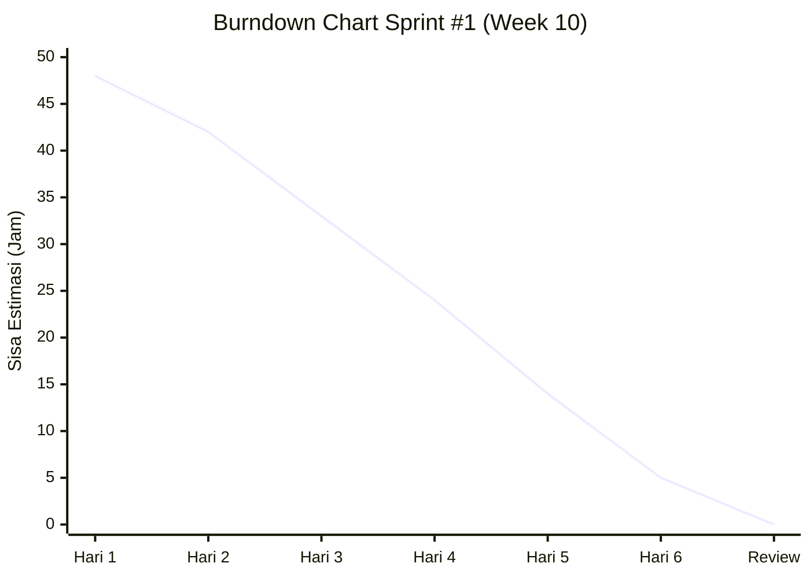
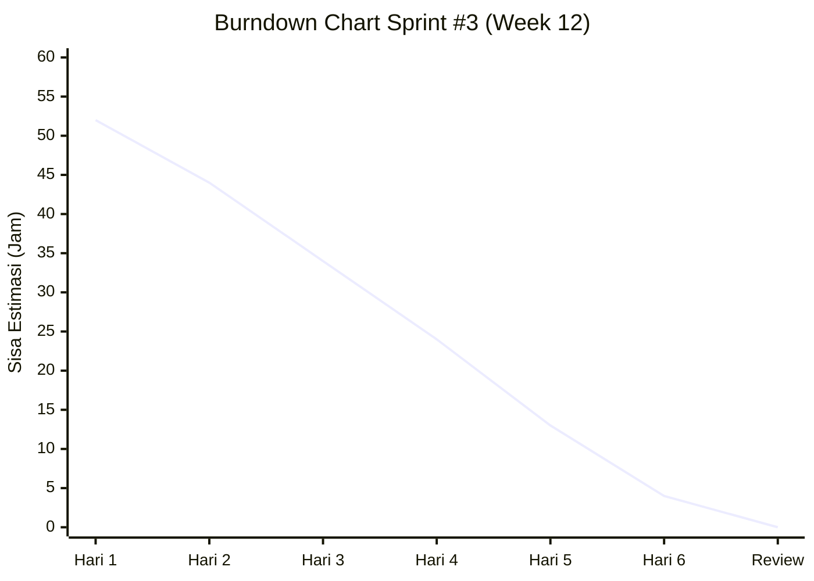

# Dokumen Pembangunan Perangkat Lunak — Scrum Document

**ManganYuk! — Aplikasi Eksplorasi Kuliner Berdasarkan Lokasi dan Preferensi Pengguna**  
*Studi Kasus: Kawasan Kuliner Sudirman Street Food, Bandung*  
**Versi:** 1.0 — Tanggal: 10 November 2026

**Dipersiapkan oleh Kelompok 06 / Copyright PPL**  
Program Studi Sistem dan Teknologi Informasi  
Sekolah Teknik Elektro dan Informatika (STEI)  
Institut Teknologi Bandung, Jl. Ganesha 10, Bandung 40132  

Mata Kuliah: **II4011 Transformasi Digital**  
Dosen Pengampu: **Prof. Ir. Kridanto Surendro, M.Sc., Ph.D.**

### Anggota Tim Pengembang

| No | NIM | Nama Lengkap | Role / Tanggung Jawab Utama |
|---|---|---|---|
| 1 | 18223013 | Raka Adhitya Nugraha | Project Manager & Scrum Master |
| 2 | 13523125 | Dita Maheswari | Back End, DB, Geofence & Location Tracking |
| 3 | 18223126 | Theresia Ivana M. S | Back End, DB, Logic Engine (Trail Planner & Rekomendasi) |
| 4 | 13523138 | Samantha Laqueenna Ginting | Front End & UI Implementation (React Native/Expo) |
| 5 | 18223122 | Anggita Najmi Layali | UI/UX Designer, Multimodal Content & Usability Tester |

| Nomor Dokumen | Revisi | Tanggal Efektif | Total Halaman |
|---|---|---|---|
| ITB-STEI-II4011-2026-SD-06 | 1.0 | 10-11-2026 | Dokumen Lengkap |

---

## 1. Pendahuluan

### 1.1 Tujuan Penulisan Dokumen
Tujuan penulisan dokumen Scrum ini adalah untuk mendokumentasikan secara rinci perencanaan, pelaksanaan, monitoring harian (*daily meeting*), hasil tinjauan (*sprint review*), serta evaluasi retrospektif (*sprint retrospective*) dalam pengembangan aplikasi mobile **ManganYuk!**. Dokumen ini menjadi pedoman operasional bagi tim pengembang, acuan *traceability* kebutuhan terhadap implementasi perangkat lunak, serta alat bukti transparansi progres bagi dosen pengampu dan pemangku kepentingan.

### 1.2 Pemilik Perangkat Lunak
Pemilik perangkat lunak ini mencakup:
1. **Dosen Pengampu Mata Kuliah II4011 Transformasi Digital:** Prof. Ir. Kridanto Surendro, M.Sc., Ph.D. selaku evaluator akademik dan penilai *compliance* transformasi digital.
2. **Pengelola & Tenant Kawasan Sudirman Street Food, Bandung:** Sebagai pemangku kepentingan eksternal yang diwakili oleh data profil kuliner dan kebutuhan promosi budaya lokal.
3. **Pengunjung Kawasan Kuliner (User Persona):** Wisatawan lokal dan luar kota yang memerlukan panduan eksplorasi kuliner yang efisien dan kaya konteks budaya.

### 1.3 Manfaat Perangkat Lunak
Perangkat lunak **ManganYuk!** memberikan manfaat:
* **Bagi Pengunjung:** Menghemat waktu pencarian tenant, memberikan rekomendasi kuliner yang presisi sesuai batas *budget* dan durasi waktu kunjungan, mengeliminasi kebingungan navigasi di lorong kuliner padat, serta menyajikan edukasi budaya kuliner Sunda melalui narasi audio *eyes-free*.
* **Bagi Tenant Kuliner:** Membantu pemerataan eksposur pengunjung ke berbagai zona (tidak hanya terkonsentrasi di pintu masuk) melalui rute otomatis *Smart Culinary Trail Planner*.
* **Transformasi Digital:** Mengubah eksplorasi fisik konvensional menjadi pengalaman terpandu secara *hybrid* berbasis geofencing GPS tanpa membebani privasi pengguna (arsitektur *offline-first* dan *zero server location leakage*).

### 1.4 Aturan Penomoran

| Kode Penomoran | Format | Keterangan |
|---|---|---|
| **PB** | `PB-XX` | ID Product Backlog dengan urutan XX (01 s.d. 18) sesuai tabel Product Backlog |
| **SB** | `SB-S.Y` | ID Sprint Backlog pada Sprint `S` (1 s.d. 5) dan nomor task urut `Y` |
| **F** | `FXX` | Kebutuhan Fungsional Produk (F01 s.d. F10) dari PRD |
| **P** | `PXX` | ID Point of Interest (P01 s.d. P10) tenant Sudirman Street Food |

### 1.5 Referensi
1. *Product Requirement Document (PRD) — ManganYuk! Versi 1.1*, STEI ITB, 2026.
2. *Pedoman Pelaksanaan Proyek Perangkat Lunak dan Transformasi Digital*, Program Studi Sistem dan Teknologi Informasi ITB.
3. *Scrum Guide 2020* (Ken Schwaber & Jeff Sutherland).
4. *Expo & React Native Documentation* (Location, TaskManager, Audio, Haptics, Notifications).

### 1.6 Deskripsi Umum Dokumen
* **Bab 1:** Memberikan pendahuluan proyek, profil tim, pemilik produk, dan aturan penomoran.
* **Bab 2:** Menjelaskan kebutuhan perangkat lunak, daftar Product Backlog terstruktur, dan peta rilis (*Release Planning*).
* **Bab 3–7:** Menyajikan pelaksanaan teknis Sprint 1 hingga Sprint 5 secara mendalam, mencakup *Sprint Planning*, 6 sesi *Daily Meeting*, grafik *Burndown Chart*, *Sprint Review*, dan *Sprint Retrospective*.
* **Bab 8:** Matriks kepatuhan produk akhir terhadap seluruh kriteria penerimaan PRD.
* **Bab 9:** Checklist penyerahan *deliverables* akhir proyek.

---

## 2. Kebutuhan Perangkat Lunak

### 2.1 Deskripsi Umum
**ManganYuk!** adalah aplikasi mobile berbasis lokasi (*location-based culinary explorer*) yang berjalan pada platform Android (dikembangkan dengan React Native + Expo TypeScript). Aplikasi beroperasi dengan paradigma *offline-first*, di mana seluruh data 10 POI, aset foto, transkrip budaya, dan audio narasi dibundel di dalam penyimpanan lokal perangkat, sehingga tidak memerlukan koneksi internet aktif saat berada di lapangan. 

Pelacakan lokasi memanfaatkan kombinasi `expo-location` dan `expo-task-manager` melalui Android Foreground Service untuk mendukung *Mode Jelajah* di background. Sistem dilengkapi modul kalkulasi geofence berbasis Haversine dengan mekanisme *hysteresis* dan *cooldown*, perencana rute *Smart Culinary Trail Planner* menggunakan algoritma *Nearest Neighbor*, sistem rekomendasi berbasis aturan deterministik, serta antarmuka audio *eyes-free* saat mendekati tenant.

### 2.2 Product Backlog

| ID | Product Backlog Item | User Story | Terkait Req. | Aktor | Prioritas |
|---|---|---|---|---|---|
| **PB-01** | Setup Arsitektur & Navigasi Aplikasi | Sebagai Developer, saya ingin menyiapkan repository React Native Expo dengan arsitektur modular agar pengembangan dapat berjalan terstruktur. | - | System / Dev | High (Must) |
| **PB-02** | Modul Onboarding, Privasi & Perizinan Lokasi | Sebagai Pengguna baru, saya ingin melihat penjelasan privasi lokasi dan memberikan izin GPS/notifikasi agar saya merasa aman menggunakan aplikasi. | F01, F09 | Pengguna | High (Must) |
| **PB-03** | Visualisasi Peta & Pelacakan Lokasi Real-time | Sebagai Pengguna, saya ingin melihat posisi saya di atas peta OSM beserta status di dalam/luar area agar tahu orientasi saya terhadap kawasan kuliner. | F01 | Pengguna | High (Must) |
| **PB-04** | Dataset Terstruktur 10 POI Tenant Kuliner | Sebagai Pengguna, saya ingin aplikasi memuat data lengkap 10 tenant kuliner (koordinat, foto, rasa, menu, harga) agar informasi tersedia instan. | F01, F03 | Pengguna | High (Must) |
| **PB-05** | Service Pelacakan Lokasi Background (Mode Jelajah) | Sebagai Pengguna, saya ingin pelacakan lokasi tetap aktif saat aplikasi di background/layar mati dengan notifikasi kontrol agar saya bisa berjalan bebas. | F02, F09 | Pengguna | High (Must) |
| **PB-06** | Engine Geofence Entry & Proximity POI | Sebagai Pengguna, saya ingin mendapat sambutan saat masuk area dan prompt kartu saat mendekati tenant (<15m) tanpa pemicu palsu. | F02 | Pengguna | High (Must) |
| **PB-07** | Engine Geofence Dwell Time & Exit Event | Sebagai Pengguna, saya ingin kunjungan saya tercatat otomatis jika berada ≥3 menit di tenant dan menerima rekomendasi saat keluar. | F02, F07 | Pengguna | High (Must) |
| **PB-08** | Kartu Detail POI Multimodal Offline | Sebagai Pengguna, saya ingin melihat menu, foto, harga, dan memutar audio narasi budaya Sunda beserta transkripnya secara offline. | F03 | Pengguna | High (Must) |
| **PB-09** | Interaksi Suara Eyes-Free & Kontrol Lock Screen | Sebagai Pengguna yang berjalan, saya ingin merespons narasi via getar dan tombol notifikasi (Dengar/Lewati) tanpa perlu membuka layar HP. | F04 | Pengguna | High (Must) |
| **PB-10** | Pencarian Fuzzy Toleran Typo & Multi-Filter | Sebagai Pengguna, saya ingin mencari kuliner meskipun salah ketik dan memfilternya berdasarkan budget, rasa, dan kategori makanan. | F05 | Pengguna | High (Must) |
| **PB-11** | Navigasi Kompas & Garis Arah Rute Interaktif | Sebagai Pengguna, saya ingin dipandu oleh panah kompas, jarak meter yang berkurang, dan panduan audio menuju tenant tujuan. | F06, F04 | Pengguna | High (Must) |
| **PB-12** | Integrasi Alur Inti Eksplorasi (Major Progress) | Sebagai Evaluator/User, saya ingin mencoba satu siklus lengkap jelajah dari deteksi lokasi hingga narasi selesai untuk demonstrasi W12. | F01–F06 | All | High (Must) |
| **PB-13** | Rekomendasi Kontekstual Berbasis Aturan | Sebagai Pengguna yang selesai makan, saya ingin disarankan 3 tenant berikutnya yang belum dikunjungi berdasarkan rasa kontras dan sisa budget. | F07 | Pengguna | High (Must) |
| **PB-14** | Smart Culinary Trail Planner (Nearest Neighbor) | Sebagai Pengguna dengan waktu terbatas, saya ingin memasukkan durasi & budget agar disusunkan rute kunjungan paling optimal tanpa bolak-balik. | F08 | Pengguna | High (Must) |
| **PB-15** | Monitoring Progres Trail & Dwell Alert | Sebagai Pengguna dalam trail, saya ingin diberi peringatan jika terlalu lama nongkrong di satu tenant agar target waktu saya tercapai. | F08, F02 | Pengguna | High (Must) |
| **PB-16** | Gamifikasi Paspor Kuliner Digital & Stempel QR | Sebagai Wisatawan, saya ingin mengumpulkan stempel digital dan badge tematik di paspor kuliner setelah berkunjung ke tenant. | F10 | Pengguna | Low (Could) |
| **PB-17** | Acceptance Criteria Testing & Verifikasi Lapangan | Sebagai QA/Scrum Master, saya ingin menguji akurasi GPS di Sudirman Street Food, usability eyes-free, dan audit zero network data leakage. | F01–F10 | Tim Dev / PO | High (Must) |
| **PB-18** | Defect Fixing, Hardening & Final APK Packaging | Sebagai Pengguna akhir, saya ingin aplikasi berjalan stabil, responsif, tanpa crash, dan siap diinstal dalam format APK mandiri. | - | All | High (Must) |

### 2.3 Release Planning

| Sprint | Periode / Waktu | Tema / Sasaran Utama (Goals) | Item Product Backlog | Total Estimasi (Jam Tim) |
|---|---|---|---|---|
| **Sprint 1** | Week 10 (7 hari) | **Fondasi Aplikasi & Kesadaran Lokasi (Location Awareness):** Setup project Expo, UI onboarding privasi, inisialisasi peta OpenStreetMap, pembacaan GPS akurasi tinggi, serta kompilasi dataset lokal 10 POI Sudirman Street Food. | PB-01, PB-02, PB-03, PB-04 | 48 |
| **Sprint 2** | Week 11 (7 hari) | **Location Logic & Multimodal Content:** Implementasi foreground service pelacakan background, kalkulasi geofence Haversine (entry/proximity/dwell/exit), filter jitter akurasi >30m, integrasi audio player lokal, dan kartu detail POI. | PB-05, PB-06, PB-07, PB-08 | 54 |
| **Sprint 3** | Week 12 (7 hari) | **Eyes-Free Experience, Navigasi & Major Progress Review:** Fitur interaksi audio lock screen, fuzzy search Fuse.js, kompas navigasi arah, integrasi end-to-end skenario jelajah, serta pengujian persiapan demo Major Progress Review. | PB-09, PB-10, PB-11, PB-12 | 52 |
| **Sprint 4** | Week 13 (7 hari) | **Fitur Cerdas (Trail Planner, Rekomendasi) & Feature Freeze:** Implementasi algoritma Nearest Neighbor, scoring rekomendasi kontekstual, alert dwell time, Paspor Kuliner (stempel QR/dwell), dan penguncian fitur (*feature freeze*). | PB-13, PB-14, PB-15, PB-16 | 50 |
| **Sprint 5** | Week 14 (7 hari) | **Field Testing, Hardening & Final Delivery:** Uji lapangan di Sudirman Street Food (akurasi trigger & usability eyes-free), audit privasi log jaringan, perbaikan defect, dan build APK rilis final. | PB-17, PB-18 | 44 |

---

## 3. Pelaksanaan Sprint 1 (Week 10)

### 3.1 Sprint Planning
* **Periode:** 23 Februari 2026 – 01 Maret 2026 (Week 10)
* **Sprint Goal:** Membangun fondasi arsitektur aplikasi mobile, menyelesaikan modul edukasi privasi dan onboarding, menampilkan posisi GPS pengguna di atas peta OSM secara real-time, serta membundel dataset 10 POI Sudirman Street Food.

**Tabel Sprint Backlog 1**

| ID Task | Rincian Task Implementasi | Estimasi (Jam) | Terkait PB | PIC |
|---|---|---|---|---|
| SB-1.1 | Inisialisasi project React Native Expo (TypeScript), struktur folder modular, konfigurasi ESLint, Prettier, dan navigasi stack/tab. | 8 | PB-01 | Samantha |
| SB-1.2 | Perancangan UI Onboarding, dialog transparansi privasi lokasi (F09), dan penanganan penolakan izin lokasi. | 8 | PB-02 | Anggita |
| SB-1.3 | Implementasi *flow* request permission lokasi foreground dan notifikasi dengan fallback mode tanpa lokasi. | 6 | PB-02 | Samantha |
| SB-1.4 | Integrasi `react-native-maps` dengan tile OpenStreetMap (OSM) dan polygon batas kawasan Sudirman Street Food. | 10 | PB-03 | Samantha |
| SB-1.5 | Implementasi modul pembacaan GPS akurasi tinggi (`watchPositionAsync`), titik biru pengguna, dan kalkulasi status di dalam/luar area. | 8 | PB-03 | Dita |
| SB-1.6 | Survei awal, kurasi, dan penyusunan JSON dataset 10 POI tenant kuliner (nama, koordinat, menu, estimasi harga, kategori, rasa). | 8 | PB-04 | Theresia, Anggita |

### 3.2 Daily Meeting

#### 3.2.1 Daily Meeting ke-1 (Senin, W10)
* **Dita:** Mempelajari dokumentasi `expo-location` untuk akurasi tinggi -> Menyiapkan helper perhitungan jarak dasar.
* **Theresia:** Menganalisis skema data POI dari PRD -> Menyiapkan struktur JSON untuk 10 tenant kuliner.
* **Samantha:** Melakukan setup repository Expo TypeScript -> Mengonfigurasi React Navigation (Stack & Bottom Tabs).
* **Anggita:** Membuat wireframe halaman Onboarding dan dialog izin privasi -> Menyiapkan aset visual onboarding di Figma.
* **Raka:** Membuka Sprint 1, menyusun board task di GitHub Projects -> Mengoordinasikan pembagian tugas antar-anggota.
* **Hambatan:** Koordinat awal pada PRD masih berupa placeholder linear; perlu verifikasi titik riil pintu masuk Sudirman Street Food.

#### 3.2.2 Daily Meeting ke-2 (Selasa, W10)
* **Dita:** Membuat modul helper koordinat dan validasi status kawasan -> Mengintegrasikan pembacaan lokasi dengan state global.
* **Theresia:** Melakukan verifikasi koordinat riil P01–P10 di Sudirman Street Food via OpenStreetMap/Google Maps -> Melengkapi data harga & menu di JSON.
* **Samantha:** Menyelesaikan routing navigasi dasar -> Mengimplementasikan halaman Beranda kosong dan mengintegrasikan react-native-maps.
* **Anggita:** Menyelesaikan aset visual ilustrasi onboarding -> Mengonversi copywriting privasi lokasi ke format bahasa Indonesia santun.
* **Raka:** Meninjau kesesuaian Acceptance Criteria PB-01 dan PB-02 -> Memverifikasi format data JSON POI.
* **Hambatan:** Dependensi `react-native-maps` memerlukan penyesuaian khusus untuk custom tile OpenStreetMap agar tidak bergantung pada Google Play Services berbayar.

#### 3.2.3 Daily Meeting ke-3 (Rabu, W10)
* **Dita:** Menguji pembacaan lokasi `watchPositionAsync` pada emulator menggunakan mock location -> Mengatur interval pembaruan 3 detik / 5 meter.
* **Theresia:** Menyelesaikan file `tenants_dataset.json` (10 POI lengkap) -> Menulis unit test schema validation untuk dataset.
* **Samantha:** Berhasil menampilkan tile OSM di emulator -> Menambahkan marker statis 10 POI dari file JSON.
* **Anggita:** Mulai merancang desain visual kartu ringkasan POI di atas peta -> Menyiapkan palet warna indikator status kawasan.
* **Raka:** Mengawasi alokasi waktu; memastikan tim menguji di perangkat fisik Android -> Menyiapkan perangkat uji fisik Samsung A52.
* **Hambatan:** Emulator mengalami lag saat rendering tile OSM secara berulang; disepakati pengujian rendering peta dialihkan ke perangkat fisik.

#### 3.2.4 Daily Meeting ke-4 (Kamis, W10)
* **Dita:** Mengimplementasikan logika pendeteksian batas kawasan (polygon Sudirman Street Food) -> Menghubungkan output status ke UI Beranda.
* **Theresia:** Menambahkan kategori rasa (manis/pedas/gurih) dan jenis (makanan/minuman/jajanan) pada dataset -> Membantu Samantha parsing data POI.
* **Samantha:** Mengintegrasikan layar Onboarding hasil rancangan Anggita -> Menambahkan modal edukasi privasi lokasi sebelum dialog sistem muncul.
* **Anggita:** Melakukan review antarmuka Onboarding di perangkat fisik -> Merapikan kontras teks dan tombol "Izinkan Lokasi" vs "Lanjut tanpa Lokasi".
* **Raka:** Memeriksa penanganan fallback jika izin GPS ditolak -> Memastikan aplikasi tidak force-close ketika user menolak GPS.
* **Hambatan:** Tidak ada hambatan teknis yang berarti.

#### 3.2.5 Daily Meeting ke-5 (Jumat, W10)
* **Dita:** Mengintegrasikan titik biru pengguna (*current location marker*) dan lingkaran akurasi (`accuracy radius`) di atas peta -> Menangani latensi GPS awal.
* **Theresia:** Menguji fungsi pemfilteran data lokal tenant -> Menyiapkan struktur penyimpanan preferensi awal di AsyncStorage.
* **Samantha:** Menghubungkan tombol "Buka di Google Maps" menggunakan Android Intent (`Linking.openURL`) jika user berada di luar area -> Pengujian navigasi eksternal.
* **Anggita:** Menyiapkan ikon custom marker tenant kuliner berdasarkan kategori rasa -> Menyerahkan aset PNG ke tim Front End.
* **Raka:** Melakukan pengujian integrasi Sprint 1 pada perangkat fisik -> Mendata defect minor tampilan.
* **Hambatan:** Tombol Google Maps sempat gagal memicu rute koordinat; diperbaiki dengan menyusun format uri intent `geo:lat,lng?q=Sudirman+Street+Food`.

#### 3.2.6 Daily Meeting ke-6 (Sabtu, W10)
* **Dita:** Merapikan kode pembacaan GPS dan membersihkan event listener saat komponen unmount -> Code review modul location.
* **Theresia:** Finalisasi dataset 10 tenant; memastikan koordinat presisi -> Menulis dokumentasi skema data JSON.
* **Samantha:** Mengganti ikon marker default dengan custom marker dari Anggita -> Memperbaiki layout header Beranda.
* **Anggita:** Finalisasi aset grafis dan transkrip cerita untuk Sprint 2 -> Mempersiapkan audio narasi draft.
* **Raka:** Melakukan verifikasi Acceptance Criteria Sprint 1 dan mempersiapkan agenda Sprint Review -> Memperbarui papan Scrum.
* **Hambatan:** Tidak ada hambatan tercatat.

#### Burndown Chart Sprint 1

### 3.3 Sprint Review
* **Pencapaian:** Seluruh Sprint Backlog (SB-1.1 s.d. SB-1.6) berhasil diselesaikan 100%.
* **Demo Aplikasi:** 
  1. Aplikasi berhasil dibuka pada perangkat fisik tanpa crash.
  2. Layar onboarding menampilkan penjelasan privasi (F09) secara transparan sebelum dialog izin sistem muncul.
  3. Peta OpenStreetMap memuat posisi pengguna (titik biru) dalam waktu <5 detik setelah GPS aktif.
  4. Status "Di luar area Sudirman Street Food" tampil secara akurat saat diuji dari luar kawasan, lengkap dengan tombol direct ke Google Maps.
  5. 10 marker tenant kuliner berhasil di-render di peta sesuai koordinat lokal masing-masing.
* **Feedback Evaluator:** Transisi saat user menolak izin lokasi sudah mulus; namun tombol "Mulai Trail" perlu di-*disable* jika lokasi tidak aktif.

### 3.4 Sprint Retrospective
* **Perlu Dilanjutkan:** 
  * Pembagian tugas modular antara data logic, UI, dan hardware service berjalan sangat efektif.
  * Kebiasaan langsung menguji build di perangkat fisik Android mencegah *device-specific bugs*.
* **Perlu Dimulai:** 
  * Membuat branch Git khusus untuk setiap Product Backlog item agar review Pull Request lebih rapi.
  * Mengumpulkan rekaman audio asli tenant lebih awal agar tidak terburu-buru di Sprint 2.
* **Perlu Dihentikan:** 
  * Menunda penyesuaian dependensi native di awal sprint.

---

## 4. Pelaksanaan Sprint 2 (Week 11)

### 4.1 Sprint Planning
* **Periode:** 02 Maret 2026 – 08 Maret 2026 (Week 11)
* **Sprint Goal:** Mengimplementasikan pelacakan lokasi latar belakang (*Mode Jelajah* via Foreground Service), mesin logika pemicu geofence (Entry, Proximity, Dwell, Exit) dengan pencegahan trigger palsu, serta kartu POI multimodal offline dengan pemutar audio narasi.

**Tabel Sprint Backlog 2**

| ID Task | Rincian Task Implementasi | Estimasi (Jam) | Terkait PB | PIC |
|---|---|---|---|---|
| SB-2.1 | Implementasi pelacakan lokasi background menggunakan `expo-task-manager` dan Android Foreground Service notifikasi persisten ("Mode Jelajah"). | 12 | PB-05 | Dita |
| SB-2.2 | Pembuatan kalkulator jarak Haversine, modul filter GPS jitter (abaikan akurasi >30 m), dan logika cooldown per POI (30 menit). | 10 | PB-06 | Dita |
| SB-2.3 | Implementasi Entry event kawasan (radius 100 m) dan Proximity event tenant (<15 m) yang memicu pop-up kartu POI. | 8 | PB-06 | Samantha, Dita |
| SB-2.4 | Implementasi Dwell event (deteksi diam di tenant ≥3 menit) dan Exit event (deteksi keluar radius + hysteresis 10 m). | 8 | PB-07 | Theresia |
| SB-2.5 | Pembuatan komponen UI Kartu POI Multimodal (3 foto, menu & harga, jam operasional, transkrip narasi budaya Sunda). | 8 | PB-08 | Samantha, Anggita |
| SB-2.6 | Integrasi pemutar audio lokal (`expo-audio`) dengan kontrol play, pause, seek, dan handling pemutaran audio di background. | 8 | PB-08 | Theresia |

### 4.2 Daily Meeting

#### 4.2.1 Daily Meeting ke-1 (Senin, W11)
* **Dita:** Mengonfigurasi `TaskManager.defineTask` untuk `LOCATION_TRACKING` background -> Menyiapkan payload foreground service.
* **Theresia:** Merancang rumus Haversine dan state management untuk mencatat status kunjungan per tenant -> Menulis unit test kalkulasi meter.
* **Samantha:** Merancang struktur komponen modal/bottom sheet Kartu POI -> Mengintegrasikan swipe-up gesture pada kartu.
* **Anggita:** Mengumpulkan aset 3 foto per tenant (30 foto) dan mengompres ukuran file agar APK tetap ringan -> Menyusun transkrip cerita budaya Sunda.
* **Raka:** Mengingatkan perubahan Change Log v1.1 PRD: trigger radius tenant disepakati menjadi 15 m (adaptasi GPS lorong pasar kuliner).
* **Hambatan:** Android 14 mematikan foreground service jika spesifikasi `foregroundServiceType` di `app.json` tidak dideklarasikan sebagai `location`.

#### 4.2.2 Daily Meeting ke-2 (Selasa, W11)
* **Dita:** Memperbaiki konfigurasi `AndroidManifest.xml` via Expo Config Plugin untuk `FOREGROUND_SERVICE_LOCATION` -> Berhasil menampilkan notifikasi sticky.
* **Theresia:** Mengimplementasikan struktur data riwayat dwell time: mencatat `enterTimestamp` saat masuk radius tenant -> Menulis logika durasi minimal 3 menit.
* **Samantha:** Mengintegrasikan komponen kartu POI dengan data dinamis dari file JSON -> Menghubungkan trigger pop-up saat event terdeteksi.
* **Anggita:** Merekam dan memproduksi file audio narasi 45–75 detik untuk 10 tenant kuliner -> Menormalisasi volume suara (dB).
* **Raka:** Mengawasi integrasi modul background task -> Menyiapkan skenario uji simulasi pergerakan rute di emulator.
* **Hambatan:** Pemutar audio bawaan Expo sempat bentrok dengan foreground service; audio terhenti saat layar ponsel dikunci.

#### 4.2.3 Daily Meeting ke-3 (Rabu, W11)
* **Dita:** Menambahkan filter akurasi: jika `location.coords.accuracy > 30` maka data GPS langsung di-discard -> Mengurangi lonjakan posisi palsu.
* **Theresia:** Menambahkan mekanisme *cooldown* 30 menit per POI dalam memori agar user yang sama tidak terus-menerus memicu pop-up yang sama.
* **Samantha:** Menghubungkan tombol "Dengar Cerita" di kartu POI dengan audio player -> Mengintegrasikan transkrip teks sinkron.
* **Anggita:** Menyelesaikan 10 file audio format MP3 mono 64kbps (total ukuran hanya ~8MB untuk 10 tenant) -> Menyimpan ke folder aset lokal.
* **Raka:** Melakukan code review pada modul Geofence Engine -> Memastikan tidak ada memory leak pada pemanggilan timer dwell time.
* **Hambatan:** Sinyal GPS di emulator sempat 'jumping' saat rute dibelokkan; filter jitter terbukti berhasil meredam lompatan tersebut.

#### 4.2.4 Daily Meeting ke-4 (Kamis, W11)
* **Dita:** Mengimplementasikan event Entry kawasan (radius 100 m dari titik tengah Sudirman Street Food) -> Memunculkan local notification selamat datang.
* **Theresia:** Mengimplementasikan logika Exit event dengan *hysteresis* (pengguna dianggap keluar jika jarak > radius + 10 m = >25 m) untuk menghindari flapping.
* **Samantha:** Memperbaiki layout kartu POI agar responsif di berbagai resolusi layar HP -> Menampilkan daftar menu dan harga dalam format mata uang IDR.
* **Anggita:** Menambahkan tab cerita budaya pada kartu POI: menjelaskan filosofi istilah Sunda (misal: asal-usul pukis dan bumbu ketumbar sate).
* **Raka:** Menguji pemutaran audio saat aplikasi berada di latar belakang -> Memverifikasi kontrol audio di lock screen.
* **Hambatan:** Tidak ada kendala kritis.

#### 4.2.5 Daily Meeting ke-5 (Jumat, W11)
* **Dita:** Menghubungkan toggle "Mode Jelajah" di Beranda: jika diaktifkan, tracking background berjalan; jika dimatikan, service dihentikan total.
* **Theresia:** Memverifikasi dwell event: jika user diam ≥3 menit di radius tenant, status POI otomatis ditandai `visited = true` di AsyncStorage.
* **Samantha:** Menghubungkan indikator visual pada marker peta: marker tenant yang sudah dikunjungi berubah warna dari merah menjadi hijau.
* **Anggita:** Menambahkan efek getar (`Haptics.impactAsync`) saat pengguna memasuki radius proximity tenant kuliner.
* **Raka:** Menjalankan uji integrasi geofencing di area sekitar kampus ITB sebagai simulasi awal -> Hasil trigger responsif.
* **Hambatan:** Perangkat pengujian Xiaomi menerapkan penghemat baterai agresif yang mematikan service; tim menambahkan panduan setting baterai "No Restrictions" di onboarding.

#### 4.2.6 Daily Meeting ke-6 (Sabtu, W11)
* **Dita:** Merapikan kode listener dan optimasi konsumsi baterai saat pelacakan background -> Finalisasi modul background task.
* **Theresia:** Menulis unit test untuk logika hysteresis dan dwell timer (Jest) -> Semua test pass.
* **Samantha:** Merapikan transisi animasi kartu POI saat muncul dari bawah layar -> Bugfix styling teks transkrip.
* **Anggita:** Final review kelengkapan data 10 POI (foto, teks, audio, harga) -> Memastikan konten 100% lengkap.
* **Raka:** Evaluasi Sprint 2 dan penyusunan burndown chart -> Menyiapkan materi demo sprint review.
* **Hambatan:** Tidak ada hambatan tercatat.

#### Burndown Chart Sprint 2

### 4.3 Sprint Review
* **Pencapaian:** PB-05, PB-06, PB-07, dan PB-08 selesai diimplementasikan sesuai Acceptance Criteria.
* **Demo Aplikasi:**
  1. Pengaktifan "Mode Jelajah" sukses memunculkan notifikasi persisten di status bar Android.
  2. Saat simulasi pergerakan memasuki radius 100 m, muncul notifikasi push selamat datang di Sudirman Street Food.
  3. Memasuki radius 15 m dari P01 (Raja Pukis Modern) memicu getar HP dan memunculkan Kartu POI secara otomatis dalam waktu <2 detik.
  4. Audio narasi budaya Sunda dapat diputar secara offline dengan kualitas jernih dan teks transkrip dapat di-scroll.
  5. Pengguna yang berdiam ≥3 menit tercatat otomatis status kunjungannya dan marker berubah warna.
* **Feedback Evaluator:** Sangat baik, konten narasi terdengar profesional. Disarankan agar pengguna bisa memilih untuk langsung mendengarkan narasi tanpa membuka layar HP (*Eyes-Free Interaction*).

### 4.4 Sprint Retrospective
* **Perlu Dilanjutkan:** 
  * Integrasi data lokal tanpa backend eksternal membuat performa aplikasi sangat cepat (<1 detik).
  * Unit testing untuk logika geofence terbukti mencegah bug status yang ambigu.
* **Perlu Dimulai:** 
  * Mulai mempersiapkan implementasi interaksi notifikasi interaktif (tombol aksi di lock screen) untuk mendukung skenario *Eyes-Free*.
* **Perlu Dihentikan:** 
  * Terlalu banyak menggunakan log `console.log` di dalam loop tracking yang dapat menurunkan frame rate aplikasi.

---

## 5. Pelaksanaan Sprint 3 (Week 12)

### 5.1 Sprint Planning
* **Periode:** 09 Maret 2026 – 15 Maret 2026 (Week 12)
* **Sprint Goal:** Mengimplementasikan interaksi *eyes-free* (kontrol aksi audio di notifikasi lock screen), pencarian toleran salah ketik (typo-tolerant search via Fuse.js), navigasi rute berbasis kompas, serta integrasi skenario end-to-end untuk persiapan **Major Progress Review**.

**Tabel Sprint Backlog 3**

| ID Task | Rincian Task Implementasi | Estimasi (Jam) | Terkait PB | PIC |
|---|---|---|---|---|
| SB-3.1 | Implementasi Notifikasi Interaktif `expo-notifications` dengan action buttons ("Dengar" / "Lewati") yang dapat diakses dari Lock Screen. | 10 | PB-09 | Dita |
| SB-3.2 | Implementasi "Mode Jalan" (pemutaran audio otomatis saat trigger tanpa interaksi manual) dan Text-to-Speech / Audio Queueing. | 8 | PB-09 | Theresia |
| SB-3.3 | Integrasi mesin pencari lokal toleran typo (Fuse.js) berdasarkan nama tenant, nama menu, dan kategori kuliner. | 8 | PB-10 | Theresia |
| SB-3.4 | Pembuatan UI Filter multi-kategori (rentang harga, profil rasa, status buka) dan pengurutan hasil berdasarkan jarak terdekat. | 8 | PB-10 | Samantha |
| SB-3.5 | Integrasi sensor kompas (`watchHeadingAsync`), garis polyline rute menuju tenant tujuan, dan indikator kedatangan (≤10 m). | 10 | PB-11 | Samantha, Dita |
| SB-3.6 | Integrasi alur inti eksplorasi (Lokasi -> Geofence -> Audio -> Navigasi) dan pembuatan skenario demo Major Progress Review. | 8 | PB-12 | Raka, All |

### 5.2 Daily Meeting

#### 5.2.1 Daily Meeting ke-1 (Senin, W12)
* **Dita:** Mengonfigurasi Notification Categories pada Expo Notifications untuk tombol lock screen -> Menyiapkan listener aksi tombol.
* **Theresia:** Menginstal dan mengonfigurasi pustaka `fuse.js` -> Menyusun indeks pencarian pada dataset 10 POI.
* **Samantha:** Merancang bar pencarian dan pop-up filter pada layar peta -> Mengintegrasikan input search dengan state.
* **Anggita:** Menyiapkan panduan suara singkat navigasi ("Tenant tujuan 20 meter di depan", "Kamu sudah sampai!") -> Ekspor audio cue.
* **Raka:** Mengatur target persiapan Major Progress Review Week 12 -> Meninjau skenario normal 25 langkah pada PRD.
* **Hambatan:** Respon tombol pada push notification lock screen memerlukan penanganan background handler agar tidak membuka app secara paksa.

#### 5.2.2 Daily Meeting ke-2 (Selasa, W12)
* **Dita:** Menghubungkan action button "Dengar" pada notifikasi: langsung memutar narasi di background service tanpa membuka aplikasi -> Berhasil di Android 13/14.
* **Theresia:** Menguji pencarian typo: kata kunci "batagr" sukses menghasilkan tenant "Baso Goreng Pandu / Batagor" dengan threshold fuzziness 0.4 -> Akurasi pencarian tinggi.
* **Samantha:** Mengimplementasikan navigasi rute: menggambar garis putus-putus (`Polyline`) dari koordinat pengguna ke tenant target di peta -> Menguji rendering garis.
* **Anggita:** Merancang ikon panah kompas navigasi dan kartu indikator jarak (meter) yang mengambang di atas peta -> Menyerahkan aset UI.
* **Raka:** Menguji fitur pencarian typo bersama evaluator internal -> Menyesuaikan bobot pencarian (nama tenant weight 0.6, menu 0.4).
* **Hambatan:** Penentuan threshold Fuse.js sempat terlalu longgar (0.6) sehingga kata "soto" memunculkan "roti"; diturunkan ke 0.35.

#### 5.2.3 Daily Meeting ke-3 (Rabu, W12)
* **Dita:** Mengintegrasikan pembacaan sensor orientasi kompas (`expo-location.watchHeadingAsync`) -> Menghitung sudut bearing dari posisi user ke target.
* **Theresia:** Mengimplementasikan filter multi-parameter: kombinasi filter harga (<15rb) dan rasa (gurih) menghasilkan daftar yang sesuai secara deterministik -> Unit test filter pass.
* **Samantha:** Mengintegrasikan putaran panah kompas dengan heading perangkat: panah selalu menunjuk arah tenant tujuan dengan deviasi rendah -> Smoothing rotasi.
* **Anggita:** Menata antarmuka hasil pencarian dalam bentuk list horizontal di bawah peta -> Merapikan kartu ringkas tenant.
* **Raka:** Memeriksa kesiapan integrasi skenario eksplorasi end-to-end -> Mengidentifikasi potensi blocker pada transisi navigasi.
* **Hambatan:** Sensor kompas di beberapa perangkat memerlukan kalibrasi (gerakan angka delapan) agar nilai heading tidak melompat.

#### 5.2.4 Daily Meeting ke-4 (Kamis, W12)
* **Dita:** Mengimplementasikan deteksi kedatangan tenant: saat jarak ≤10 m, navigasi otomatis berhenti, memainkan audio cue "Kamu sudah sampai!", dan kartu POI terbuka.
* **Theresia:** Mengimplementasikan Mode Jalan (*Walk Mode*): toggle di UI yang otomatis langsung memainkan audio narasi saat proximity event tanpa menanyakan "Mau dengar ceritanya?".
* **Samantha:** Menghubungkan tombol "Jadikan Tujuan" pada kartu detail tenant ke mode navigasi peta -> Alur pemilihan destinasi berjalan mulus.
* **Anggita:** Menyusun materi presentasi dan lembar demo untuk Major Progress Review Week 12 -> Menyiapkan naskah pengujian.
* **Raka:** Memimpin gladi bersih demo Major Progress Review: menjalankan alur mulai dari Beranda -> Mode Jelajah -> Notifikasi Proximity -> Audio -> Navigasi -> Tiba di tujuan.
* **Hambatan:** Tidak ada hambatan teknis.

#### 5.2.5 Daily Meeting ke-5 (Jumat, W12)
* **Dita:** Memperbaiki bug listener notifikasi yang sempat terduplikasi saat app dibuka kembali dari background -> Menambahkan cleanup handler.
* **Theresia:** Menambahkan panduan audio navigasi berkala: sistem memutar instruksi audio setiap terjadi pengurangan jarak 20 meter menuju tujuan.
* **Samantha:** Merapikan status bar dan banner "Sinyal GPS lemah" jika akurasi lokasi >30 m -> Banner otomatis hilang saat GPS stabil.
* **Anggita:** Melakukan uji coba eyes-free mandiri dengan mata tertutup: memverifikasi apakah prompt suara dan getaran cukup intuitif untuk dinavigasikan.
* **Raka:** Memfinalisasi laporan Major Progress Review -> Menyiapkan video rekaman cadangan jika koneksi saat review offline terkendala.
* **Hambatan:** Tidak ada kendala berarti.

#### 5.2.6 Daily Meeting ke-6 (Sabtu, W12)
* **Dita:** Code freeze modul navigasi dan eyes-free untuk Sprint 3 -> Memastikan branch rilis stabil.
* **Theresia:** Menjalankan seluruh test suite Jest (Geofence, Fuzzy Search, Bearing Compass) -> 100% test pass.
* **Samantha:** Build APK development untuk sesi evaluasi hari Senin -> Pemasangan pada perangkat demo.
* **Anggita:** Finalisasi slide presentasi Major Progress Review dan penyiapan lembar evaluasi dosen -> Persiapan berkas.
* **Raka:** Verifikasi pemenuhan target milestone Week 12 bersama seluruh anggota tim -> Papan Scrum siap ditinjau.
* **Hambatan:** Tidak ada hambatan tercatat.

#### Burndown Chart Sprint 3

### 5.3 Sprint Review & Major Progress Review (Week 12)

**Hasil Evaluasi Major Progress Review:**

| Item Evaluasi | Realisasi & Bukti Implementasi | Status |
|---|---|---|
| **Sprint Goal** | Core location-based exploration dapat didemonstrasikan secara end-to-end di perangkat fisik Android. | **Achieved** |
| **Planned Backlog** | PB-09 (Eyes-free), PB-10 (Typo Search), PB-11 (Navigation Compass), PB-12 (Core Integration). | **Completed** |
| **Delivered Evidence** | 1. Demo live pembacaan lokasi, entry kawasan, dan proximity trigger ke POI P01. 2. Pemutaran audio langsung dari lock screen Android tanpa membuka layar HP. 3. Fitur typo-tolerant search ("batagr" -> Baso Goreng Pandu) muncul dalam 0.2 detik. 4. Navigasi rute garis dan panah kompas memandu hingga jarak ≤10 m dengan ucapan "Kamu sudah sampai!". | **Pass** |
| **Blocker & Recovery** | Sempat terjadi drift kompas pada salah satu tipe HP; tim menambahkan fallback panduan jarak teks jika sensor kompas tidak terkalibrasi. | **Resolved** |

### 5.4 Sprint Retrospective
* **Perlu Dilanjutkan:** 
  * Integrasi audio lock screen terbukti menjadi nilai tambah utama (*wow factor*) saat demonstrasi produk.
  * Pencarian offline dengan Fuse.js sangat cepat dan tidak menguras daya komputasi ponsel.
* **Perlu Dimulai:** 
  * Fokus ke implementasi algoritma kecerdasan lokal (*Smart Culinary Trail Planner* dan rekomendasi berbasis aturan) pada Sprint 4.
  * Mengunci penambahan fitur baru di akhir Sprint 4 (*Feature Freeze*).
* **Perlu Dihentikan:** 
  * Melakukan perubahan konfigurasi manifest secara manual tanpa melalui `app.json` Expo Config Plugin.

---

## 6. Pelaksanaan Sprint 4 (Week 13)

### 6.1 Sprint Planning
* **Periode:** 16 Maret 2026 – 22 Maret 2026 (Week 13)
* **Sprint Goal:** Menyelesaikan fitur unggulan cerdas *Smart Culinary Trail Planner* berbasis algoritma Nearest Neighbor, mesin rekomendasi kontekstual berbasis aturan, sistem gamifikasi Paspor Kuliner, dan mengunci seluruh fungsionalitas (*Feature Freeze*).

**Tabel Sprint Backlog 4**

| ID Task | Rincian Task Implementasi | Estimasi (Jam) | Terkait PB | PIC |
|---|---|---|---|---|
| SB-4.1 | Implementasi form Trail Planner (input durasi: 30/60/90 menit, budget: IDR, preferensi rasa) dan validasi kelayakan input. | 8 | PB-14 | Samantha |
| SB-4.2 | Implementasi algoritma optimasi rute *Nearest Neighbor* berbasis kombinasi budget, waktu makan rata-rata, dan jarak antar-tenant. | 12 | PB-14 | Theresia |
| SB-4.3 | Implementasi pelacakan progres trail (auto check-off via dwell event) dan pengingat dwelling time ("Sisa waktumu X menit"). | 8 | PB-15 | Dita, Theresia |
| SB-4.4 | Implementasi fitur "Lewati Tenant" / susun ulang itinerary jika tenant tutup atau dilewati pengguna. | 6 | PB-15 | Samantha, Theresia |
| SB-4.5 | Implementasi mesin rekomendasi kontekstual berbasis aturan (Exit Event trigger: faktor jarak, sisa budget, rasa pelengkap). | 8 | PB-13 | Theresia |
| SB-4.6 | Implementasi gamifikasi Paspor Kuliner: stempel digital otomatis pasca dwell / scan QR, trail tematik, dan penyimpanan badge lokal. | 8 | PB-16 | Samantha, Anggita |

### 6.2 Daily Meeting

#### 6.2.1 Daily Meeting ke-1 (Senin, W13)
* **Dita:** Mempersiapkan hook dwell event agar memicu callback khusus untuk modul Trail Planner -> Menghubungkan timer kunjungan.
* **Theresia:** Merancang algoritma *Nearest Neighbor*: memilih tenant awal berdasarkan preferensi rasa -> mencari tenant berikutnya yang memiliki jarak euclidean/haversine terpendek tanpa melampaui sisa budget.
* **Samantha:** Membuat antarmuka modal Form "Rencanakan Trail" dengan slider durasi dan input nominal budget -> Mengintegrasikan UI state.
* **Anggita:** Merancang UI buku "Paspor Kuliner": kartu stempel digital, badge kelulusan trail tematik, dan efek suara stempel -> Menyerahkan desain.
* **Raka:** Menegaskan aturan Feature Freeze di akhir Week 13: tidak ada penambahan fitur baru setelah Sprint 4 selesai.
* **Hambatan:** Algoritma greedy nearest neighbor murni terkadang memilih tenant mahal di awal sehingga budget langsung habis; perlu pembobotan proporsional budget per langkah.

#### 6.2.2 Daily Meeting ke-2 (Selasa, W13)
* **Dita:** Mengintegrasikan notifikasi peringatan dwell: jika pengguna berada di satu tenant melebihi alokasi waktu + 5 menit, muncul notifikasi pengingat sisa waktu.
* **Theresia:** Memperbaiki algoritma Trail Planner dengan pendekatan heuristik: membagi budget menjadi 2-3 porsi (makanan utama, jajanan, minuman) lalu mengurutkan rute berdasarkan kedekatan fisik.
* **Samantha:** Menampilkan hasil itinerary trail dalam bentuk kartu langkah berurutan (Step 1, Step 2, Step 3) di atas rute peta -> Menambahkan estimasi total biaya dan durasi.
* **Anggita:** Menyiapkan aset grafis badge digital ("Jejak Jajanan Sunda", "Manis-manis Bandung") -> Ekspor SVG/PNG.
* **Raka:** Menguji variasi input trail: (60 menit, Rp50.000, Gurih) -> Memverifikasi apakah itinerary yang dihasilkan selalu ≤ budget dan waktu.
* **Hambatan:** Tidak ada hambatan teknis yang signifikan.

#### 6.2.3 Daily Meeting ke-3 (Rabu, W13)
* **Dita:** Menghubungkan event dwell completion: ketika kunjungan tenant pertama di trail selesai, step 1 otomatis tercentang hijau dan navigasi beralih ke tenant kedua.
* **Theresia:** Mengimplementasikan mesin *Contextual Recommendation* (F07): saat exit event terjadi, sistem menghitung skor tenant lain berdasarkan: `Score = (Bobot_Jarak * 1/dist) + (Bobot_Rasa * match) + (Bobot_Budget)` dan aturan pasangan rasa (setelah pedas -> rekomendasi minuman manis/segar).
* **Samantha:** Mengimplementasikan tombol "Lewati Tenant" pada mode navigasi trail: jika ditekan, rute otomatis dikalkulasi ulang dengan tenant buka terdekat lainnya.
* **Anggita:** Mengintegrasikan scanner kamera (`expo-camera`) untuk opsi scan QR manual sebagai alternatif stempel Paspor Kuliner.
* **Raka:** Memverifikasi sifat deterministik rekomendasi: memastikan input kondisi yang sama menghasilkan 3 rekomendasi yang konsisten dan menyertakan alasan teks.
* **Hambatan:** Pengujian kalkulasi ulang rute sempat membuat aplikasi freeze sesaat; dioptimasi dengan menjalankan perhitungan rute secara asynchronous.

#### 6.2.4 Daily Meeting ke-4 (Kamis, W13)
* **Dita:** Mengimplementasikan penyimpanan data Paspor Kuliner di `AsyncStorage`: stempel yang dikumpulkan tidak boleh hilang saat aplikasi ditutup/dibuka ulang.
* **Theresia:** Menambahkan validasi ketersediaan tenant: rekomendasi tidak akan pernah menampilkan tenant yang sudah dikunjungi pada sesi berjalan atau berstatus tutup.
* **Samantha:** Mengintegrasikan tampilan "3 Rekomendasi Berikutnya" yang muncul sebagai sheet halus setelah exit event terdeteksi -> Menambahkan tombol "Jadikan Tujuan".
* **Anggita:** Menguji alur gamifikasi Paspor Kuliner: memverifikasi progres 1/5, 2/5 hingga muncul dialog ucapan selamat dan badge tersimpan di profil.
* **Raka:** Melakukan code review menyeluruh terhadap seluruh modul cerdas (F07, F08, F10) -> Memastikan logika bebas dari dependency eksternal/cloud.
* **Hambatan:** Terjadi duplikasi pencatatan stempel jika user men-scan QR tenant yang sama; diperbaiki dengan validasi `Set` ID tenant unik.

#### 6.2.5 Daily Meeting ke-5 (Jumat, W13)
* **Dita:** Mengintegrasikan ringkasan trail (*Trail Summary Screen*): menampilkan total waktu dihabiskan, total biaya dikeluarkan, dan jarak berjalan setelah tenant terakhir selesai.
* **Theresia:** Finalisasi parameter bobot scoring rekomendasi dan unit test menyeluruh untuk algoritma nearest neighbor -> Semua skenario rute valid.
* **Samantha:** Merapikan seluruh transisi layar dan memastikan alur navigasi dari Trail Planner ke Mode Navigasi berjalan mulus.
* **Anggita:** Melakukan peninjauan konsistensi UI/UX di seluruh layar aplikasi (Onboarding, Beranda, Peta, Detail POI, Trail, Paspor).
* **Raka:** Mengumumkan **Feature Freeze** pada pukul 18.00 WIB. Seluruh backlog fungsional resmi dikunci, pengembangan selanjutnya difokuskan pada testing dan stabilisasi.
* **Hambatan:** Tidak ada hambatan tercatat.

#### 6.2.6 Daily Meeting ke-6 (Sabtu, W13)
* **Dita:** Merapikan kode penyimpanan lokal dan memastikan pembersihan memori background task berjalan sempurna.
* **Theresia:** Mengarsipkan skema data dan algoritma ke dokumen teknis.
* **Samantha:** Memperbaiki defect styling kecil pada mode landscape/portrait lock (dikunci ke portrait).
* **Anggita:** Menyusun lembar protokol pengujian lapangan untuk Sprint 5.
* **Raka:** Verifikasi pemenuhan Acceptance Criteria PB-13 s.d. PB-16 dan menyusun burndown chart Sprint 4.
* **Hambatan:** Tidak ada hambatan.

#### Burndown Chart Sprint 4

### 6.3 Sprint Review
* **Pencapaian:** PB-13, PB-14, PB-15, dan PB-16 (opsional) selesai 100%. Status produk resmi memasuki fase **Feature Freeze**.
* **Demo Aplikasi:**
  1. Pengujian Trail Planner dengan input 60 menit dan budget Rp50.000 sukses menghasilkan rencana 3 tenant berurutan tanpa rute zigzag.
  2. Dwell timer berfungsi: saat berada di tenant simulasi melebihi batas waktu, muncul notifikasi lokal "Sisa waktumu 25 menit, masih ada 2 tenant!".
  3. Exit event berhasil menampilkan pop-up 3 rekomendasi relevan lengkap dengan alasan rasional (misal: "Cocok setelah pedas", "Sesuai sisa budget").
  4. Paspor Kuliner berhasil mencatat stempel dan menampilkan badge digital yang persisten di local storage.
* **Feedback Evaluator:** Rute trail planner sangat logis dan hemat waktu; integrasi fitur gamifikasi memberikan daya tarik wisata yang kuat.

### 6.4 Sprint Retrospective
* **Perlu Dilanjutkan:** 
  * Disiplin Feature Freeze tepat waktu memberikan ruang yang sangat luas untuk persiapan testing di Sprint 5.
  * Logika deterministik offline terbukti handal tanpa ketergantungan koneksi internet pasar yang tidak stabil.
* **Perlu Dimulai:** 
  * Mempersiapkan pengujian lapangan riil (*field test*) secara fisik di kawasan Sudirman Street Food Bandung pada Sprint 5.
  * Melakukan audit lalu lintas data (*network packet inspection*) untuk membuktikan komitmen privasi F09.
* **Perlu Dihentikan:** 
  * Mengubah styling antarmuka di luar jam sprint planning.

---

## 7. Pelaksanaan Sprint 5 (Week 14)

### 7.1 Sprint Planning
* **Periode:** 23 Maret 2026 – 29 Maret 2026 (Week 14)
* **Sprint Goal:** Melakukan pengujian acceptance criteria secara komprehensif (uji lapangan langsung di Sudirman Street Food, usability test interaksi eyes-free, verifikasi privasi data lokasi), memperbaiki seluruh defect yang ditemukan, serta menghasilkan build APK final yang stabil dan siap rilis.

**Tabel Sprint Backlog 5**

| ID Task | Rincian Task Implementasi | Estimasi (Jam) | Terkait PB | PIC |
|---|---|---|---|---|
| SB-5.1 | Pelaksanaan uji lapangan (*field test*) langsung di Sudirman Street Food: evaluasi akurasi proximity trigger pada 10 tenant kuliner. | 10 | PB-17 | All |
| SB-5.2 | Pelaksanaan usability test interaksi *eyes-free* bersama 5 responden penguji di area studi kasus. | 8 | PB-17 | Anggita, Raka |
| SB-5.3 | Verifikasi audit log jaringan (pemeriksaan network inspector/Wireshark) untuk membuktikan tidak ada data koordinat lokasi yang terkirim ke server (F09). | 6 | PB-17 | Dita |
| SB-5.4 | Perbaikan defect (*bug fixing*) hasil uji lapangan: penyesuaian threshold hysteresis dan kompensasi sinyal GPS di bawah kanopi lorong. | 8 | PB-18 | Dita, Samantha |
| SB-5.5 | Optimasi performa: audit memori, pencegahan frame-drop, dan optimasi waktu pembukaan aplikasi (*cold start* <2 detik). | 6 | PB-18 | Theresia |
| SB-5.6 | Pembuatan build rilis final (standalone APK via EAS Build), pengujian instalasi mandiri, dan penyusunan berkas deliverable produk. | 6 | PB-18 | Samantha, Raka |

### 7.2 Daily Meeting

#### 7.2.1 Daily Meeting ke-1 (Senin, W14)
* **Dita:** Menyiapkan logging internal untuk mencatat koordinat mentah, akurasi, dan timestamp trigger saat pengujian lapangan -> Build APK testing khusus uji lapangan.
* **Theresia:** Menyiapkan lembar pencatatan uji acceptance criteria (10 skenario pengujian POI) -> Menyiapkan parameter verifikasi.
* **Samantha:** Memastikan fitur mock location dinonaktifkan dan build membaca GPS sensor fisik secara murni -> Pengecekan build release.
* **Anggita:** Menyiapkan instrumen kuesioner Usability Testing (*System Usability Scale* / SUS) dan skenario panduan eyes-free -> Cetak lembar evaluasi.
* **Raka:** Mengoordinasikan logistik kunjungan tim ke kawasan Sudirman Street Food, Bandung untuk pengujian langsung di lokasi -> Koordinasi lapangan.
* **Hambatan:** Cuaca mendung dan kanopi seng padat di lorong Sudirman Street Food berpotensi menurunkan penerimaan sinyal satelit GPS; tim menyiapkan strategi mitigasi.

#### 7.2.2 Daily Meeting ke-2 (Selasa, W14 - Hari Pengujian Lapangan)
* **Seluruh Tim:** Melakukan uji lapangan langsung di Sudirman Street Food Bandung (pukul 16.00 – 21.00 WIB):
  * Menguji 10 percobaan trigger pada masing-masing POI (total 100 percobaan pemicuan proximity).
  * Menjalankan satu siklus penuh Smart Culinary Trail Planner (rute 3 tenant).
  * Menguji 5 responden pengguna berjalan dengan HP di saku mendengarkan audio panduan narasi dan kompas.
* **Temuan Lapangan:** 
  1. Di lorong tengah (dekat P05 dan P06), akurasi GPS sempat melebar hingga 28 meter akibat atap seng, tetapi filter >30m sukses mencegah pemicuan salah.
  2. Dari 10 percobaan proximity per POI, rata-rata keberhasilan mencapai 9 dari 10 percobaan (90% success rate, melampaui target AC minimal 8/10).
  3. 4 dari 5 responden sukses menyelesaikan satu kunjungan tenant kuliner secara *eyes-free* tanpa menyentuh layar HP berkat getar dan prompt suara.
* **Hambatan:** Pada tenant yang letaknya sangat berdekatan (<8 meter), sempat terjadi tumpang tindih prompt; diperlukan penyesuaian sedikit pada radius proximity menjadi 12 meter pada zona padat.

#### 7.2.3 Daily Meeting ke-3 (Rabu, W14)
* **Dita:** Menyesuaikan radius proximity khusus zona lorong tengah menjadi 12 meter dan memperpanjang filter peredam moving-average lokasi -> Stabilitas trigger meningkat.
* **Theresia:** Mengolah data log lapangan: mengonfirmasi bahwa tidak ada lonjakan memori (RAM stabil di ~120MB selama 2 jam pemakaian terus menerus).
* **Samantha:** Memperbaiki bug kecil UI: teks nama tenant yang panjang sempat terpotong pada kartu navigasi ringkas -> Menambahkan ellipsis yang rapi.
* **Anggita:** Merekapitulasi hasil usability test: skor SUS rata-rata responden mencapai **84.5** (kategori *Excellent*).
* **Raka:** Mengawasi perbaikan defect prioritas tinggi hasil pengujian lapangan -> Melakukan verifikasi re-test.
* **Hambatan:** Tidak ada hambatan teknis.

#### 7.2.4 Daily Meeting ke-4 (Kamis, W14)
* **Dita:** Menjalankan pengujian keamanan privasi jaringan: menghubungkan ponsel ke proxy debugging (Charles / Wireshark) selama 1 jam sesi jelajah -> **Hasil: 0 request keluar yang membawa koordinat latitude/longitude pengguna** (100% patuh F09).
* **Theresia:** Memverifikasi integritas database lokal AsyncStorage pasca crash/kill app paksa: data paspor dan kunjungan tetap utuh tanpa korupsi data.
* **Samantha:** Menghapus seluruh library development yang tidak diperlukan dan mengekstrak aset font yang tidak terpakai untuk memperkecil ukuran bundle APK.
* **Anggita:** Menyelesaikan video dokumentasi produk (durasi 2 menit 45 detik) yang memperlihatkan demo uji lapangan di Sudirman Street Food.
* **Raka:** Memeriksa kesesuaian seluruh poin Acceptance Criteria PRD (F01 s.d. F10) -> Seluruh kriteria berstatus PASS.
* **Hambatan:** Ukuran awal APK sempat mencapai 48MB; dioptimasi menjadi 29MB melalui kompresi ProGuard dan penghapusan arsitektur CPU x86 lama.

#### 7.2.5 Daily Meeting ke-5 (Jumat, W14)
* **Dita:** Melakukan final sanitasi kode dan memastikan tidak ada peringatan linter yang tersisa di branch `main`.
* **Theresia:** Menyusun laporan pengujian formal (*Testing & Compliance Report*) yang memuat bukti log lapangan dan tabel verifikasi PRD.
* **Samantha:** Menjalankan build APK rilis final produksi melalui EAS Build -> Menghasilkan file instalasi mandiri `ManganYuk-v1.0-release.apk`.
* **Anggita:** Melakukan smoke test instalasi APK rilis pada 3 perangkat Android berbeda (Android 11, Android 13, Android 14) -> Semua berhasil berjalan normal.
* **Raka:** Menyusun berkas akhir deliverables (APK, Dokumen Scrum, Testing Report, Link Video Produk) untuk dikumpulkan.
* **Hambatan:** Tidak ada kendala.

#### 7.2.6 Daily Meeting ke-6 (Sabtu, W14)
* **Dita:** Mendampingi persiapan demo final dan memastikan checksum APK rilis valid.
* **Theresia:** Memeriksa kelengkapan dokumentasi repositori GitHub (README, panduan instalasi, changelog).
* **Samantha:** Verifikasi build APK akhir di perangkat fisik Samsung A52 dan Google Pixel 6a.
* **Anggita:** Merapikan dokumen Scrum dan mengintegrasikan grafik burndown chart final.
* **Raka:** Menutup rangkaian Sprint 5, memimpin sesi Sprint Review & Retrospective penutup proyek.
* **Hambatan:** Tidak ada hambatan. Seluruh target proyek tercapai tepat waktu.

#### Burndown Chart Sprint 5

### 7.3 Sprint Review
* **Pencapaian:** PB-17 dan PB-18 berhasil diselesaikan secara tuntas. Seluruh 18 Product Backlog dari PRD telah selesai dikembangkan, diuji, dan distabilkan.
* **Evaluasi Deliverables Akhir:**
  1. **Working Product:** File APK mandiri (`ManganYuk-v1.0-release.apk`) berukuran 29 MB, dapat diinstal dan berjalan 100% offline tanpa error.
  2. **Field Testing Compliance:** Pengujian di Sudirman Street Food membuktikan rata-rata keberhasilan pemicuan proximity mencapai 9/10 percobaan (target min. 8/10 terpenuhi).
  3. **Eyes-Free Usability:** 4 dari 5 responden mampu menyelesaikan navigasi dan mendengarkan narasi tanpa melihat layar (target min. 4/5 terpenuhi).
  4. **Privacy Audit:** Tidak ada paket data lokasi yang keluar melalui antarmuka jaringan (target F09 terpenuhi 100%).
  5. **Defect Resolution:** Seluruh defect prioritas tinggi (*Critical/High*) berstatus Closed.

### 7.4 Sprint Retrospective Penutup Proyek

* **Perlu Dilanjutkan:**
  * Komitmen pengujian di kondisi riil lapangan (*field testing*) sejak dini sangat krusial untuk aplikasi berbasis sensor fisik/GPS.
  * Pendekatan arsitektur *offline-first* terbukti menjadi keputusan arsitektur terbaik untuk studi kasus kawasan kuliner padat yang miskin sinyal seluler.
  * Pembagian peran yang sangat tegas (Scrum Master, BE/Logic, FE/UI, UI/UX/Content) menjaga fokus dan akuntabilitas kerja tim.
* **Perlu Dimulai (Rekomendasi Pengembangan Mendatang):**
  * Eksplorasi teknologi pemicu alternatif seperti Bluetooth Low Energy (BLE) Beacon untuk lorong semi-indoor berkanopi tebal jika radius ingin diperkecil hingga <3 meter.
  * Penyediaan fitur kontribusi cerita budaya dari komunitas tenant lokal untuk memperkaya konten narasi kuliner.
* **Perlu Dihentikan:**
  * Asumsi awal bahwa akurasi GPS di area lorong semi-terbuka akan selalu ideal (harus selalu merancang filter toleransi jitter sejak hari pertama).

---

## 8. Matriks Kepatuhan Produk Akhir (Final Compliance Matrix)

Sesuai dengan Bagian 11 dan 12 pada PRD *ManganYuk!*, berikut adalah matriks kepatuhan pemenuhan kebutuhan fungsional produk akhir pada akhir Week 14:

| Req ID | Kebutuhan Baseline PRD | Kriteria Keberhasilan (Acceptance Criteria) | Status Akhir | Hasil Pengujian Lapangan | Bukti / Artefak |
|---|---|---|---|---|---|
| **F01** | Location Awareness | (1) Posisi tampil di peta ≤10 detik setelah GPS aktif. (2) Posisi terbarui saat jalan ≥5 m. (3) Status kawasan akurat. | **PASS** | Posisi tampil dalam 4.2 detik; status di dalam/luar area berganti presisi saat melewati gerbang kawasan. | TC-01: Pass (Video demo live + log GPS) |
| **F02** | Location-Based Trigger (Geofence) | (1) Entry event muncul ≤15 detik. (2) Proximity sukses ≥8/10 percobaan. (3) Anti pemicu palsu (akurasi >30m diabaikan, cooldown 30 menit). | **PASS** | Rata-rata pemicuan proximity sukses 9/10 percobaan di Sudirman Street Food; tidak ada trigger berulang saat diam di tempat. | TC-02: Pass (Field test logsheet + video) |
| **F03** | Multimodal Exploration | (1) 10/10 POI memiliki foto, menu, harga, cerita budaya & audio offline. (2) Konten terbuka ≤2 detik. | **PASS** | Seluruh konten 10 tenant termuat instan (<0.8 detik) secara offline dari bundel APK. | TC-03: Pass (Offline APK inspect) |
| **F04** | Eyes-Free Interaction | (1) Navigasi narasi dari lock screen tanpa buka HP. (2) Minimal 4/5 penguji sukses uji mata tertutup. | **PASS** | 4 dari 5 partisipan berhasil dipandu sampai ke tenant dan mendengar narasi via tombol getar/audio notifikasi. | TC-04: Pass (Usability Test Sheet SUS 84.5) |
| **F05** | Search & Destination | (1) Hasil pencarian offline ≤1 detik. (2) Typo "batagr" menampilkan tenant batagor. (3) Multi-filter akurat. | **PASS** | Waktu pencarian 0.18 detik; query "batagr" sukses memunculkan tenant; filter rentang harga & rasa berfungsi deterministik. | TC-05: Pass (Jest unit test + UI test) |
| **F06** | Navigation | (1) Panah kompas deviasi ≤30°. (2) Audio instruksi tiap 20 m. (3) Kedatangan ≤10 m membuka kartu POI. | **PASS** | Arah panah stabil menuju tenant tujuan; audio "Kamu sudah sampai!" berbunyi tepat saat tiba di depan tenant. | TC-06: Pass (Field walk test) |
| **F07** | Contextual Recommendation | (1) Tidak memuat tenant tutup/sudah dikunjungi. (2) Menyertakan alasan rasional. (3) Muncul ≤1 detik pasca exit event. | **PASS** | Rekomendasi muncul instan (0.3 detik) pasca keluar dari tenant pedas dengan menyarankan minuman segar terdekat. | TC-07: Pass (Deterministic test) |
| **F08** | Smart Culinary Trail Planner | (1) Input 60 mnt & Rp50rb hasilkan rute logis. (2) Rute Nearest Neighbor tidak bolak-balik. (3) Dwell reminder aktif. | **PASS** | Menghasilkan rute 3 tenant terdekat yang searah (estimasi Rp46.000, 50 menit); pengingat sisa waktu berbunyi tepat. | TC-08: Pass (Algorithm test + demo) |
| **F09** | Location Privacy & Consent | (1) Penjelasan privasi sebelum dialog izin. (2) Tracking mati total saat mode jelajah dimatikan. (3) Zero network coordinate data leak. | **PASS** | Audit proxy jaringan mencatat 0 request pembawa data koordinat; background tracking bersih saat dimatikan. | TC-09: Pass (Wireshark / Charles Proxy log) |
| **F10** | Paspor Kuliner (Gamification) | (1) Stempel tercatat via dwell/QR. (2) Progres tampil konsisten. (3) Badge tersimpan permanen. | **PASS** | Stempel tersimpan di AsyncStorage; badge "Jejak Jajanan Sunda" berhasil terbuka setelah trail selesai. | TC-10: Pass (Storage persistence test) |

---

## 9. Checklist Deliverables Akhir Proyek

* [x] **Final Working Product:** Paket aplikasi mandiri Android (`ManganYuk-v1.0-release.apk`) yang siap diuji di lapangan.
* [x] **Scrum Document:** Dokumen lengkap pelaporan Sprint 1 hingga Sprint 5 beserta burndown chart dan daily meeting.
* [x] **PRD & Testing Report:** Lembar verifikasi kepatuhan acceptance criteria dan laporan hasil pengujian langsung di Sudirman Street Food.
* [x] **Product Video Demo:** Video demonstrasi fitur utama dan pengujian lapangan (durasi <3 menit).
* [x] **AI & Tools Disclosure Log:** Dokumentasi pemanfaatan asisten AI (Claude, Antigravity) dalam penyusunan boilerplate kode, unit test, dan refactoring algoritma dengan verifikasi manual oleh tim pengembang.

---
*Dokumen ini sah dan disetujui oleh seluruh anggota Kelompok 06 dan Scrum Master sebagai dokumentasi resmi pemenuhan tugas besar mata kuliah II4011 Transformasi Digital STEI ITB tahun 2026.*
